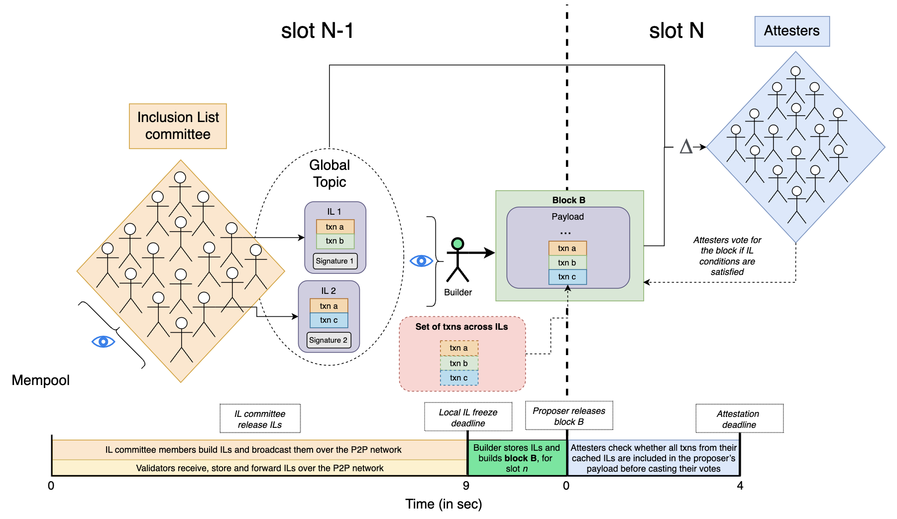

## Abstract

FOCIL implements a robust mechanism to preserve Ethereum's censorship resistance properties by guaranteeing timely transaction inclusion.

FOCIL (**Fo**rk-**c**hoice enforced **I**nclusion **L**ists) is built in a few simple steps:

- In each slot, a set of validators is selected as inclusion list (IL) committee members. Each member builds and gossips one IL according to their subjective view of the mempool.
- The proposer and all attesters of the next slot monitor, store and forward available ILs.
- The proposer (or the builder if the block is not built locally by the proposer) includes transactions from all collected ILs in its block. The proposer then broadcasts the block including IL transactions to the rest of the network.
- Attesters only vote for the proposer's block if it includes transactions from all stored ILs.

## Motivation

In an effort to shield the Ethereum validator set from centralizing forces, the right to build blocks has been auctioned off to specialized entities known as *builders*. This has led to a few sophisticated builders dominating block production, leading to a deterioration of the network's censorship resistance properties. To address this issue, research has focused on improving Ethereum's transaction inclusion guarantees by enabling validators to impose constraints on builders. This is achieved by force-including transactions in blocks via ILs.

### High-level Overview

FOCIL is a committee-based, fork-choice enforced inclusion list (IL) design that improves upon previous IL mechanisms and block co-creation proposals. It addresses issues related to bribing/extortion attacks, IL equivocation, account abstraction (AA), and transaction invalidation.



### Roles And Participants

This section outlines the workflow of FOCIL, detailing the roles and responsibilities of various participants: IL committee members, validators, builders, proposers and attesters.

#### IL Committee Members

- **`Slot N`, `t=0 to 8s`**:
IL committee members construct their ILs by including transactions pending in the public mempool, and broadcast them over the P2P network after processing the block for `slot N` and confirming it as the head. If no block is received by `t=7s`, they should run `get_head` and build and release their ILs based on the node's local head.

IL committee members may follow different strategies for constructing their ILs as discussed in [IL Building](#il-building).

#### Validators

- **`Slot N`, `t=0s to 9s`**: Validators receive ILs from the P2P network and store (1) all new ILs that pass the CL P2P validation rules, and (2) any evidence of IL equivocation by committee members (i.e., if multiple ILs are received from the same committee member).

- **`Slot N`, `t=9s` to `Slot N+1`, `t=4s`**: After the view freeze deadline at `t=9s`, validators:
  1. Do not store new ILs received after the deadline.
  2. Continue forwarding ILs to peers following the CL P2P validation rules.
  3. Record any evidence of IL equivocation that occurs after the view freeze deadline.

After the attestation deadline of **`Slot N+1`, `t=4s`**, validators ignore any new ILs related to the previous slot's IL committee, and stop recording equivocation evidence for the previous slot's ILs.

#### Builder

- **`Slot N`, `t=0s to 11s`**: The builder (i.e., a proposer doing local block building or an external builder) receives ILs from the P2P network, forwarding and caching those that pass the CL P2P validation rules. Optionally, an RPC endpoint can be added to allow the builder to request missing ILs from its peers (e.g., by committee index at `t=10s`).

- **`Slot N`, `t=11s`**:
The builder freezes its view of ILs and asks the EL to update its execution payload by adding transactions from its view (the exact timings will be defined after running some tests/benchmarks).

#### Proposer

- **`Slot N+1`, `t=0s`**:
The proposer broadcasts its block with the up-to-date execution payload satisfying IL transactions over the P2P network.

#### Attesters

- **`Slot N+1`, `t=4s`**:
Attesters monitor the P2P network for the proposer's block. Upon detecting it, they verify whether all transactions from their stored ILs are included in the proposer's execution payload, except for ILs whose sender has equivocated. Based on their frozen view of the ILs from `t=9s` in the previous slot, attesters check if the execution payload satisfies IL conditions. This is done either by confirming that all transactions are present or by determining that the omission of each missing transaction is excused under the [Execution Layer](#execution-layer) rules. In such cases, attesters use the EL to check the missing transactions against the payload and whether there is enough space in the block to include them.

#### CL P2P Validation Rules

When validators receive ILs from the P2P network, they perform a series of validation checks before forwarding or caching them. These rules protect against Denial-of-Service attacks by (1) limiting ILs' byte size and (2) restricting IL proposals to a small committee of IL committee members, thereby tightly bounding bandwidth, the main resource consumed by the propagation of ILs. Consumption of other relevant resources, such as verification time, is minimal because the only nontrivial check performed on IL propagation is signature verification. At this stage, there is no EL verification of the transactions within ILs. This means that ILs are allowed to contain any transactions—valid or invalid—since validators do not perform EL-side validity checks. This design choice is intended to avoid additional computational overhead.

1. The slot of the IL matches the current or previous slot.
2. The root of the IL committee referenced in the IL matches the expected IL committee root for its slot.
3. Received two or fewer ILs from this IL committee member (see IL equivocation section below).
4. The IL is correctly signed by the validator.
5. The validator is part of the IL committee.
6. The size of a IL does not exceed the maximum size allowed (e.g., `MAX_TRANSACTIONS_BYTES_PER_INCLUSION_LIST = 8 KiB`).

## Specification

### Execution Layer

On the execution layer, an additional check is introduced for new payloads. After all of the transactions in the payload have been executed, we check whether any IL transaction that is not already present in the payload was omitted without justification under the Profile 1 or Profile 2 rules defined in [Profile 2 omission claims and per IL budgets](#profile-2-omission-claims-and-per-il-budgets). If that is the case for any transaction, the EL reports the inclusion list as unsatisfied to the CL, separately from execution validity. An otherwise valid payload remains `VALID`; the CL applies its IL fork-choice rules.

Let `B` denote the current block.
At insertion index `k` of `B`, let `execution_gas_available = B.gas_limit - block_execution_gas_used` and `state_gas_available = B.gas_limit - block_state_gas_used`, where both [EIP-8037](./eip-8037.md) counters are summed over the transactions of `B` before `k`. These counters come from executing `B`; receipts and the block-level access list do not record both. A transaction `T` fits at `k` if:

- for an [EIP-8141](./eip-8141.md) frame transaction, `max(frame_tx_intrinsic_gas + sum(frame.limits.execution), calldata_floor_gas) <= execution_gas_available` and `sum(frame.limits.state) <= state_gas_available`, summing over `T.frames`;
- otherwise, `min(TX_MAX_GAS_LIMIT, T.gas) <= execution_gas_available` and `T.gas <= state_gas_available`.

EIP-8037 applies `TX_MAX_GAS_LIMIT` only to execution gas; `T.gas` may exceed it for state gas. Its separate total-gas and intrinsic-gas validity limits still apply.

The end of `B` is the index after all payload transactions and before withdrawals and other post-execution updates.

For each distinct IL transaction `T` that is not present in `B`, perform the following:

1. If `T` is covered by Profile 1, apply the Profile 1 rule below: its omission is unjustified exactly when `T` fits and passes the Profile 1 checks at the end of `B`.

2. If `T` is a Profile 2 candidate, apply the Profile 2 rule below: its omission is unjustified exactly when some position admits `T` and `T` passes replay at its [evaluation index](#evaluation-index).

3. Otherwise, its omission is excused.

If the omission of any such `T` is unjustified, the inclusion check completes with `inclusionListSatisfied = false`, without changing the payload's execution status. Otherwise it completes with `inclusionListSatisfied = true`.

#### Engine API Changes

We make the following changes to the engine API:

- Add `engine_getInclusionListV1` endpoint to retrieve an IL from the `ExecutionEngine`.
- Extend `engine_forkchoiceUpdated` payload attributes with separate ILs for building the child payload.
- Extend `engine_newPayload` with separate ILs and the committed claims. A `VALID` response includes the completed boolean `inclusionListSatisfied` verdict for that call's exact inputs; other execution statuses return `null`. An unsatisfied IL does not make the execution payload `INVALID`. `engine_forkchoiceUpdated` does not report inclusion satisfaction.

#### IL Building

The rules for building ILs are left to the discretion of implementers. For instance, they may select transactions from the public mempool in various ways such as at random, by priority fee, or based on how long they have been pending. The IL has a maximum size of `MAX_TRANSACTIONS_BYTES_PER_INCLUSION_LIST = 8 KiB`, counted as the total bytes of its transaction envelopes ([EIP-2718](./eip-2718.md) typed envelopes or legacy RLP) before deduplication, as in the Engine API.

An IL committee member SHOULD NOT include [Profile 2](#profile-2-omission-claims-and-per-il-budgets) candidates whose total VERIFY budget cost exceeds `MAX_VERIFY_GAS_PER_IL`. For a list containing only valid candidates within that bound, the order of the budget fill does not affect admission. Invalid-signature entries still consume signature budget and can exclude later-hashed valid candidates in their own list; they cannot consume another list's budget. Members SHOULD omit candidates whose expiry deadline is earlier than the target payload slot's timestamp, or whose recent root references cannot pass at that slot; equality with the expiry deadline is allowed.

### Consensus Layer

The full consensus changes can be found in the following GitHub repository. They are split between: 

- [Beacon Chain](https://github.com/ethereum/consensus-specs/blob/e678deb772fe83edd1ea54cb6d2c1e4b1e45cec6/specs/_features/eip7805/beacon-chain.md) changes.
- [Fork choice](https://github.com/ethereum/consensus-specs/blob/e678deb772fe83edd1ea54cb6d2c1e4b1e45cec6/specs/_features/eip7805/fork-choice.md) changes.
- [P2P](https://github.com/ethereum/consensus-specs/blob/e678deb772fe83edd1ea54cb6d2c1e4b1e45cec6/specs/_features/eip7805/p2p-interface.md) changes.
- [Honest validator guide](https://github.com/ethereum/consensus-specs/blob/e678deb772fe83edd1ea54cb6d2c1e4b1e45cec6/specs/_features/eip7805/validator.md) changes.

#### Beacon chain changes

##### Preset

| Name | Value |
| - | - |
| `DOMAIN_IL_COMMITTEE`       | `DomainType('0x0C000000')`  |
| `INCLUSION_LIST_COMMITTEE_SIZE` | `uint64(2**4)` (=16)  |
| `MAX_TRANSACTIONS_BYTES_PER_INCLUSION_LIST` |  `uint64(2**13)` (=8192) |

##### New containers

```python
class InclusionList(Container):
    slot: Slot
    validator_index: ValidatorIndex
    inclusion_list_committee_root: Root
    transactions: List[Transaction, MAX_TRANSACTIONS_PER_PAYLOAD]
```

```python
class SignedInclusionList(Container):
    message: InclusionList
    signature: BLSSignature
```

#### Fork choice changes

- Store ILs observed over gossip before the view freeze deadline.
- If more than one IL is observed from the same IL committee member, mark the committee member as an equivocator and ignore any further ILs from them.
- The beacon block from the current slot is only attested to if it satisfies IL conditions, based on all stored ILs from non equivocators.
  
#### P2P changes

- A new global topic for broadcasting `SignedInclusionList` objects.
- A new RPC topic for request `SignedInclusionList` based on IL committee index.

### Profile 2 omission claims and per IL budgets

This section defines the binding eligibility and omission rules; [EIP-8369](./eip-8369.md) explains their VOPS rationale. Both profiles apply from FOCIL activation, which requires [EIP-8141](./eip-8141.md), [EIP-8250](./eip-8250.md), [EIP-8272](./eip-8272.md), and their prerequisites to be active. Omission of a transaction outside both profiles is excused.

Profile 1 covers statically valid legacy, [EIP-2930](./eip-2930.md), [EIP-1559](./eip-1559.md) and [EIP-7702](./eip-7702.md) transactions with a valid protocol signature and matching chain ID when present. Its omission is unjustified exactly when it fits at the end of `B` and passes the transaction's nonce, balance, intrinsic gas, fee and [EIP-3607](./eip-3607.md) sender code checks there, including EIP-7702's delegation-indicator exception. Fee checks require `max_fee_per_gas >= base_fee_per_gas` and `max_priority_fee_per_gas <= max_fee_per_gas`, using `gas_price` for both transaction fee fields in legacy and EIP-2930 transactions. Eligibility does not execute sender code, and Profile 1 consumes no VERIFY budget.

Under ePBS, the post-reveal verdict gates extending the revealed payload in fork choice; it is not a pre-reveal beacon-attestation or payload-timeliness check. If no completed verdict is available when proposers select their parent at the start of the proposal slot, they MUST use the empty-payload branch and proceed with the scheduled proposal; pending is never satisfaction. A later result updates local fork choice but does not undo an already signed proposal.

#### Constants

| Name | Value |
| - | - |
| `MAX_VERIFY_GAS_PER_IL` | `uint64(2**20)` (= 1,048,576) |
| `MAX_VERIFY_GAS_PER_TX` | `uint64(2**18)` (= 262,144) |
| `AA_VOPS_SLOT_COUNT` | `uint64(4)` |
| `MAX_RECENT_ROOT_REFERENCES` | `uint64(16)` |
| `MAX_OMISSION_CLAIMS` | `uint64(2**12)` (= 4,096) |
| `MAX_REPLAY_CODE_BODIES` | `uint64(2**4)` (= 16) |
| `MAX_REPLAY_CODE_BYTES` | `uint64(2**17)` (= 131,072) |

#### Profile 2 predicates

`declared_prefix(T)` consists of an optional EIP-8141 `expiry_verify` frame, an optional EIP-8272 `recent_root_verify` frame, then one of `self_verify`, `deploy | self_verify`, `only_verify | pay` or `deploy | only_verify | pay`. Modes, flags, targets and optional-verifier data encodings must match those specifications. Each optional verifier appears at most once, in that order. The recent-root verifier contains at most `MAX_RECENT_ROOT_REFERENCES` references. This prefix is determined before execution; successful replay must make it the actual EIP-8141 validation prefix.

`is_profile_2_candidate(T)` holds if and only if:

1. `T` is an EIP-8141 frame transaction that passes canonical decoding and the active fork's noncryptographic static transaction checks, including the EIP-8250 nonce encoding, and has no blobs. Protocol signatures are checked separately by the budget fill.
2. `declared_prefix(T)` exists, no frame in it has `ATOMIC_BATCH_FLAG` set, and no later frame has mode `VERIFY`.
3. `verify_cost(T) <= MAX_VERIFY_GAS_PER_TX`, where `verify_cost(T)` is EIP-8141's `signature_verification_cost` plus the sum of `limits.execution` over `declared_prefix(T)`. The optional protocol verifiers are included; `limits.state` is excluded from this work budget but remains enforced during replay and block-fit checks.

`is_profile_2_eligible(T, state, B)` holds if and only if `is_profile_2_candidate(T)`, its protocol signatures passed the fill, the EIP-8250 keyed nonce checks pass, and every frame of the declared prefix completes successfully against `state` under the following rules:

1. Apply full EIP-8141 and EIP-8250 semantics, including each required `APPROVE` scope, state-gas charges, nonce consumption and maximum-cost collection. `payer` must be `sender` for a `self_verify` shape, or the `pay` frame's `resolved_target` otherwise.
2. Apply EIP-8141's generic validation trace and opcode rules through completion of the payment-approving frame, substituting the Profile 2 work budget and access rules below. Canonical paymaster code grants no additional exception.
3. If present, `deploy` installs code or an EIP-7702 delegation indicator at `sender`. The optional EIP-8272 verifier uses its canonical code, frame and storage rules, with `current_slot` taken from [EIP-7843](./eip-7843.md)'s `slotNumber` of `B`.

The held state is the account nonce, balance and code of `sender` and `payer`, deployment bookkeeping described below, their storage slots `0` through `AA_VOPS_SLOT_COUNT - 1`, the selected EIP-8250 keyed nonce entries, EIP-8272 entries named by the canonical verifier frame, and code for every account reached, including delegated targets. Access is restricted as follows:

| Access | Permission |
| --- | --- |
| Ordinary storage reads | Low slots of `sender` and `payer` only |
| Deployment storage writes | Low slots of `sender` only |
| Deployment account bookkeeping | Only active-fork `CREATE`/`CREATE2` or `SETDELEGATE` checks and effects required to install code at `sender`, including creator nonce/balance and sender collision/existence checks |
| Keyed nonce bookkeeping and payment approval | Exactly the protocol reads and writes required by EIP-8141 and EIP-8250 |
| Recent root checks | Only EIP-8272's canonical top-level verifier gets its specified storage and `SLOTNUM` exceptions |
| Code inspection and execution | Delegation indicators of `sender` may be followed; this grants no access to the target's storage. `CALL*` and `EXTCODE*` to any other delegated account are refused, as in EIP-8141 |
| Transient storage | Not a state write: the deploy frame may use `TSTORE`; `VERIFY` frames stay static |
| Other state or opcode access | EIP-8141 restrictions remain; holding a value does not grant permission to read or write it |

Deployment bookkeeping includes authenticated sender storage-emptiness information when required by the active collision rules. It grants no access to factory storage or counters and permits no deployment to another address; normal failure and rollback semantics apply.

A replay loads a code body, identified by its code hash, when execution starts in it, after any delegation indicator is followed, and when `EXTCODESIZE` or `EXTCODECOPY` reads it. Empty code, precompiles and `EXTCODEHASH` load nothing. A replay that loads more than `MAX_REPLAY_CODE_BODIES` distinct bodies, or distinct bodies totalling more than `MAX_REPLAY_CODE_BYTES`, fails.

`T` passes replay at insertion index `k` if it is eligible against `S_k`, passes the active fork's chain and fee checks (`max_fee_per_gas >= base_fee_per_gas` and `max_priority_fee_per_gas <= max_fee_per_gas`), and fits at `k`. Each replay uses an isolated overlay with fresh EIP-8141 transaction-scoped warmth, transient storage and approval context, and the payload's fork, chain, timestamp, base fee and slot. Stop after the declared prefix completes and discard all effects; replays do not modify the payload or each other.

For `n = len(B.transactions)`, `S_k` is the parent state with all pre-execution updates and transactions before `k` applied. In a validated [EIP-7928](./eip-7928.md) block-level access list, these are exactly changes with `block_access_index <= k`: index `0` is pre-execution, indices `1..k` are preceding transactions, and post-execution changes at `n + 1` are excluded even for `k == n`. The payload and BAL must be validated before using these values. The execution layer must reconstruct the required state and gas counters before returning `VALID` with an inclusion verdict; missing local data does not excuse an omission. If no verdict is available at the proposal-slot parent decision, the empty-payload fallback applies.

#### Separate inclusion lists

For payload building and inclusion checking, the consensus layer passes `inclusionLists`: an array of `INCLUSION_LIST_COMMITTEE_SIZE` transaction lists in committee-position order. Entry `i` contains the IL of the member at position `i`, or an empty list if no applicable IL is available. Only the valid, non-equivocating ILs selected by the consensus layer are used. A validator holding several positions has the same list at each. Each list retains its original entries, including duplicates, and its byte limit applies before deduplication. The execution layer may share decoding, signature verification and replay work across lists without pooling their budgets.

#### Omission claims

An omission claim is a pair `(transaction_hash, evaluation_index)` of 32 bytes and a `uint64`. `transaction_hash` is the ordinary transaction hash of an IL transaction. `evaluation_index` is an index into the payload transactions, where `0` is before the first transaction and `len(payload.transactions)` is the end of the payload.

The builder commits an ordered list of at most `MAX_OMISSION_CLAIMS` claims in its signed payload bid, as the SSZ `hash_tree_root` of the list, and reveals the list with the payload. A revealed list that does not match the committed root makes the payload envelope invalid. The consensus layer passes the revealed list unchanged to the execution layer with the payload.

#### Evaluation index

Let `n = len(payload.transactions)`. The execution layer ignores every claim whose `transaction_hash` appears in more than one claim, and every claim that matches no IL transaction, matches a transaction that is not a Profile 2 candidate, or matches a transaction included in the payload. A Profile 2 candidate with a remaining claim is evaluated at `min(evaluation_index, n)`. Every other omitted Profile 2 candidate is evaluated at `n`.

#### VERIFY budget

For each committee position independently, start with `MAX_VERIFY_GAS_PER_IL`. Deduplicate exact envelope bytes within that position's IL and sort them by `(keccak256(envelope), envelope)`, comparing bytes lexicographically; the envelope tie-break makes the order deterministic even on a hash collision. Included and omitted transactions both participate. For each transaction:

1. Check the noncryptographic candidate conditions before signature verification. Skip failures.
2. Let `s` be its EIP-8141 signature cost and `v` its declared-prefix execution cost. If `s + v` exceeds the remaining budget, skip without a debit.
3. Deduct `s` and verify protocol signatures. On failure, retain only that debit and do not admit the transaction.
4. Otherwise deduct `v` and admit it. Stateful replay failure does not refund the debit.

Each transaction is charged once per position, even when signature results are cached. There is no budget shared across positions, so an over-budget IL affects only its own fill. A member holding several positions has the same list at each; those identical fills may be computed once, and never multiply its available budget.

Omission of a Profile 2 candidate `T` is unjustified if and only if some position admits `T` and `T` passes replay at its evaluation index.

#### Payload building

The builder runs the same per position fill over the separate ILs it received, so it knows which Profile 2 candidates are admitted. It must include each admitted candidate that passes the replay at the end of the payload, or claim an index at which the replay fails. A claim binds the builder, which is judged at that index alone, so it should claim only where the candidate fails the replay and not where it skipped the candidate for its own reasons. It may leave unadmitted candidates unclaimed.

## Rationale

### Core Properties

- Committee-based: FOCIL relies on a committee of multiple validators, rather than a single proposer, to construct and broadcast ILs. This approach significantly reduces the surface for bribery and extortion attacks and strengthens censorship resistance.
- Fork-choice enforced: FOCIL incorporates the force-inclusion mechanism into the fork-choice rule, an integral component of the consensus process, thereby preventing any actor from bypassing the system. Attesters vote only for blocks that include transactions from a set of ILs provided by the IL committee and that satisfy the IL constraints. Any block failing to meet these criteria will not be voted on by the attesters, and therefore cannot be canonical.
- Same-slot: With FOCIL running in parallel with the block building process for `slot N+1` during `slot N`, the constraints imposed on `block B` for `slot N+1` can include transactions submitted during `slot N`. This represents a strict improvement over forward IL designs like [EIP-7547](./eip-7547.md), where the forward property introduced a 1-slot delay.
- Conditional inclusion: FOCIL adopts conditional inclusion, accepting blocks that may lack some transactions from ILs if they cannot append the transactions to the end of the block or if they are full.
- Anywhere-in-block: FOCIL is unopinionated about the placement of transactions from ILs within a block. This reduces incentives for sophisticated actors to use side channels to bypass the mechanism. Combined with conditional inclusion, this flexibility makes the emergence of off-protocol markets less attractive.
- No incentive mechanism: FOCIL does not provide explicit rewards for IL committee members participating in the mechanism. We believe that the added complexity of implementing a transaction fee system for FOCIL is not justified. Instead, we rely on altruistic behavior, as FOCIL requires only a `1-out-of-N` honesty assumption from IL committee members for the mechanism to work as intended.

### Profile 2 constants

- `MAX_VERIFY_GAS_PER_IL = 2**20` bounds metered signature and prefix execution work to `2**24`, about 16.8M gas, across 16 ILs before shared verification results are reused. It does not bound the full replay pipeline.
- `MAX_VERIFY_GAS_PER_TX = 2**18` lets one admitted candidate consume at most a quarter of its IL's budget, including when stateful replay fails.
- `AA_VOPS_SLOT_COUNT = 4` fixes the ordinary validation storage surface to four words per account; code and protocol-managed state are additional data.
- `MAX_REPLAY_CODE_BODIES = 2**4` and `MAX_REPLAY_CODE_BYTES = 2**17` bound the code one replay loads, two 64 KiB bodies' worth, independently of gas. They are candidate values pending the full-pipeline benchmarks.
- `MAX_OMISSION_CLAIMS = 2**12` permits a claim for every candidate: each is longer than 32 bytes, so sixteen 8 KiB lists contain fewer than 4,096 distinct candidates. At 40 bytes per claim, the fixed-size SSZ list occupies at most 160 KiB.

## Backwards Compatibility

This EIP introduces backward incompatible changes to the block validation rule set on the consensus layer and must be accompanied by a hard fork. These changes do not break anything related to current user activity and experience.

## Test Cases

| Case | Expected result |
| --- | --- |
| Reordered IL, or duplicate envelope in one IL | Identical admitted set; one debit per exact envelope |
| One validator occupies several committee positions | Identical lists and fills; no additional budget |
| Duplicates make one IL exceed its byte limit | Reject the container before deduplication |
| Same execution hash submitted with different ILs or claims | Each inclusion verdict applies only to its request inputs |
| `engine_newPayload` returns `VALID` | Include a completed boolean inclusion verdict for the supplied ILs and claims |
| Inclusion check pending at the proposal-slot parent decision | Select the empty-payload branch; do not treat pending as satisfied |
| A malicious IL exceeds its budget | Other positions' fills are unchanged |
| Candidate admitted by one position and rejected by another | Replay once; a passing replay makes omission unjustified |
| Invalid signature; valid signatures but failed stateful replay | Debit signature cost only in the first case, full declared cost in the second |
| Optional expiry and recent root verifier frames | Both counted in cost and checked during replay |
| Duplicate, unmatched, noncandidate or already included claim | Ignore it; duplicate claimed hashes all lose their claimed index |
| Missing claim, index `n`, or larger uint64 index | Evaluate at `n`; malformed claim encoding is rejected by its container |
| State capacity exhausted while execution capacity remains | Omission justified |
| Replay creates keyed nonce state or deploys sender code | Discard effects before checking another candidate |
| Parent value changed at BAL index `0`, `k`, or `n + 1` | Apply the first two to `S_k`; exclude post-execution index `n + 1` |
| Required code, state or gas counters are unavailable locally | Do not return `VALID` or declare the omission justified before completing the check |
| Replay loads exactly `MAX_REPLAY_CODE_BODIES` bodies or `MAX_REPLAY_CODE_BYTES` bytes, then one more | Replay continues at the bound and fails past it |
| `TSTORE` in the deploy frame, or in a `VERIFY` frame | Permitted in the first; the static `VERIFY` frame fails |

## Security Considerations

### Consensus Liveness

The builder of `slot N+1` cannot construct a canonical block without first receiving the ILs broadcast during `slot N`. This means that the builder (including cases in which the proposer locally builds its block) must be well-connected to the IL committee members to ensure timely access to these inclusion lists. Additionally, there must be sufficient time between the view freeze deadline (`t=9s` of `slot N`) and the moment the proposer must broadcast `block B` to the rest of the network. This buffer allows the builder to gather all available ILs and update the execution payload of `block B` accordingly.

### IL Equivocation

To mitigate IL equivocation, FOCIL introduces a new P2P network rule that allows forwarding up to two ILs per IL committee member. If the proposer or attesters detect two different ILs sent by the same IL committee member, they should ignore all ILs from that member. In the worst case, the bandwidth of the IL gossip subnet can at most double.

### Payload Construction

The builder, responsible for constructing the execution payload, must ensure that the IL is satisfied. A naive way to do so would be to build an initial payload in whatever way the builder desires, then execute the following algorithm:

1. Sequentially check validity of any yet-to-be-included IL tx against the post-state. If none is found, payload building is over.
2. If one is found, append it to the end of the payload and update the post-state. Go back to step 1.

The issue with this simple approach is that, given a set of `n` IL transactions, one might end up needing to do `n + (n-1) + (n-2) + ...` validity checks, so `O(n^2)`. For example, the `n`th tx might be valid while all others are not, but its execution sends balance to the sender of the `(n-1)`th tx, making it valid, and in turn, the `(n-1)`th sends balance to the sender of the `(n-2)`th tx, etc.

To efficiently ensure that all valid IL txs have been included in the payload, builders can adopt a simple strategy: prior to building the payload, they store the `nonce` and `balance` of all Externally Owned Accounts (EOAs) involved in IL transactions. As they construct the payload, builders track these EOAs, maintaining and updating each EOA's `nonce` and `balance` whenever changes occur—specifically, when the `nonce` increments (indicating that a transaction from that EOA has been executed) or when the `balance` changes without a `nonce` increment (e.g., after an Account Abstraction (AA) transaction has interacted with that EOA). 

This tracking allows builders to verify IL transaction validity in real-time, enabling them to add transactions sequentially until all remaining transactions are either invalid because the nonce or balance of the associated EOA does not change or cannot be included due to insufficient gas. This approach minimizes overhead by keeping track only of the state changes that are relevant to the validity of IL txs.

### Activation and check latency

Activation requires complete authenticated state reconstruction, a post-reveal inclusion-check duty, and benchmarks showing that the full pipeline fits the payload-extension decision window on supported validator hardware. Benchmarks must cover 16 budget fills, up to `MAX_OMISSION_CLAIMS` distinct replays with maximum code loads, and re-execution when indexed state is unavailable. The proposed caps are pending these benchmarks; metered gas alone is not deadline evidence.

The empty-payload fallback preserves beacon-chain progress and inclusion enforcement, but a slow EL can still cause an honest, satisfying execution payload to be discarded. Delaying the scheduled proposal or treating pending as satisfied would instead risk missed proposals or bypassing FOCIL. This tradeoff must be evaluated before activation.

### Profile 2 claims and budgets

A claim only changes the verdict on the committing builder's own payload. The cap on claims only limits the builder: an unclaimed candidate is evaluated at the end of the payload, which is its verdict without claims. The builder chooses the index, so a Profile 2 transaction is protected only if it stays valid at every index the builder can claim. This gives weaker protection to transactions requiring an in-block nonce predecessor or a shared payer balance: they can fail before the predecessor or after another sponsored transaction.

A payload executed without retaining the required insertion states and both gas counters may need re-execution. Authenticated BAL-indexed state reconstruction can avoid state re-execution only if the corresponding execution and state gas counters are also retained.

Claims add no replays: each omitted candidate admitted by some fill is replayed once, at its claimed index or at the end of the payload. Implementations can index the validated BAL once and resolve each read to its last write at or before that index, falling back to parent state, rather than rebuild the full state for each claim. The VERIFY budget bounds metered signature and prefix execution work, and the replay code bounds cap the code each replay loads; neither bounds parsing, indexing or the entire attestation workload. Those costs require full-pipeline benchmarks; the claim-count cap is an encoding bound, not evidence of a safe replay deadline.

The budget is per IL because a budget shared across ILs lets one includer exhaust it with maximum cost candidates, which are never executed and so cost nothing. A builder colluding with that includer could then leave every other includer's candidates unadmitted and their omission excused, turning the `1-out-of-N` honesty assumption into an assumption that every includer is honest. A shared budget also depends on processing order, and tie-breaking over transaction identifiers can be ground. Per position, the fill depends only on the transactions that member listed, so a transaction outside a member's IL cannot change that member's fill. A member whose list contains only candidates with valid signatures and total cost no greater than `MAX_VERIFY_GAS_PER_IL` has none ignored for lack of budget, whatever the hash order.

## Copyright

Copyright and related rights waived via [CC0](../LICENSE.md).
