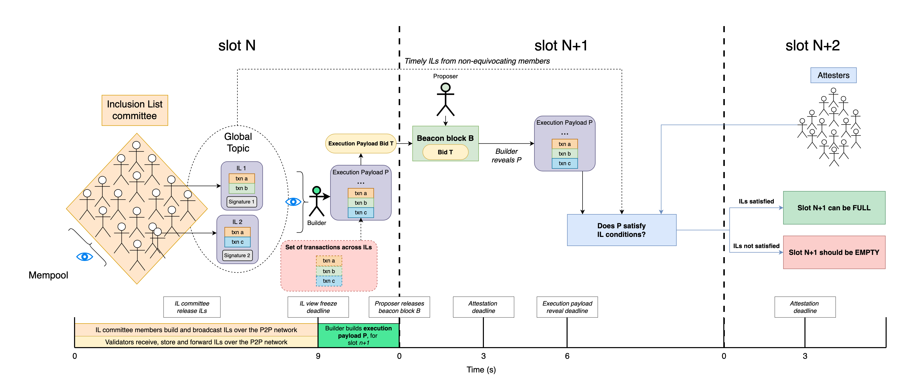

## Abstract

FOCIL implements a robust mechanism to preserve Ethereum's censorship resistance properties by guaranteeing timely transaction inclusion.

FOCIL (**Fo**rk-**c**hoice enforced **I**nclusion **L**ists) is built in a few simple steps:

- In each slot, a set of validators is selected as inclusion list (IL) committee members. Each member builds and gossips one IL according to their subjective view of the mempool.
- The proposer, builders and all attesters of the next slot receive, store and forward available ILs.
- The builder constructs an execution payload that satisfies IL conditions based on the ILs it has collected. The builder then broadcasts the execution payload to the rest of the network.
- Attesters do not extend an execution payload that fails to satisfy IL conditions. The corresponding beacon block can still become canonical but without its execution payload, leaving the slot *empty*.

## Motivation

In an effort to shield the Ethereum validator set from centralizing forces, the right to build execution payloads has been auctioned off to specialized entities known as *builders*. This has led to a few sophisticated builders dominating block production, leading to a deterioration of the network's censorship resistance properties. To address this issue, research has focused on improving Ethereum's transaction inclusion guarantees by enabling validators to impose constraints on builders. This is achieved by force-including transactions in execution payloads via ILs.

### High-level Overview

FOCIL is a committee-based, fork-choice enforced inclusion list (IL) design that improves upon previous IL mechanisms and block co-creation proposals. It addresses issues related to bribing/extortion attacks, IL equivocation, account abstraction (AA), and transaction invalidation.



### Roles And Participants

This section outlines the workflow of FOCIL, detailing the roles and responsibilities of various participants: IL committee members, validators, builders, proposers and attesters.

#### IL Committee Members

- **`Slot N`, `t=0s to 9s`**: IL committee members construct their ILs by including transactions pending in the public mempool and broadcast them over the P2P network. ILs should be built against the execution payload for `Slot N` if it has been processed and confirmed as the head, or against the local head returned by `get_head()` otherwise.

IL committee members may follow different strategies for constructing their ILs as discussed in [IL Building](#il-building).

#### Validators

- **`Slot N`, `t=0s to 9s`**: Validators receive ILs from the P2P network and store (1) the first IL from each committee member that passes the CL P2P validation rules, and (2) any evidence of IL equivocation by committee members (i.e., if multiple ILs are received from the same committee member).

- **`Slot N`, `t=9s to 12s`**: After the view freeze deadline at `t=9s`, validators:
  1. Store valid new ILs but mark them as untimely.
  2. Continue forwarding ILs to peers following the CL P2P validation rules.
  3. Record any evidence of IL equivocation observed after the view freeze deadline.

After **`Slot N`, `t=12s`**, validators ignore any ILs from `Slot N` received over gossip.

#### Builder

- **`Slot N`, `t=9s to 12s`**: The builder (i.e., a proposer doing local block building or an external builder) should continue incorporating ILs from non-equivocating committee members after the view freeze deadline to cover attesters' views. It may use `InclusionListsByIndices` to fetch missing ILs from its peers (e.g., by committee index at `t=10s`). Before committing to its execution payload, the builder should ensure that it satisfies IL conditions. The builder sets `inclusion_list_bits` in its bid to cover all valid ILs it has observed from non-equivocating committee members.

- **`Slot N+1`, `t=3s to 6s`**: The builder broadcasts its execution payload satisfying IL conditions over the P2P network.

#### Proposer

- **`Slot N+1`, `t=0s`**: The proposer selects an execution payload bid whose `inclusion_list_bits` cover all valid ILs it has observed from non-equivocating committee members. The proposer broadcasts its beacon block over the P2P network.

#### Attesters

- **`Slot N+1`, `t=3s to 12s`**: Attesters monitor the P2P network for the builder's execution payload. Once the blob data is available and the payload has been verified, attesters record whether the payload satisfies IL conditions based on the EL's response for ILs that were received before `t=9s` in the previous slot and were proposed by non-equivocating committee members. Attesters pass the IL transactions to the EL for the checks specified in the [Execution Layer](#execution-layer) section.

- **`Slot N+2`, `t=0s to 3s`**: When choosing the head to attest to, attesters select the parent's `EMPTY` branch if the previous slot's execution payload failed to satisfy IL conditions.

#### CL P2P Validation Rules

When validators receive ILs from the P2P network, they perform a series of validation checks before forwarding or caching them. These rules protect against Denial-of-Service attacks by (1) limiting ILs' byte size and (2) restricting IL proposals to a small committee of IL committee members, thereby tightly bounding bandwidth, the main resource consumed by the propagation of ILs. Consumption of other relevant resources, such as verification time, is minimal because the only nontrivial check performed on IL propagation is signature verification. At this stage, validators do not perform EL validation of the transactions in the ILs. This means that ILs may contain invalid transactions since validators do not perform EL validity checks. This design choice is intended to avoid additional computational overhead.

1. Fewer than two ILs proposed by this validator for the same slot and dependent root have already passed gossip validation (see the [IL Equivocation](#il-equivocation) section below).
2. The slot of the IL matches the current slot.
3. The total size of the IL transactions is non-zero.
4. The total size of the IL transactions does not exceed the maximum size allowed (e.g., `MAX_TRANSACTIONS_BYTES_PER_INCLUSION_LIST = 8 KiB`).
5. The size of every IL transaction is non-zero.
6. The dependent root of the IL is valid.
7. The validator is part of the IL committee.
8. The IL is correctly signed by the validator.

## Specification

### Execution Layer

On the execution layer, an additional check is introduced for new payloads. The EL determines whether any missing IL transaction could have been appended to the end of the payload's transactions. If so, the EL returns `false` for `inclusionListSatisfied` to the CL. Although the payload remains valid, the CL will not extend it.

Let `B` denote the current block.
Let `S` denote the execution state after all transactions in `B` have been executed and before any withdrawals are processed.
Let `payload_size(B)` denote the combined byte length of the transactions, block access list and requests of the complete payload:

```python
def payload_size(B) -> int:
    return (
        sum(len(tx) + TX_FRAMING_BYTES for tx in B.transactions)  # EIP-2718 encoded transactions
        + len(B.block_access_list)                                # RLP-encoded block access list (EIP-7928)
        + sum(len(r) for r in B.requests if len(r) > 1)           # non-empty request_type ++ request_data (EIP-7685)
    )
```

| Name | Value |
| - | - |
| `TX_FRAMING_BYTES` | `4` |
| `IL_PAYLOAD_SIZE_LIMIT` | `MAX_RLP_BLOCK_SIZE - 2**12` (= 8,384,512) |

`MAX_RLP_BLOCK_SIZE` is defined in [EIP-7934](./eip-7934.md). The inputs to `payload_size(B)` are byte strings the EL receives in `engine_newPayloadV6`:

- `B.transactions`: the payload's `transactions`. Each one is an [EIP-2718](./eip-2718.md) encoded transaction (the RLP encoding for legacy transactions). `len(T)` is the length of an IL transaction in the same encoding, as received.
- `B.block_access_list`: the payload's `blockAccessList`.
- `B.requests`: the `executionRequests` parameter ([EIP-7685](./eip-7685.md)), which omits requests with empty `request_data`.

For a valid payload, the block access list and non-empty requests that the EL computes are the same bytes. `TX_FRAMING_BYTES` covers what a transaction adds around its own bytes: at most 4 bytes of RLP prefix in the block, and a 4-byte SSZ offset in the envelope.

For each IL transaction `T` not already present in `B`, perform the following:

1. Decode `T`. If decoding fails, continue to the next transaction.

2. If `T` is a type 3 transaction, continue to the next transaction.

3. Apply the pre-execution transaction validation rules for the current chain to `T`, with `S` used for any state-dependent checks. These rules include intrinsic gas checks under [EIP-2780](./eip-2780.md#intrinsic-gas-costs), fee and balance checks under [EIP-1559](./eip-1559.md#specification) and sender code checks under [EIP-7702](./eip-7702.md#transaction-origination). If any check fails, continue to the next transaction.

4. Check whether `T` fits within the block's remaining execution gas and state gas capacity as defined in [EIP-8037](./eip-8037.md#transaction-validation). If it does not, continue to the next transaction.

5. Check whether `T` fits within the block's remaining size capacity: if `payload_size(B) + len(T) + TX_FRAMING_BYTES > IL_PAYLOAD_SIZE_LIMIT`, continue to the next transaction.

6. `T` could have been appended: return `false` for `inclusionListSatisfied`.

If the loop completes, return `true` for `inclusionListSatisfied`.

Each IL transaction is checked independently against the same `S`, remaining gas and `payload_size(B)`, without executing it or updating state, gas used or payload size.

Steps 1 to 4 use `S` and the gas counters immediately after the last transaction. Step 5 uses the complete payload, which includes the block access list entries and requests that withdrawals and post-execution system calls produce. Since `payload_size(B)` is the same for every `T`, it is enough to evaluate step 5 once, for the shortest missing IL transaction that reaches it. See [Payload Size](#payload-size) for why step 5 covers both the execution layer and consensus layer size limits.

#### Engine API Changes

We make the following changes to the engine API:

- Add the `engine_getInclusionListV1` endpoint to retrieve IL transactions from the EL. Each transaction must be returned as a nonempty byte string, and the EL should not include blob transactions.
- Add the `engine_newPayloadV6` endpoint with an `inclusionListTransactions` parameter. The returned status is extended to include `inclusionListSatisfied`, which indicates whether the payload satisfies IL conditions when its status is `VALID` and is `null` otherwise.
- Add the `engine_forkchoiceUpdatedV5` endpoint to build a payload with IL transactions. `payloadAttributes` is extended to include the IL transactions. `payloadStatus` is extended to include `inclusionListSatisfied` for the head payload.

#### IL Building

The rules for building ILs are left to the discretion of implementers. For instance, they may select transactions from the public mempool in various ways such as at random, by priority fee, or based on how long they have been pending. The total size of the IL transactions must not exceed `MAX_TRANSACTIONS_BYTES_PER_INCLUSION_LIST` (8 KiB) in their [EIP-2718](./eip-2718.md) encoding.

### Consensus Layer

The full consensus changes can be found in the following GitHub repository. They are split between: 

- [Beacon Chain](https://github.com/ethereum/consensus-specs/blob/45fba517b6beb562f2b9d7a58f8eeece318ba64a/specs/heze/beacon-chain.md) changes.
- [Fork Choice](https://github.com/ethereum/consensus-specs/blob/45fba517b6beb562f2b9d7a58f8eeece318ba64a/specs/heze/fork-choice.md) changes.
- [Inclusion List](https://github.com/ethereum/consensus-specs/blob/45fba517b6beb562f2b9d7a58f8eeece318ba64a/specs/heze/inclusion-list.md) changes.
- [Optimistic Sync](https://github.com/ethereum/consensus-specs/blob/45fba517b6beb562f2b9d7a58f8eeece318ba64a/specs/heze/optimistic-sync.md) changes.
- [Networking](https://github.com/ethereum/consensus-specs/blob/45fba517b6beb562f2b9d7a58f8eeece318ba64a/specs/heze/p2p-interface.md) changes.
- [Honest Validator](https://github.com/ethereum/consensus-specs/blob/45fba517b6beb562f2b9d7a58f8eeece318ba64a/specs/heze/validator.md) changes.
- [Honest Builder](https://github.com/ethereum/consensus-specs/blob/45fba517b6beb562f2b9d7a58f8eeece318ba64a/specs/heze/builder.md) changes.

#### Beacon chain changes

##### Types

| Name | SSZ equivalent |
| - | - |
| `InclusionListBits` | `Bitvector[INCLUSION_LIST_COMMITTEE_SIZE]` |

##### Configs

| Name | Value |
| - | - |
| `MAX_TRANSACTIONS_BYTES_PER_INCLUSION_LIST` | `Uint64(2**13)` (= 8,192) | 

##### Constants

| Name | Value |
| - | - |
| `DOMAIN_INCLUSION_LIST_COMMITTEE` | `DomainType('0x10000000')` |

##### Preset

| Name | Value |
| - | - |
| `INCLUSION_LIST_COMMITTEE_SIZE` | `Uint64(2**4)` (= 16) |

##### New containers

#### `InclusionList`

```python
class InclusionList(Container):
    slot: Slot
    validator_index: ValidatorIndex
    dependent_root: Root
    transactions: Transactions
```

#### `SignedInclusionList`

```python
class SignedInclusionList(Container):
    message: InclusionList
    signature: BLSSignature
```

##### Modified containers

#### `ExecutionPayloadBid`

```python
class ExecutionPayloadBid(ProgressiveContainer):
    ACTIVE_FIELDS = active_fields(width=13)

    parent_block_hash: Hash32
    parent_block_root: Root
    block_hash: Hash32
    prev_randao: Bytes32
    fee_recipient: ExecutionAddress
    gas_limit: Uint64
    builder_index: BuilderIndex
    slot: Slot
    value: Gwei
    execution_payment: Gwei
    blob_kzg_commitments: BlobKZGCommitments
    execution_requests_root: Root
    # [New in Heze:EIP7805]
    inclusion_list_bits: InclusionListBits
```

#### `SignedExecutionPayloadBid`

```python
class SignedExecutionPayloadBid(Container):
    # [Modified in Heze:EIP7805]
    message: ExecutionPayloadBid
    signature: BLSSignature
```

#### `BeaconBlockBody`

```python
class BeaconBlockBody(ProgressiveContainer):
    ACTIVE_FIELDS = active_fields(width=13)

    randao_reveal: BLSSignature
    eth1_data: Eth1Data
    graffiti: Bytes32
    proposer_slashings: ProposerSlashings
    attester_slashings: AttesterSlashings
    attestations: Attestations
    deposits: Deposits
    voluntary_exits: VoluntaryExits
    sync_aggregate: SyncAggregate
    bls_to_execution_changes: BLSToExecutionChanges
    # [Modified in Heze:EIP7805]
    signed_execution_payload_bid: SignedExecutionPayloadBid
    payload_attestations: PayloadAttestations
    parent_execution_requests: ExecutionRequests
```

#### `BeaconState`

```python
class BeaconState(ProgressiveContainer):
    ACTIVE_FIELDS = active_fields(width=46)

    genesis_time: Uint64
    genesis_validators_root: Root
    slot: Slot
    fork: Fork
    latest_block_header: BeaconBlockHeader
    block_roots: BlockRoots
    state_roots: StateRoots
    historical_roots: HistoricalRoots
    eth1_data: Eth1Data
    eth1_data_votes: Eth1DataVotes
    eth1_deposit_index: Uint64
    validators: Validators
    balances: Balances
    randao_mixes: RandaoMixes
    slashings: Slashings
    previous_epoch_participation: EpochParticipation
    current_epoch_participation: EpochParticipation
    justification_bits: JustificationBits
    previous_justified_checkpoint: Checkpoint
    current_justified_checkpoint: Checkpoint
    finalized_checkpoint: Checkpoint
    inactivity_scores: InactivityScores
    current_sync_committee: SyncCommittee
    next_sync_committee: SyncCommittee
    latest_block_hash: Hash32
    next_withdrawal_index: WithdrawalIndex
    next_withdrawal_validator_index: ValidatorIndex
    historical_summaries: HistoricalSummaries
    deposit_requests_start_index: Uint64
    deposit_balance_to_consume: Gwei
    exit_balance_to_consume: Gwei
    earliest_exit_epoch: Epoch
    consolidation_balance_to_consume: Gwei
    earliest_consolidation_epoch: Epoch
    pending_deposits: PendingDeposits
    pending_partial_withdrawals: PendingPartialWithdrawals
    pending_consolidations: PendingConsolidations
    proposer_lookahead: ProposerLookahead
    builders: Builders
    next_withdrawal_builder_index: BuilderIndex
    execution_payload_availability: ExecutionPayloadAvailability
    builder_pending_payments: BuilderPendingPayments
    builder_pending_withdrawals: BuilderPendingWithdrawals
    # [Modified in Heze:EIP7805]
    latest_execution_payload_bid: ExecutionPayloadBid
    payload_expected_withdrawals: Withdrawals
    ptc_window: PayloadTimelinessCommitteeWindow
```

#### Fork choice changes

- Store ILs that pass validation and record whether they were received before the IL view freeze deadline.
- If more than one distinct valid IL is observed from the same IL committee member for the same slot and dependent root, mark the committee member as an equivocator and ignore their ILs for that slot and dependent root.
- When choosing between the `FULL` and `EMPTY` branches of a beacon block from the previous slot, select `EMPTY` if the block's execution payload fails to satisfy IL conditions based on all stored timely ILs from non-equivocating IL committee members.

#### P2P changes

- A new global topic for broadcasting `SignedInclusionList` objects.
- A new request/response method `InclusionListsByIndices` for requesting `SignedInclusionList` objects by slot, dependent root and IL committee indices.
- An execution payload bid received over gossip is ignored if its `inclusion_list_bits` do not cover all valid ILs for slot `bid.slot - 1` on the node's current head branch that were received before the IL view freeze deadline and were proposed by non-equivocating committee members.

## Rationale

### Core Properties

- Committee-based: FOCIL relies on a committee of multiple validators, rather than a single proposer, to construct and broadcast ILs. This approach significantly reduces the surface for bribery and extortion attacks and strengthens censorship resistance.
- Fork-choice enforced: FOCIL incorporates the force-inclusion mechanism into the fork-choice rule. Fork choice does not extend an execution payload that fails to satisfy IL conditions. The beacon block can still become canonical but without its execution payload.
- Same-slot: With FOCIL running in parallel with the block building process for `slot N+1` during `slot N`, the constraints imposed on `payload P` for `slot N+1` can include transactions submitted during `slot N`. This represents a strict improvement over forward IL designs like [EIP-7547](./eip-7547.md), where the forward property introduced a 1-slot delay.
- Conditional inclusion: FOCIL adopts conditional inclusion, accepting an execution payload that may lack some IL transactions if the payload is full (by gas or by size) or none of the missing IL transactions can be appended to the end of the payload.
- Anywhere-in-block: FOCIL is unopinionated about the placement of transactions from ILs within an execution payload. This reduces incentives for sophisticated actors to use side channels to bypass the mechanism. Combined with conditional inclusion, this flexibility makes the emergence of off-protocol markets less attractive.
- No incentive mechanism: FOCIL does not provide explicit rewards for IL committee members participating in the mechanism. We believe that the added complexity of implementing a transaction fee system for FOCIL is not justified. Instead, we rely on altruistic behavior, as FOCIL requires only a `1-out-of-N` honesty assumption from IL committee members for the mechanism to work as intended.

## Backwards Compatibility

This EIP does not change execution payload validity. It changes consensus-layer containers, fork choice, networking and the Engine API, and must be accompanied by a hard fork. These changes do not break anything related to current user activity and experience.

## Security Considerations

### Consensus Liveness

The builder of `slot N+1` may fail to construct an execution payload that satisfies IL conditions if it misses ILs broadcast during `slot N`. This means that the builder (including cases in which the proposer locally builds its block) must be well-connected to the IL committee members to ensure timely access to these inclusion lists. Additionally, there must be sufficient time between the IL view freeze deadline (`t=9s` of `slot N`) and the moment the builder must commit to the execution payload. This buffer allows the builder to gather all available ILs and update its execution payload accordingly.

### IL Equivocation

To mitigate IL equivocation, FOCIL introduces a new P2P network rule that allows forwarding up to two valid ILs per IL committee member for a given slot and dependent root. Within that scope, if validators detect two different valid ILs from the same IL committee member, they should ignore all ILs from that member. In the worst case, the bandwidth of the IL gossip subnet can at most double per branch.

### Payload Size

A transaction can fit within the remaining gas but not within the remaining size. Two size limits apply:

- [EIP-7934](./eip-7934.md) makes a block invalid if its RLP encoding (header, transactions, withdrawals) exceeds `MAX_RLP_BLOCK_SIZE` (8 MiB).
- The consensus layer cannot gossip or serve a `SignedExecutionPayloadEnvelope` larger than `MAX_PAYLOAD_SIZE` (10 MiB). The envelope also carries the block access list and requests.

Without step 5, a builder near either limit could neither append a missing IL transaction nor omit it.

Step 5 keeps `B` with `T` appended within both limits, without executing `T`:

- Execution layer: the header, up to 16 withdrawals and the list prefixes take at most 1,572 bytes, which fits in the `2**12`-byte margin. `TX_FRAMING_BYTES` covers each transaction's RLP prefix.
- Consensus layer: the rest of the envelope takes at most 1,476 bytes, which also fits in the margin, and `TX_FRAMING_BYTES` covers each transaction's SSZ offset. That leaves 2 MiB for the block access list and request bytes that appending `T` adds: those `T` creates, and changes to those written by withdrawals and post-execution system calls after it.

Gas bounds those bytes. The part paid with execution gas costs at least 58 gas per byte (a cold storage read: 2,100 gas for at most 36 bytes), and [EIP-7825](./eip-7825.md) caps a transaction's execution gas at `TX_MAX_GAS_LIMIT`, so it is under 283 KiB. Deployed code costs 1,530 state gas per byte, so it is at most `T.gas / 1530` bytes. Entries not paid per byte add under 128 KiB. Step 4 keeps `T.gas` within the block gas limit, so the total stays below 2 MiB for any block gas limit up to about 2.5 billion.

The [EIP-7928](./eip-7928.md) item limit cannot bind above a block gas limit of about 25M: outside a fixed set of fewer than 600 items, every item costs at least 2,100 execution gas, against 2,000 gas allowed per item.

These bounds depend on the gas schedule. They must be re-checked by any fork that changes these gas costs, `TX_MAX_GAS_LIMIT`, the per-block withdrawal or request limits, either size limit or the envelope format, or that adds a new kind of block access list or request data. Step 5 does not use the bounds, so a wrong bound cannot make nodes disagree. At worst, a builder near a size limit has to leave room itself, as it would without step 5.

Step 5 can only excuse a transaction once `payload_size(B)` is less than 8,196 bytes below `IL_PAYLOAD_SIZE_LIMIT`, or above it. Under Glamsterdam pricing, the densest known payloads get there at a block gas limit of about 260M. Above that, filling a payload by size still costs about 260M gas while filling it by gas costs the whole gas limit, so the cost of excusing IL transactions stops growing with the gas limit.

### Payload Construction

The builder must construct an execution payload that satisfies IL conditions. A naive approach is to build an initial payload and then apply the following algorithm.

1. Sequentially check each yet-to-be-included IL transaction against the state and remaining gas capacity after all payload transactions have been executed and before any withdrawals are processed, and against the `payload_size` of the finished payload, following the [Execution Layer](#execution-layer) section. If none passes, payload building is over.
2. If one is found, append it to the end of the payload and update the state. Go back to step 1.

Builders already compute the block access list and requests of the finished payload before committing to a bid, because the payload commits to the block access list hash and the bid commits to the requests root. After appending an IL transaction, the builder recomputes them before checking the remaining IL transactions.

The issue with this simple approach is that, given a set of `n` IL transactions, one might end up needing to do `n + (n-1) + (n-2) + ...` validity checks, so `O(n^2)`. For example, the `n`-th transaction might be valid while all others are not, but its execution sends balance to the sender of the `(n-1)`-th transaction, making it valid, and in turn, the `(n-1)`-th sends balance to the sender of the `(n-2)`-th transaction, etc.

To efficiently ensure that all valid IL transactions have been included in the payload, builders can adopt a simple strategy: prior to building the payload, they store the `nonce` and `balance` of all Externally Owned Accounts (EOAs) involved in IL transactions. As they construct the payload, builders track these EOAs, maintaining and updating each EOA's `nonce` and `balance` whenever changes occur—specifically, when the `nonce` increments (indicating that a transaction from that EOA has been executed) or when the `balance` changes without a `nonce` increment (e.g., after an Account Abstraction (AA) transaction has interacted with that EOA). 

This tracking allows builders to verify IL transaction validity in real-time, enabling them to add transactions sequentially until all remaining transactions are either invalid because the nonce or balance of the associated EOA does not change or cannot be included due to insufficient gas or size. This approach minimizes overhead by keeping track only of the state changes that are relevant to the validity of IL transactions.

## Copyright

Copyright and related rights waived via [CC0](../LICENSE.md).
