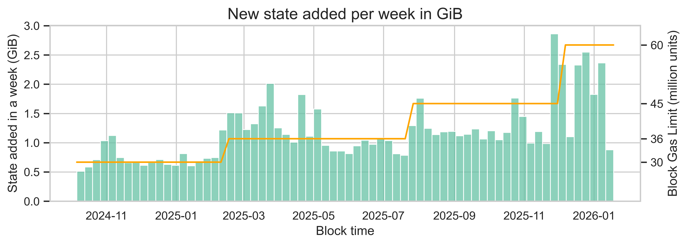

## Abstract

This proposal increases the cost of state creation operations, thus avoiding excessive state growth under increased block gas limits. It introduces a new variable, `CPSB` (cost per state byte), and sets this unit of gas costs per new state byte by targeting an average state growth of 120 GiB per year at a reference block gas limit of `150M` gas units. It also introduces an independent metering for state creation costs, thus allowing for increased throughput and for larger contract deployments without being limited by the single transaction gas limit.

## Motivation

State creation does not have a harmonized cost, with different methods incurring varied costs for creating the same size of new state. For instance, while contract deployment only costs ~200 gas units per new byte created, new storage slots cost ~313 gas units per new byte created. Also, deploying duplicated bytecode costs the same as deploying new bytecode, even though clients don't store duplicated code in the database. This proposal establishes a standard to harmonize all state creation operations.

Additionally, state growth will become a bottleneck for scaling under higher block limits. As of January 2026, the current database size in a Geth node dedicated to state is ~390 GiB. After the increase in gas limit from `30M` to `60M` gas units, the average size of new state created each day more than tripled, from ~105 MiB to ~326 MiB. This results in an annual growth of ~116 GiB.



The state-growth response we observe is not linear in the gas limit increase: a 2× bump (`30M` → `60M`) produced a roughly 3× jump in daily new state, suggesting a one-off shift in user behavior rather than a steady-state ratio. Treating the post-bump rate as the new baseline and extrapolating proportionally to the new gas limit, at a `200M` gas limit, the state would grow at a rate of ~387 GiB per year. Starting from 390 GiB, this rate would breach the 650 GiB threshold (at which point nodes begin experiencing performance degradation) in less than a year.

## Specification

### New parameters

| **Parameter** | **Value** |
|:---:|:---:|
| `CPSB` | 1530 |
| `STATE_BYTES_PER_STORAGE_SET` | 64 |
| `STATE_BYTES_PER_NEW_ACCOUNT` | 120 |
| `STATE_BYTES_PER_AUTH_BASE` | 23 |
| `SYSTEM_MAX_SSTORES_PER_CALL` | 16 |
| `TX_MAX_TOTAL_GAS_LIMIT` | 4,294,967,295 (2^32 - 1) |
| `LEGACY_GAS_PER_STATE_BYTE` | 200 |
| `PRE_FORK_GAS_STORAGE_SET` | 20,000 |
| `PRE_FORK_GAS_NEW_ACCOUNT` | 25,000 |
| `PRE_FORK_GAS_CREATE` | 32,000 |

### Parameter changes

Upon activation of this EIP, the following parameters of the gas model are updated. The "New State Gas" column shows the state gas cost (charged to the state-gas dimension), while the "New Execution Gas" column shows additional execution gas costs that accompany the state gas charge.

| **Parameter** | **Current** | **New State Gas** | **New Execution Gas** | **Operations affected** |
|---|---|---|---|---|
| `GAS_CREATE` | 32,000 | `STATE_BYTES_PER_NEW_ACCOUNT x CPSB` | `CREATE_ACCESS` | `CREATE`, `CREATE2` |
| `GAS_CODE_DEPOSIT` | 200/byte | `CPSB` per byte | `6 × ceil(len/32)` (hash cost) | `CREATE`, `CREATE2` |
| `GAS_NEW_ACCOUNT` | 25,000 | `STATE_BYTES_PER_NEW_ACCOUNT x CPSB` | 0 | `CALL`, `SELFDESTRUCT` |
| `GAS_STORAGE_SET` | 20,000 | `STATE_BYTES_PER_STORAGE_SET x CPSB` | 0 | `SSTORE` |
| `PER_EMPTY_ACCOUNT_COST` | 25,000 | `STATE_BYTES_PER_NEW_ACCOUNT x CPSB` | `ACCOUNT_WRITE` | EOA delegation |
| `PER_AUTH_BASE_COST` | 12,500 | `STATE_BYTES_PER_AUTH_BASE x CPSB` | `EXECUTION_PER_AUTH_BASE_COST` | EOA delegation |

The `EXECUTION_PER_AUTH_BASE_COST` is defined as the sum of:

- Calldata cost: 1,616 (101 bytes × 16), where 101 is the byte size of an [EIP-7702](./eip-7702.md) authorization tuple (`chain_id` 8 + `address` 20 + `nonce` 8 + `y_parity` 1 + `r` 32 + `s` 32). This is a representative size, not a worst case, since `chain_id` is a `uint256` and may exceed 8 bytes.
- Recovering authority address (ecRecover): `PRECOMPILE_ECRECOVER`
- Reading nonce and code of authority (cold access): `COLD_ACCOUNT_ACCESS` (is updated by [EIP-8038](./eip-8038.md))
- Storing values in an already warm account: 2 x `WARM_ACCESS`

`COLD_ACCOUNT_ACCESS`, `ACCOUNT_WRITE` and `CREATE_ACCESS` are defined and updated in [EIP-8038](./eip-8038.md). The values are not yet final.

### Multidimensional metering for state creation costs

Besides the parameter changes, this proposal introduces an independent metering for state creation costs. Two gas dimensions are introduced, execution-gas and state-gas. For state creation operations, the "new state costs" are charged to state-gas, while the "new execution costs" are charged to execution-gas. The costs of all other operations are charged to execution-gas.

At transaction level, the user pays for both execution-gas and state-gas. The total gas cost of a transaction is the sum of both dimensions. In addition, the transaction gas limit set in [EIP-7825](./eip-7825.md) only applies to execution-gas, while state-gas is capped by `tx.gas`, which this proposal in turn caps at `TX_MAX_TOTAL_GAS_LIMIT`.

At the block level, only the gas used in the bottleneck resource is considered when checking if the block is full and when updating the base fee for the next block. This gives a new meaning to the block's gas limit and the block's gas target: each now bounds the bottleneck resource (the dimension with the highest cumulative gas used) rather than a single combined gas counter.

#### Transaction validation

Before transaction execution, inclusion of a transaction in a block requires that:

1. The transaction's **gas limit is not higher than `TX_MAX_TOTAL_GAS_LIMIT`**. Concretely, `tx.gas <= TX_MAX_TOTAL_GAS_LIMIT`. Unlike [EIP-7825](./eip-7825.md)'s `TX_MAX_GAS_LIMIT`, which this proposal applies to execution-gas only, this bound applies to `tx.gas` as a whole and therefore to the sum of both dimensions.
2. The transaction's **intrinsic gas is not higher than [EIP-7825](./eip-7825.md)'s transaction cap**. Concretely, `max(intrinsic_gas, calldata_floor_gas_cost) <= TX_MAX_GAS_LIMIT`. Under [EIP-2780](./eip-2780.md), `intrinsic_gas` is state-independent and charged entirely in execution-gas; there is no intrinsic state-gas component.
3. For each gas dimension, the **cumulative gas used of all previous transactions added to the transaction's contribution does not exceed the block gas limit**. Concretely, `min(TX_MAX_GAS_LIMIT, tx.gas) <= execution_gas_available` and `tx.gas <= state_gas_available`, where `execution_gas_available = block_env.block_gas_limit - block_output.block_execution_gas_used` and `state_gas_available = block_env.block_gas_limit - block_output.block_state_gas_used`.

This check is performed before transaction inclusion in a block.

`intrinsic_gas` is the state-independent intrinsic cost defined by [EIP-2780](./eip-2780.md), charged entirely in execution-gas (base transaction cost, calldata, access lists, the recipient touch, value costs, and per-authorization base costs). It is the sole input to the transaction-validity check.

All state-dependent charges — new account creation and [EIP-7702](./eip-7702.md) delegation costs — are no longer part of intrinsic gas. Per [EIP-2780](./eip-2780.md), they are **runtime charges** applied in the pre-execution phase, after the transaction is deemed valid but before the first EVM frame is entered.

#### Transaction-level gas accounting (reservoir model)

Since transactions have a single gas limit parameter (`tx.gas`), gas accounting is enforced through a **reservoir model**. The gas is split into `gas_left` and `state_gas_reservoir`, and all gas counters are initialized, during the pre-execution phase defined by [EIP-2780](./eip-2780.md). This phase occurs after the transaction has passed the intrinsic gas check but before the first EVM frame is entered.

This EIP defines how the split and the counters are computed. The remaining accounting rules of the pre-execution phase (authorization processing, recipient warming, and the runtime account-creation and access charges) is specified in [EIP-2780](./eip-2780.md).

`gas_left` and `state_gas_reservoir` are initialized as follows:

```python
evm_gas = tx.gas - intrinsic_gas
execution_gas_budget = TX_MAX_GAS_LIMIT - intrinsic_gas
gas_left = min(execution_gas_budget, evm_gas)
state_gas_reservoir = evm_gas - gas_left
```

Because [EIP-2780](./eip-2780.md) makes intrinsic gas state-independent, no state-gas component is subtracted from `tx.gas` here and none is seeded into the reservoir. The state-dependent costs are applied as runtime charges — later in the pre-execution phase and during execution — drawing from `state_gas_reservoir` first and from `gas_left` once the reservoir is exhausted.

This means that the `state_gas_reservoir` holds gas that exceeds [EIP-7825](./eip-7825.md)'s budget. Additionally, two new counters are introduced:

- `evm_state_gas_used` encodes the total state-gas used by the transaction, and it is initialized as `evm_state_gas_used = 0`.
- `state_gas_used_snapshot` and `state_gas_reservoir_snapshot` record the values of `evm_state_gas_used` and `state_gas_reservoir` at the start of the state changes a frame's rollback undoes, which for a call frame is its entry. Like `gas_left`, they are frame-local.

The gas counters operate as follows:

- Execution-gas charges deduct from `gas_left` only.
- State-gas charges deduct first from `gas_left`, up to the operation's legacy share (see below), then from `state_gas_reservoir`, within the frame's state-gas allowance (see [State-gas allowance of call frames](#state-gas-allowance-of-call-frames)). When the reservoir or the allowance is exhausted, the remainder deducts from `gas_left`. If `gas_left` cannot pay the legacy share, the frame halts exceptionally, whatever the reservoir holds. State-gas charges increment `evm_state_gas_used`.
- If a state creation is undone during execution, the corresponding amount of state-gas is **refilled**: it is credited to `state_gas_reservoir` and `evm_state_gas_used` is decremented by the same amount. A refill never credits `gas_left`, whichever pool the charge drew from. Throughout this specification, "refilling state-gas" refers to this operation.
- `state_gas_reservoir` is a single counter for the whole transaction. A child frame can draw on it up to its state-gas allowance (see [State-gas allowance of call frames](#state-gas-allowance-of-call-frames)). The 63/64 rule applies to `gas_left` only.
- The `GAS` opcode returns `gas_left` only (excluding the reservoir).
- State-gas accounting never credits `gas_left`. A frame's `gas_left` increases only when a child frame returns its unused `gas_left`, as before this EIP.
- State-gas is metered at the end of all state-mutating opcodes, call-frame boundaries (in case of exceptional halts and reverts) and at the end of the transaction.

##### Legacy share of state-gas charges

The legacy share of a state-gas charge is the part of it that is paid from `gas_left` even when the reservoir could pay it. With it, a new storage slot, a new account, and a `CREATE`/`CREATE2` to a non-existent address take at least their cost before this EIP from `gas_left`. The code deposit and a `CREATE`/`CREATE2` to an existing address are exceptions (see [State creation with a reservoir](#state-creation-with-a-reservoir)).

The legacy share is defined for each cost component that creates state. `PRE_FORK_COST` is the cost of the component before this EIP, and `execution_gas_charge` is the execution-gas that the same component costs with this EIP and [EIP-8038](./eip-8038.md):

```python
legacy_share = min(state_gas_charge, max(0, PRE_FORK_COST - execution_gas_charge))
```

| State-gas charge | `PRE_FORK_COST` | `execution_gas_charge` | Legacy share with the values of this EIP |
|---|---|---|---|
| New storage slot (`SSTORE`) | `PRE_FORK_GAS_STORAGE_SET` | `STORAGE_WRITE` | 10,000 |
| New account (`CALL*` with value, `SELFDESTRUCT`) | `PRE_FORK_GAS_NEW_ACCOUNT` | 0 | 25,000 |
| Account creation of `CREATE`/`CREATE2` | `PRE_FORK_GAS_CREATE` | `CREATE_ACCESS` | 20,000 |

Implementations MUST compute the share from the formula. The last column uses the values of [EIP-8038](./eip-8038.md) at the time of writing, `STORAGE_WRITE = 10,000` and `CREATE_ACCESS = 12,000`, which [EIP-8038](./eip-8038.md) derives from measurements and can change. The figures in the rest of this EIP use these values. The constants `PRE_FORK_*` are fixed: they are the costs before this EIP and do not change when a later EIP changes the gas schedule.

For each of these components, the execution-gas charge and the legacy share together take `max(PRE_FORK_COST, execution_gas_charge)` from `gas_left`, which is at least the cost of the component before this EIP. The only exception is a state-gas charge smaller than `PRE_FORK_COST - execution_gas_charge`: then all of it is the legacy share. The rule applies to each component, not to each operation. The other components of an operation, such as the access cost and `CALL_VALUE`, are not part of the legacy share, and [EIP-8038](./eip-8038.md) sets their costs. For example, a `CALL` with value to a cold non-existent account takes 39,300 from `gas_left`: 3,000 `COLD_ACCOUNT_ACCESS`, 11,300 `CALL_VALUE` and 25,000 legacy share, against 36,600 before this EIP. The difference of 2,700 is the increase of [EIP-8038](./eip-8038.md), which a `CALL` with value to an existing account also pays.

All other state-gas charges, including the code-deposit charge and the charges of the pre-execution phase, have a legacy share of zero. The legacy share is state-gas: it increments `evm_state_gas_used` and is refilled like the rest of the charge.

A transaction type that pays state-gas from a pool of each of its frames, without a reservoir, cannot count the legacy share as state-gas without letting a frame exceed its state-gas limit. Such a transaction type charges the share to `gas_left` as execution-gas in addition to the state-gas charge, and does not count the share in the gas that the frame used, as its own specification states.

##### Gas accounting for SSTORE (opcode-level)

| Original value | Current value | New value | Description | State-gas charges/refills |
|---|---|---|---|---|
| 0 | x | 0 | Cleared slot, zero at transaction start | `STATE_BYTES_PER_STORAGE_SET × CPSB` refilled |
| 0 | 0 | x | New slot | `STATE_BYTES_PER_STORAGE_SET × CPSB` charged |
| x | x | 0 | Cleared slot, non-zero at transaction start | no state-gas adjustments |
| x | 0 | x | Cleared slot restored to its original non-zero value | no state-gas adjustments |
| x or 0 | y | z | All other writes to an existing slot | no state-gas adjustments |

State-gas accounting for `SSTORE` is performed at the end of the opcode execution.

##### Gas accounting for new accounts

| Operation | State-gas charges/refills |
|---|---|
| `CALL*` with value to non-existent account | `STATE_BYTES_PER_NEW_ACCOUNT × CPSB` charged |
| `CREATE`/`CREATE2` with bytecode size of `L` to existent account | `L × CPSB` charged |
| `CREATE`/`CREATE2` with bytecode size of `L` to non-existent account | `(STATE_BYTES_PER_NEW_ACCOUNT + L) × CPSB` charged |
| `SELFDESTRUCT` where balance transfer creates a new account | `STATE_BYTES_PER_NEW_ACCOUNT × CPSB` charged |

Here, an account is *existent* if it already has a leaf in the state trie, i.e., it has a nonzero balance, a nonzero nonce, or non-empty code (per [EIP-161](./eip-161.md)).

In particular, an address that holds a balance but has no code and a zero nonce is existent and is a valid `CREATE`/`CREATE2` target under [EIP-684](./eip-684.md). Creating a contract at such an address updates the existing leaf rather than adding a new one, so only the code-deposit cost (`L × CPSB`) applies and the `STATE_BYTES_PER_NEW_ACCOUNT × CPSB` account-creation charge does not.

State-gas accounting for `CALL*` and `CREATE`/`CREATE2` operations is performed right before the respective call frame. In both families the `STATE_BYTES_PER_NEW_ACCOUNT × CPSB` account-creation charge is applied *conditionally*: only when the operation is about to create a new account. The families differ only in *when* the destination account may be read, which [EIP-7928](./eip-7928.md) constrains (see [Account-creation charging and EIP-7928](#account-creation-charging-and-eip-7928)).

**`CALL*` family (conditional charge).** The `STATE_BYTES_PER_NEW_ACCOUNT × CPSB` account-creation charge is applied *conditionally* right before entering the child frame: only when the target account does not exist and a positive value is transferred. The charge, including its legacy share, is part of the cost of the `CALL*` that is subtracted from `gas_left` before the gas to forward is computed by the 63/64 rule of [EIP-150](./eip-150.md), as `GAS_NEW_ACCOUNT` was before this EIP. Thus a portion drawn from `gas_left` reduces the gas forwarded to the child frame, and a failed charge exceptionally halts the calling frame. The charge is applied before the balance and call-depth checks. If the operation is unsuccessful before entering the call frame (e.g., due to insufficient balance or due to the stack depth), or if the child frame reverts or halts exceptionally, the charged state-gas is refilled and `evm_state_gas_used` decreases by the same amount. The refill goes to the reservoir, so the part of the charge that came from `gas_left` stays consumed from `gas_left`: at least the legacy share, as `GAS_NEW_ACCOUNT` did before this EIP, and the full charge when the reservoir was empty.

**`CREATE`/`CREATE2` family (conditional charge).** [EIP-7928](./eip-7928.md) defers reading the computed destination address until creation has passed the checks that precede any state access: sender balance for the endowment, nonce overflow, and the call-stack depth limit. A creation failing those checks never reads the destination, and no account-creation state-gas is charged. Once the checks pass, the destination is accessed — a single read that also performs the [EIP-684](./eip-684.md) collision check:

- If the destination is non-existent (per the existence rule above), `STATE_BYTES_PER_NEW_ACCOUNT × CPSB` is charged in the creating frame, before 63/64 of the remaining gas is forwarded: a portion drawn from `gas_left` reduces the gas forwarded to the create frame, and a failed charge exceptionally halts the creating frame — exactly as for `CALL*`. If the destination pre-exists (e.g., it holds a balance), nothing is charged. The charge is decided by existence alone, independently of the collision outcome below.
- On an address collision ([EIP-684](./eip-684.md)) the creation fails as an exceptional halt of the create frame, consuming the forwarded gas. A colliding destination has a nonzero nonce or non-empty code, so it is existent and no account-creation state-gas was charged. A nonzero balance or non-empty storage alone does not cause a collision.
- If the create frame reverts or halts exceptionally (including an address collision and a failed code deposit), the account creation is rolled back and any charged account-creation state-gas is refilled, decreasing `evm_state_gas_used` by the same amount — exactly as for `CALL*`.

The code-deposit portion (`L × CPSB`) is unaffected by this rule and is charged at code-deposit time as usual.

The same conditional rule applies to top-level contract-creation transactions. Under [EIP-2780](./eip-2780.md) the `STATE_BYTES_PER_NEW_ACCOUNT × CPSB` account-creation charge is not part of intrinsic gas and is not reserved up front; it is applied as a runtime charge in the pre-execution phase, when transaction setup accesses the deployment address (an access [EIP-7928](./eip-7928.md) always records), only if the destination does not already exist. Like any other state charge, it draws from `state_gas_reservoir` first and from `gas_left` once the reservoir is exhausted. If the transaction reverts or halts (including an address collision), any charged portion is undone by the frame's rollback, and the unspent reservoir is returned to the sender by the normal end-of-transaction settlement.

Charges for account creation with `SELFDESTRUCT` are charged at the point where it executes.

##### Gas refills for `SELFDESTRUCT`

`SELFDESTRUCT` for accounts created in the same transaction does not produce increases in state size as the account, its data and its storage is not included in the state trie. However, this operation does not produce any state-gas refills and there are no changes to `evm_state_gas_used`.

For an account that existed before the transaction, `SELFDESTRUCT` only transfers its balance and the account is not removed. Thus, no state-gas refill applies and no changes to `evm_state_gas_used`. This is consistent with the behavior of [EIP-6780](./eip-6780.md).

##### Gas accounting for halts and reverts

A call frame's state changes are rolled back on both reverts and exceptional halts. In both cases `evm_state_gas_used` is restored to the frame's snapshot. The two cases differ in how the frame's `gas_left` is treated, exactly as in existing EVM semantics, and the state-gas that the frame drew from `gas_left` follows its `gas_left`.

On a **revert**, the remaining `gas_left` is returned to the parent, and the net state-gas the frame charged is credited to the reservoir:

```python
state_gas_reservoir += evm_state_gas_used - state_gas_used_snapshot
evm_state_gas_used = state_gas_used_snapshot
```

After this restore, the reservoir equals its value at the snapshot plus the state-gas that the frame and its descendants drew from `gas_left` and did not lose in an exceptional halt. The credit is negative for a frame that refilled more than it charged (for example, a frame that cleared a slot allocated by an earlier frame): the rollback also restores the state whose removal the refill credited. The reservoir cannot become negative, because after the restore it is the sum of two values that are not negative: its value at the snapshot, and the state-gas drawn from `gas_left`.

On an **exceptional halt**, `gas_left` is consumed, and the state-gas the frame drew from `gas_left` is consumed with it:

```python
state_gas_reservoir = state_gas_reservoir_snapshot
evm_state_gas_used = state_gas_used_snapshot
```

In neither case is state-gas that was drawn from `gas_left` credited back to `gas_left`. After a revert it stays in `state_gas_reservoir`, where it can pay for later state creation, and is returned to the sender by the end-of-transaction settlement if unused. The restore is applied before any refill its parent makes for the failed operation. Thus a frame that creates state and then reverts makes the sender pay only the execution-gas part of that state creation, as before this change. This does not apply to an exceptional halt, which consumes the state-gas that the frame drew from `gas_left`.

The snapshot of the top-level frame is not taken at its entry. It is always taken after the processing of the [EIP-7702](./eip-7702.md) authorizations, which can be empty, and before the account-creation charge for the transaction's target. Thus:

- A rollback of the top-level frame does not refill the state-gas of the authorizations, because it does not undo them ([EIP-2780](./eip-2780.md)).
- A rollback of the top-level frame refills the account-creation charge of a contract-creation transaction, because it undoes the account. This also applies to a transaction without authorizations, for example a contract-creation transaction whose init code reverts at once. A plain value transfer to a non-existent account cannot be rolled back, except a transfer to an empty precompile that fails ([EIP-2780](./eip-2780.md)), which refills its account-creation charge in the same way.

If the transaction fails before the top-level frame is entered, it is processed as an exceptional halt at the transaction boundary. The pre-execution phase is rolled back, including the authorizations ([EIP-2780](./eip-2780.md)), and `gas_left` is consumed: execution-gas that the phase consumed is not returned. The state-gas of the phase is restored as for an exceptional halt, with the start of the transaction as the snapshot:

```python
state_gas_reservoir = state_gas_reservoir_at_transaction_start
evm_state_gas_used = 0
gas_left = 0
```

State-gas that the phase drew from `gas_left` is consumed with `gas_left`. State-gas that it drew from the reservoir returns to the reservoir and to the sender. Thus the sender pays `min(tx.gas, TX_MAX_GAS_LIMIT)`, and nothing from the reservoir. This resolves a choice that [EIP-2780](./eip-2780.md) leaves open ("the sender pays for all gas consumed"). The other reading returns the `gas_left` that the phase did not consume, as a revert does. This EIP chooses the out-of-gas reading: the phase fails because `gas_left` cannot pay a charge, and an exceptional halt consumes `gas_left`. This reading costs the sender more. A transaction whose `gas_left` is short by one charge, for example one with many authorizations for new accounts, pays its whole `gas_left`. Before [EIP-2780](./eip-2780.md), the account creation of an authorization and of a contract-creation transaction were intrinsic gas, so a transaction short of that gas was invalid and paid nothing. A value transfer to a non-existent account had no account-creation charge at all.

When a child frame **succeeds**, its remaining `gas_left` is returned to the parent. No gas moves between `gas_left` and `state_gas_reservoir`.

When a child frame **reverts**, all of its state changes are rolled back, its state-gas is restored as above, and its remaining `gas_left` is returned to the parent.

When a child frame **halts exceptionally**, the same restore is applied, but the child's `gas_left` is consumed (set to zero) rather than returned.

The same rules apply when the top-level call frame reverts or halts, treating the frame as a child of the transaction boundary. In particular, for address collisions in contract-creation transactions, `gas_left` is consumed in full. The colliding destination has a nonzero nonce or non-empty code ([EIP-684](./eip-684.md)), so no account-creation state-gas was charged. The `state_gas_reservoir` is returned to the sender by the normal end-of-transaction settlement.

##### Gas accounting for [EIP-7702](./eip-7702.md) authorizations

Gas charges for [EIP-7702](./eip-7702.md) authorizations follow the specification in [EIP-2780](./eip-2780.md).

##### State-gas allowance of call frames

The state-gas allowance limits what a call frame and its descendants take from `state_gas_reservoir`. It uses two more counters:

- `state_gas_drawn` is the total state-gas that the transaction took from `state_gas_reservoir`. It is a single counter for the whole transaction, initialized as `state_gas_drawn = 0`.
- `state_gas_drawn_snapshot` records the value of `state_gas_drawn` at the frame's snapshot. Like the other snapshots, it is frame-local.

Each call frame has a `state_gas_ceiling`, the highest value of `state_gas_drawn` that the frame and its descendants can reach.

- The top-level frame has no ceiling. An [EIP-7702](./eip-7702.md) delegation does not start a frame, so the delegated code of a top-level account runs without a ceiling.
- A frame that a `CALL`, `STATICCALL`, `CREATE` or `CREATE2` starts with `child_gas` of `gas_left` (after the 63/64 rule and including the call stipend) gets:

  ```python
  child.state_gas_ceiling = min(
      parent.state_gas_ceiling,  # no limit if the parent has none
      state_gas_drawn + child_gas * CPSB // LEGACY_GAS_PER_STATE_BYTE)
  ```

- A frame that a `DELEGATECALL` or `CALLCODE` starts gets the ceiling of its parent: `child.state_gas_ceiling = parent.state_gas_ceiling`. The code runs in the account of the parent, which chose it, so for the allowance it is part of the parent (see [Limiting the reservoir per call frame](#limiting-the-reservoir-per-call-frame)).
- A state-gas charge takes from the reservoir only what the ceiling of the charged frame allows. After the legacy share, the charge is paid as follows:

  ```python
  rest = amount - legacy_share
  from_reservoir = min(rest, state_gas_reservoir,
                       state_gas_ceiling - state_gas_drawn)  # no third term without a ceiling
  state_gas_reservoir -= from_reservoir
  state_gas_drawn += from_reservoir
  rest -= from_reservoir
  # rest deducts from gas_left; if gas_left cannot pay it, the frame halts exceptionally
  ```

  Thus a frame that has used its allowance pays state-gas from its own `gas_left`, as when the reservoir is empty. The allowance adds no reason for a frame to halt.
- The account-creation charge of a `CALL*` with value and of a `CREATE`/`CREATE2` is charged to the calling frame, within its ceiling, before the child frame starts. The code-deposit charge is charged to the create frame when its init code returns, within the ceiling of the create frame. If the create frame cannot pay the rest from its `gas_left`, the code deposit fails, as before.
- On a revert or an exceptional halt, `state_gas_drawn = state_gas_drawn_snapshot`. A refill does not change `state_gas_drawn`. If the transaction fails before the top-level frame starts, `state_gas_drawn = 0`.

`child_gas * CPSB // LEGACY_GAS_PER_STATE_BYTE` is the allowance derived from the forwarded gas. The actual allowance, `state_gas_ceiling` minus `state_gas_drawn` at the frame's entry, is smaller when the parent has less of its own allowance left. The ceiling limits only what a frame takes from the reservoir. State-gas that a frame pays from its own `gas_left` is not limited.

The allowance applies only where state-gas is paid by the reservoir model. A transaction type that pays state-gas from a state-gas pool of each of its frames, which call frames at every depth use directly, does not use the reservoir model, and its call frames, at every depth, have no state-gas allowance. The reason is that such a transaction type has no fallback to `gas_left`: state-gas cannot be paid from execution gas, so a call frame that reached its allowance would halt, and the allowance would add failures. The state-gas limit that the sender sets for each frame bounds what all callees of the frame cost together, as `tx.gas` does in a transaction with a reservoir. It does not make a check of execution gas sufficient: a callee with enough execution gas can still fail when an earlier callee of the same frame has used the state-gas pool (see [Untrusted callees and the shared reservoir](#untrusted-callees-and-the-shared-reservoir)). A consequence is also that the same call can take more state-gas from the pool of such a frame than from the reservoir of another transaction, so the result of a callee can differ by transaction type.

#### Pre-state and post-state gas validation

[EIP-7928](./eip-7928.md) defines two-phase gas validation for state-accessing opcodes: pre-state costs (determinable without state access) and post-state costs (requiring state access). Under this EIP, the execution-gas portion of these opcodes follows the [EIP-7928](./eip-7928.md) rules unchanged and is charged at opcode time against `gas_left`. The state-gas portion is also charged at the opcode level, with the timing given for each opcode above.

For `SSTORE`, the `GAS_CALL_STIPEND` pre-state check ([EIP-7928](./eip-7928.md)) applies to `gas_left` only, excluding the `state_gas_reservoir`.

#### Transaction gas used

At the end of transaction execution, the gas used before and after refunds is defined as:

```python
tx_gas_used_before_refund = tx.gas - tx_output.gas_left - tx_output.state_gas_reservoir
tx_gas_refund = min(tx_gas_used_before_refund // 5, tx_output.refund_counter)
tx_gas_used_after_refund = tx_gas_used_before_refund - tx_gas_refund
tx_gas_used = max(tx_gas_used_after_refund, calldata_floor_gas_cost) 
```

The refund cap remains at 20% of gas used. `tx_gas_used` applies the [EIP-7623](./eip-7623.md) calldata floor after refunds, so the floor can effectively negate part of a refund when `calldata_floor_gas_cost > tx_gas_used_after_refund`. The receipt `cumulative_gas_used` uses this post-floor value.

#### Block-level gas accounting

At block level, instead of tracking a single `gas_used` counter, we keep track of two counters, one for `state-gas` and one for `execution-gas`:

```python
tx_state_gas = tx_output.evm_state_gas_used
tx_execution_gas = max(tx_gas_used_after_refund - tx_state_gas, calldata_floor_gas_cost)

block_output.block_execution_gas_used += tx_execution_gas
block_output.block_state_gas_used += tx_state_gas
```

Since all state-gas charges are now applied as runtime or execution-time charges (per [EIP-2780](./eip-2780.md)), the transaction's total state-gas is fully captured by `evm_state_gas_used`; there is no separate intrinsic state-gas term to add.

The [EIP-7623](./eip-7623.md) calldata floor participates in block accounting through the `max` term, applied to the execution-gas dimension: calldata is an execution-gas resource, and the floor's bound on worst-case block size holds only if a data-heavy transaction contributes at least the floor to the block's gas accounting. The floor is compared against the transaction's execution-gas portion alone — not the transaction total — so execution gas may absorb the floor exactly as under [EIP-7623](./eip-7623.md), while state-gas spending cannot (see [Calldata floor in block accounting](#calldata-floor-in-block-accounting)).

The block header `gas_used` field is set to:

```python
gas_used = max(block_output.block_execution_gas_used, block_output.block_state_gas_used)
```

The block validity condition uses this value:

```python
assert gas_used <= block.gas_limit, 'invalid block: too much gas used'
```

The base fee update rule is also modified accordingly:

```python
gas_used_delta = parent.gas_used - parent.gas_target
```

##### Integration with [EIP-7778](./eip-7778.md)

[EIP-7778](./eip-7778.md) excludes transaction refunds from block gas accounting. The refunds in question are those of the transaction refund counter — a execution-gas quantity. State-gas refills are not refunds in this sense: a refill reverses a charge for state that was never durably created (a reverted or exceptionally halted frame, a failed `CALL*`/`CREATE`, or a slot set and reset within the same transaction), so the resource metered by the state-gas dimension was never consumed. Refills therefore remain netted into `evm_state_gas_used` regardless of [EIP-7778](./eip-7778.md), and only the execution-gas dimension changes (see [State-gas refills under EIP-7778](#state-gas-refills-under-eip-7778)). If implemented together with [EIP-7778](./eip-7778.md), the block level would be updated to:

```python
tx_state_gas = tx_output.evm_state_gas_used
tx_execution_gas = max(tx_gas_used_before_refund - tx_state_gas, calldata_floor_gas_cost)

block_output.block_execution_gas_used += tx_execution_gas
block_output.block_state_gas_used += tx_state_gas
```

The `max` term preserves [EIP-7778](./eip-7778.md)'s block accounting rule `block.gas_used += max(tx_gas_used, calldata_floor_gas_cost)`, applied here to the execution-gas dimension.

#### Receipt semantics

Receipt `cumulative_gas_used` tracks the cumulative sum of `tx_gas_used` (post-refund, post-floor) across transactions, instead of the block's `gas_used`. This means `receipt[i].cumulative_gas_used - receipt[i-1].cumulative_gas_used` equals the gas paid by transaction `i`.

### System contracts and system transactions

The gas limit of system contracts (e.g., [EIP-2935](./eip-2935.md), [EIP-4788](./eip-4788.md), [EIP-7002](./eip-7002.md), [EIP-7251](./eip-7251.md)) that are invoked at the start of every block via a system call is updated from `30M` to:

```python
SYSTEM_CALL_GAS_LIMIT = 30_000_000 + STATE_BYTES_PER_STORAGE_SET × CPSB × SYSTEM_MAX_SSTORES_PER_CALL
```

This ensures preservation of the existing execution margin for system contracts under higher state creation costs.

Here, `SYSTEM_MAX_SSTORES_PER_CALL = 16` is the upper bound on the number of new storage slots a single system call is expected to write. It is a margin rather than a bound derived from any particular system contract, and must be re-derived if a system call can write more new slots. The legacy share of each new slot comes from the 30M of `gas_left`, so the reservoir is larger than needed by the legacy shares. The difference is harmless.

The additional `STATE_BYTES_PER_STORAGE_SET × CPSB × SYSTEM_MAX_SSTORES_PER_CALL` is placed in `state_gas_reservoir` while the rest of the system call's gas is placed in `gas_left`. System calls remain not subject to the [EIP-7825](./eip-7825.md) `TX_MAX_GAS_LIMIT` cap, do not count against the block gas limit, and do not contribute to either `block_execution_gas_used` or `block_state_gas_used`.

## Rationale

### Deriving the cost per state byte (`CPSB`)

`CPSB` is a fixed parameter derived from a reference block gas limit. The derivation pins the cost so that, at the reference block gas limit and under expected average utilization, total state growth stays at the target rate. If a future block gas limit increase materially changes the expected state growth rate, `CPSB` can be re-derived in a subsequent EIP.

#### Inputs

- **Target state growth**: 120 GiB per year, i.e., `120 × 2^30 = 128,849,018,880` bytes.
- **Reference block gas limit**: `150M` gas units.
- **Slot time**: 12 seconds, giving `86400 / 12 = 7,200` blocks per day and `7,200 × 365 = 2,628,000` blocks per year.
- **Average state-gas utilization**: 50% of the block gas limit. Under multidimensional metering, the base fee converges to the target, which is half of the gas limit. On average, half of each block's gas budget can therefore be consumed by state-gas charges before the base fee starts pushing back.

#### Derivation

The total state gas available for state creation in a year is:

```text
total_state_gas_per_year = (gas_limit / 2) × blocks_per_year
                         = (150,000,000 / 2) × 2,628,000
                         = 75,000,000 × 2,628,000
                         = 1.971 × 10^14 gas
```

Dividing by the target byte count gives the cost per state byte:

```text
CPSB = total_state_gas_per_year / target_state_growth
     = 1.971 × 10^14 / 128,849,018,880
     ≈ 1530 gas/byte
```

#### Why target a `150M` block limit?

The reference block gas limit of `150M` is chosen as a middle ground between the current `60M` and the expected future `300M`. This allows us to set a `CPSB` that is not too high (which would cause a large immediate increase in state creation costs) nor too low (which would require a more aggressive increase in a future EIP when the block limit increases further).

With this target, we expect state growth will slow down significantly compared to the current trajectory and then increase again as we slowly increase the block gas limit.

#### Why target 120 GiB per year?

By targeting a state growth of 120 GiB per year with a `150M` block limit, we achieve the following worst-case growth rate at different block limits:

| Block limit | Worst-case growth rate |
| --- | --- |
| `100M` | 80 GiB/year |
| `150M` | 120 GiB/year |
| `200M` | 160 GiB/year |
| `250M` | 200 GiB/year |
| `300M` | 240 GiB/year |

These rates are computed assuming blocks are fully utilized with state creation operations, which is a worst-case scenario. Assuming a smooth increase in block limit from `100M` to `300M` over the next year, we would expect a worst-case average growth rate of around 160 GiB per year, which is a significant improvement over the current trajectory.

### Harmonization across state creation

With the current pricing, the gas cost of creating 1 byte of state varies depending on the method used. The following table shows the various methods and their gas cost per byte. The calculation ignores the transaction intrinsic cost (21,000 gas units) and the costs of additional opcodes and scaffolding needed to execute such a transaction.

| Method                                                      | What is written                                | Intrinsic gas                                                                                 | Bytes → state | Gas / byte |
| ----------------------------------------------------------- | ---------------------------------------------- | --------------------------------------------------------------------------------------------- | ------------- | ---------- |
| Deploy 24 kB contract ([EIP-170](./eip-170.md) limit)        | Runtime code + account trie node               | 32,000 CREATE + 200 × 24,576 code deposit = 4,947,200 gas                | 24,696 B      | ~200 gas   |
| Fund fresh EOA with 1 wei                                   | Updated account leaf                           | 25,000 new account                                                                            | ~120 B        | ~208 gas   |
| Add delegate flag to funded EOA ([EIP-7702](./eip-7702.md)) | 23 B (0xef0100‖address) + updated account leaf | 25,000 PER_EMPTY_ACCOUNT + 12,500 PER_AUTH_BASE + 1,616 calldata - 7,823 refund = ~31,300 gas | ~143 B        | ~219 gas   |
| [EIP-7702](./eip-7702.md) authorization to empty address    | 23 B (0xef0100‖address) + updated account leaf | 25,000 PER_EMPTY_ACCOUNT + 12,500 PER_AUTH_BASE + 1,616 calldata = 39,116 gas                 | ~143 B        | ~274 gas   |
| Fill new storage slots (SSTORE 0→x)                         | Slot in storage trie                           | 20,000 gas/slot                                                                               | 64 B          | ~313 gas   |

To harmonize costs, we first set the gas cost of a single state byte, `CPSB`, as explained above. Now that we have a standardized cost per byte, we can derive the various costs parameters by multiplying the unit cost by the increase in bytes any given operation creates in the database (i.e., 64 bytes per slot, 120 bytes per account and 23 bytes per authorization).

Note that the fixed cost `GAS_CREATE` for contract deployments assumes the same cost as a new account creation.

#### Deriving byte size for new slots and accounts

The byte sizes used in this proposal correspond to the on-disk footprint of a new account or storage slot, taking into account both the leaf data and the key under which it is stored.

A new account adds 120 bytes:

| Field | Size |
| --- | --- |
| Account hash (key) | 32 bytes |
| Nonce | 8 bytes |
| Balance | 16 bytes |
| Code hash | 32 bytes |
| Storage root | 32 bytes |
| **Total** | **120 bytes** |

A new storage slot adds 64 bytes:

| Field | Size |
| --- | --- |
| Slot hash (key) | 32 bytes |
| Value | 32 bytes |
| **Total** | **64 bytes** |

For [EIP-7702](./eip-7702.md) authorizations on an already-existing account, no new account leaf is created. The only new state written is the delegation indicator stored in the authority's `code` field. As specified in [EIP-7702](./eip-7702.md), this indicator is the 3-byte magic prefix `0xef0100` concatenated with the 20-byte delegate address, for a total of 23 bytes:

| Field | Size |
| --- | --- |
| Delegation magic (`0xef0100`) | 3 bytes |
| Delegate address | 20 bytes |
| **Total** | **23 bytes** |

When the authorization targets a non-existent account, the full `STATE_BYTES_PER_NEW_ACCOUNT` is charged in addition to `STATE_BYTES_PER_AUTH_BASE`, since both a new account leaf and the delegation indicator are written.

These figures account only for the leaf payload and its keccak256 key. They do not include the additional trie overhead (intermediate nodes, encoding, etc.) incurred when the new entry is inserted. The values are therefore a lower bound on the actual state growth per operation.

### Multidimensional metering

#### EIP-7825 limit on contract size

[EIP-7825](./eip-7825.md) introduces `TX_MAX_GAS_LIMIT` (16.7M) as the maximum gas for a single transaction, in particular stipulating `tx.gas <= TX_MAX_GAS_LIMIT` as a validity condition. Were we to continue enforcing this validity condition, with `CPSB = 1530`, this proposal would limit the maximum contract size that can be deployed to roughly 7.5kB. Assuming a representative constructor execution budget of `5M` execution gas on top of the 21,000 base transaction cost and the `STATE_BYTES_PER_NEW_ACCOUNT × CPSB` account-creation cost, the remaining budget for code-deposit state gas yields $\frac{16,777,216 - 21,000 - 5,000,000 - 120 \times 1530}{1530} \approx 7{,}564$ bytes. This maximum size would only decrease if `CPSB` is re-derived upward in a future EIP.

To solve this issue, we only apply this gas limit to execution gas, not state gas. Doing so does not weaken the intended scaling effect of [EIP-7825](./eip-7825.md), because execution gas meters all resources that benefit from parallelization. In particular, state growth does not: growing the state always requires writing to disk, an operation that can be parallelized, but crucially this part of the cost of a state growth operation has to be metered in execution gas, not state gas. In other words, any operation that grows the state should consume both execution gas and state gas, and the execution gas should fully account for all costs other than the long term effect of growing the state.

However, we cannot statically enforce an execution gas consumption of `TX_MAX_GAS_LIMIT`, while still allowing a higher state gas consumption, because transactions only have a single gas limit parameter, `tx.gas`. This is solved through a **reservoir model**: at transaction start, `evm_gas` is split into `gas_left` (capped at `TX_MAX_GAS_LIMIT - intrinsic_gas`) and a `state_gas_reservoir` (the overflow). State gas charges draw their legacy share from `gas_left`, then from the reservoir, then from `gas_left` when the reservoir is empty. Execution gas charges draw from `gas_left` only. Exceeding the execution gas budget behaves identically to running out of gas — no special error is needed.

State-gas refills and rollbacks credit `state_gas_reservoir` only, never `gas_left`. Contracts use the gas that remains after a failed call to tell an out-of-gas failure from a logic error, and to make sure a failure handler cannot complete when the call was given too little gas. These checks assume that gas a frame has spent does not come back. Crediting a refill to `gas_left`, for example in last-in, first-out order to the pool the charge drew from, breaks that assumption in two ways: clearing a slot allocated earlier in the transaction gives the frame execution gas at once, and an intermediary that reverts returns state-gas it had already spent to its caller. Both can turn an out-of-gas failure into one that looks like a logic error, or let a failure handler complete that would otherwise run out of gas.

Keeping the credit in the reservoir costs the sender nothing. The gas can pay for later state creation in the same transaction, and any unused remainder is returned to the sender by the end-of-transaction settlement, so the total the sender pays is the same as with a credit to `gas_left`. The only difference is that gas spent from `gas_left` on state creation that is later undone is no longer available for execution in the same transaction. This matches the treatment of the refund counter before this EIP, which also returns gas only at the end of the transaction.

The rule also removes the need for frame-local tracking of which pool paid for each charge. A refill may land in a frame other than the one that was charged, because the original value in the `SSTORE` table above is the value at transaction start. Since every refill goes to the reservoir, it does not matter which frame was charged. A frame's rollback restores `evm_state_gas_used` to the frame's snapshot, which handles a frame that refills state charged by an earlier frame (see [Gas accounting for halts and reverts](#gas-accounting-for-halts-and-reverts)). Since `gas_left` is never credited, in a user transaction it can never exceed `TX_MAX_GAS_LIMIT - intrinsic_gas`.

#### Keeping an absolute transaction gas limit

Applying [EIP-7825](./eip-7825.md)'s cap to execution-gas alone would leave `tx.gas` itself bounded only by the block gas limit. That is not the intent of this proposal: a per-transaction gas limit is worth keeping. [EIP-7825](./eip-7825.md) introduced one so that the work a single transaction can represent stays a small and predictable unit for proving, parallel execution, and scheduling, and so that this bound is fixed by the protocol rather than drifting upward with every block gas limit increase. This proposal raises that limit for the state dimension; it does not abolish it.

`tx.gas` is therefore capped at `TX_MAX_TOTAL_GAS_LIMIT`, which keeps every transaction's gas limit within an unsigned 32-bit integer. The bound is chosen to sit far above the deployments this proposal sets out to enable. Reusing the figures above (the 21,000 base transaction cost, a representative `5M` execution gas constructor budget, and the `STATE_BYTES_PER_NEW_ACCOUNT × CPSB` account-creation cost), the code-deposit budget it leaves is $\frac{2^{32} - 1 - 21,000 - 5,000,000 - 120 \times 1530}{1530} \approx 2{,}803{,}766$ bytes, roughly 2.8 MB and about 43 times [EIP-7954](./eip-7954.md)'s 65,536-byte contract size limit, so a single transaction can still deploy dozens of maximum-size contracts. While the block gas limit stays below `TX_MAX_TOTAL_GAS_LIMIT`, the per-dimension block checks are the tighter bound and the cap rejects nothing that could be included today; what it adds is a ceiling that no later block gas limit increase can lift.

#### Higher throughput

Another advantage of metering contract creation separately is that increasing the cost of state creation operation in line with the block limit will not affect the available gas for other operations. This allows for higher throughput.

#### Calldata floor in block accounting

The [EIP-7623](./eip-7623.md) calldata floor (raised further by [EIP-7976](./eip-7976.md)) bounds worst-case block size only because it participates in block gas accounting: a data-heavy transaction must occupy at least the floor's worth of the block gas limit, which is also what [EIP-7778](./eip-7778.md) preserves with `max(tx_gas_used, calldata_floor_gas_cost)`. Omitting the floor from the two-dimensional accounting would let such a transaction pay the floor while contributing only its pre-floor gas to `block_execution_gas_used`, re-expanding the maximum bytes per block by the ratio of floor to standard calldata pricing and hiding the difference from the base-fee update. The transaction-validity check `max(intrinsic_gas, calldata_floor_gas_cost) <= TX_MAX_GAS_LIMIT` does not provide this bound: it caps a single transaction's calldata against the [EIP-7825](./eip-7825.md) transaction limit but contributes nothing to the block's cumulative counters, so a block could otherwise be filled with individually valid transactions whose floors were paid but never counted.

The floor is compared against the transaction's execution-gas portion (`tx_gas_used_after_refund - tx_state_gas`, or the before-refund equivalent under [EIP-7778](./eip-7778.md)) rather than the transaction total. This is the per-dimension restatement of [EIP-7623](./eip-7623.md)'s existing rule, not a new restriction. Under single-dimensional accounting, gas spent on execution may absorb the floor, and this is sound because the absorbing gas occupies the very block budget the floor protects: with or without the floor binding, a transaction carrying `B` calldata bytes occupies at least the floor's worth of block gas, which is the invariant that bounds bytes per block. Execution gas retains exactly this absorbing role here.

What the per-dimension comparison rules out is absorption *across* dimensions. State-gas occupies the state dimension's separate budget, so under a transaction-total comparison (`max(tx_gas_used_after_refund, calldata_floor_gas_cost) - tx_state_gas`) a transaction padded with state creation would enter its calldata into the execution dimension below the floor rate. The bytes-per-block bound would then no longer be a property of the execution dimension: it would hold only to the extent that the padding fills the state dimension, making the effective calldata bound a function of the state-gas schedule (`CPSB` and the per-item byte sizes) and silently weakening it whenever that schedule is re-derived. The per-dimension comparison keeps the bound unconditional and independent of state-gas pricing.

A consequence of the per-dimension comparison is that the sum of a transaction's block-accounted gas across dimensions can exceed the gas its sender pays; this is intentional — block accounting bounds resource consumption per dimension, while the payment rule remains the transaction-level floor of [EIP-7623](./eip-7623.md).

#### State-gas refills under [EIP-7778](./eip-7778.md)

[EIP-7778](./eip-7778.md) counts refunds toward block gas because a refund rebates work that was actually performed: a refunded `SSTORE` executed and its computational cost was real, so the rebate is an incentive, not evidence of less work. A state-gas refill is the opposite case. State-gas meters durable state growth, and a refill fires only when that growth is undone — the resource the dimension meters was never consumed. Counting gross (pre-refill) state-gas would make `block_state_gas_used` overstate actual state growth and invalidate the `CPSB` derivation, which assumes the block's state-gas approximates bytes written to state. There is no smuggling vector in excluding refills: the transient computation of rolled-back operations remains fully counted, since their execution-gas charges stay consumed and, under [EIP-7778](./eip-7778.md), are counted before refunds.

#### Limiting the reservoir per call frame

The reservoir is shared by all frames of a transaction, and the gas argument of a call limits only `gas_left`. Without a limit, a callee could create state paid by the reservoir far beyond what its forwarded gas suggests, and leave later frames to pay their state-gas from their own `gas_left` (see [Untrusted callees and the shared reservoir](#untrusted-callees-and-the-shared-reservoir)).

Before this EIP, the gas that a caller forwarded limited everything that a callee could cost, including state. A frame with `g` gas could create at most `g / LEGACY_GAS_PER_STATE_BYTE` new state bytes: code deposit cost 200 gas per byte, a new account about 208 gas per byte, `CREATE` about 267, and a new slot about 312. The allowance gives exactly that number of bytes, at the price of this EIP: about `7.65 × g` of state-gas (`CPSB / LEGACY_GAS_PER_STATE_BYTE`). Thus:

- A callee that creates no more new state bytes than its gas could buy before this EIP stays within its own allowance. If its ancestors have already used their allowance, it pays the rest from its own `gas_left`, as in a transaction without a reservoir.
- A callee can take at most about `7.65 × g` from the reservoir. A top-level frame that executes untrusted code with fixed budgets can fund every callee in full: it supplies a reservoir of `CPSB / LEGACY_GAS_PER_STATE_BYTE` times the gas that it forwards to untrusted code, plus its own state-gas. The `tx.gas` that funds this reservoir must fit `TX_MAX_TOTAL_GAS_LIMIT` and the free state-gas capacity of the block (see [Untrusted callees and the shared reservoir](#untrusted-callees-and-the-shared-reservoir)). A frame below the top level cannot: its callees share its own allowance, so one callee can use what a later callee needs.
- The allowance depends only on the forwarded gas, not on `tx.gas`.

For slots, accounts and `CREATE` to a new address, the allowance never binds in a frame whose ancestors have allowance left. Each of these charges takes its legacy share and its execution-gas from `gas_left`, and the forwarded gas that pays for them grants more allowance than they draw: a new cold slot takes 22,100 from `gas_left`, which is worth about 169,000 of allowance, and draws 87,920; a new account takes 39,300 and draws 158,600; the account creation of a `CREATE` takes 32,000 and draws 163,600. The code deposit takes almost nothing from `gas_left`, so it is the charge that the allowance limits. A frame can also enter with no allowance left, when its ancestors have used theirs; then every charge pays from `gas_left`.

The ceiling is an absolute value of `state_gas_drawn`, not a pool. A child's ceiling is never above its parent's, so the draws of a frame and all its descendants stay within the frame's allowance. Because the parent does not run while the child runs, only the frame that is charged must be checked. The ceiling moves no gas between pools: each frame keeps one value and one snapshot, and each draw makes one comparison.

Refills do not lower `state_gas_drawn`. A frame that creates and clears the same state several times uses its allowance for each draw. This keeps the counter simple, and its only effect is that more of the state-gas comes from `gas_left`. A frame that creates state and then reverts gets its draws back, but a frame that creates state and then clears it does not. In neither case does the frame keep net new state, so neither case lets it exceed the bound.

The top-level frame has no ceiling. The sender controls it, so the sender's own state creation is limited only by `tx.gas`. A deployment from the transaction itself, or from a factory that the transaction calls directly, keeps the large deployments that this EIP allows, because each create frame gets an allowance from the gas forwarded to it. One level further down, for example a factory that a router or a smart-contract wallet calls, all deployments of the factory share its allowance: about 83 kB of code deposit from the reservoir for 16.7M gas. This is the limit before this EIP. A user behind a smart-contract wallet or an [ERC-4337](./eip-4337.md) `EntryPoint` is at that level. An account with an [EIP-7702](./eip-7702.md) delegation is not: its code runs in the top-level frame.

A `DELEGATECALL` or `CALLCODE` frame has the ceiling of its parent. Its code runs in the account of the parent, with the storage and the balance of the parent, so the parent trusts it as its own code. With a ceiling of its own, every proxy, wallet module and facet would be one level below its contract, and a factory behind a proxy would be limited to 83 kB per transaction even when the transaction calls the proxy directly.

A frame that reaches its allowance does not halt. It pays the rest of each charge from its own `gas_left`, by the rule that applies when the reservoir is empty, and it runs out of gas only if `gas_left` cannot pay. Thus the allowance adds no new failure: a frame whose ancestors have used their allowance is in the same position as a frame of a transaction without a reservoir. A halt at the ceiling would fail such a frame even when its own `gas_left` could pay for the state.

A lower ratio, for example from the 312 gas per byte of a new slot before this EIP, would expose senders less. But it would fail deployments from call frames that the same gas could complete before this EIP.

### Account-creation charging and [EIP-7928](./eip-7928.md)

[EIP-7928](./eip-7928.md) (Block-Level Access Lists) constrains *when* the target address of `CREATE`/`CREATE2` may be accessed: only once the EVM reaches the computed address (on post-access out-of-gas, on creation collision, or when creation setup increments the new account's nonce), and not on address computation alone, nor when creation fails before access (e.g., insufficient sender balance for the endowment, nonce overflow, or the call-stack depth limit).

The conditional account-creation charge is compatible with this by construction. The existence read that decides the charge is the *same single access* that performs the [EIP-684](./eip-684.md) collision check, and it happens after the pre-access failure checks — exactly the access [EIP-7928](./eip-7928.md) already sanctions and records. Creations that fail before access charge nothing and appear nowhere in the block access list; creations that reach the access point are recorded and pay exactly for the state they are about to create. The recorded access set is identical to that of an unconditional-charge design: the charge decision introduces no additional read.

An earlier revision of this EIP instead charged the account-creation portion unconditionally before the create frame (before the balance, nonce, and depth checks) and refilled it on frame exit when the destination pre-existed or creation failed. The conditional model was adopted because it removes the pre-existing-destination refill and the pre-access-failure refills (nothing was charged), aligns `CREATE`/`CREATE2` with the `CALL*` family (state-dependent charges are applied when the state is read, conditionally on what is actually created), and avoids temporarily under-budgeting the create frame of a deployment onto a pre-existing account (e.g., a pre-funded deterministic-deployment address). The remaining refill — on failure of the create frame — is shared with `CALL*`. At the transaction level the account-creation charge is not part of intrinsic gas at all: per [EIP-2780](./eip-2780.md) it is a runtime charge, so transaction validity remains decidable without any state access while the charge is metered only when the state is actually accessed.

Placement of the charge among the remaining alternatives:

- **Why not charge after the create frame exits?** Up to 63/64 of the parent's execution gas is forwarded to the child, and deployment code may legitimately consume nearly all of it. Deferring the charge until the frame returns could make an otherwise-successful deployment fail with out-of-gas at frame exit, introducing semantic uncertainty.
- **Why not charge inside the create frame?** That would silently move the out-of-gas condition from the parent frame (the pre-existing behavior for account-creation charges) to the child frame. Charging in the creating frame, right after the destination access and before the 63/64 split, keeps the out-of-gas locus and the forwarded-gas computation identical to the `CALL*` family.

For the `CALL*` family the charge remains conditional and is unchanged: the callee is already resolved (including [EIP-7702](./eip-7702.md) delegation resolution) before the child frame, so there is no deferred-access conflict, and unconditionally pre-charging every call would create significant compatibility concerns (e.g., Solidity's `address.transfer()` forwards no gas to the child frame).

A remaining gap is value-bearing *normal transactions* to an empty account, which trigger account creation but are not currently charged for it. This is addressed by [EIP-2780](./eip-2780.md), which adds the account-creation cost to the intrinsic gas of such transactions (see [Pricing mismatch with respect to ETH transfers](#pricing-mismatch-with-respect-to-eth-transfers)).

## Backwards Compatibility

This is a backwards-incompatible gas repricing that requires a scheduled network upgrade.

Wallet developers and node operators MUST update gas estimation handling to accommodate the new state creation costs and the two-dimensional metering model. Specifically:

- Wallets: Wallets using `eth_estimateGas` MUST be updated to ensure they correctly account for the updated state creation costs and report `tx.gas` covering both the execution-gas and state-gas dimensions. Failure to do so could result in underestimating gas, leading to failed transactions.
- Node Software: RPC methods such as `eth_estimateGas` MUST incorporate the new state-gas charges, the reservoir-model accounting, and the two-dimensional block accounting when computing gas estimates.

Users can maintain their usual workflows without modification, as wallet and RPC updates will handle these changes.

Contracts and tools measuring work as the difference between two `GAS` reads see state-gas charges that are paid from `gas_left`, but not those paid from the reservoir (see [Interaction with ERC-4337 bundles](#interaction-with-erc-4337-bundles)). State creation that is later undone stays included in the difference, as refunds did before this EIP. The difference is never negative (see [`gas_left` never increases](#gas_left-never-increases)).

The state-gas allowance of call frames has these effects on deployed contracts:

- A call frame that draws more from the reservoir than its allowance pays the rest of its state-gas from its own `gas_left`, and runs out of gas if `gas_left` cannot pay it.
- A deployment from a call frame can take its code deposit from the reservoir only with at least 200 gas of forwarded gas per byte of code. For example, a 24 kB deployment from a call frame needs at least 4.9M forwarded gas, the same as before this EIP, while its execution-gas under [EIP-8038](./eip-8038.md) is about 100,000. A frame with 16.7M gas can deploy about 83 kB, which is sufficient for one contract of the maximum size of [EIP-7954](./eip-7954.md). Deployments from deeper frames, for example from a factory that a router or a smart-contract wallet calls, share the allowance of the factory. A proxy adds no level: a `DELEGATECALL` frame has the ceiling of its parent.
- A contract that deploys code in a loop until `gasleft()` is low, inside a call frame, runs more iterations than before this EIP, because the code deposit takes less execution-gas, and can exceed its allowance. A deployment beyond the allowance takes its code deposit from `gas_left` and fails if `gas_left` cannot pay it. Before, the same loop stopped earlier and succeeded.
- Of the state-gas charges, only the code deposit can reach the allowance in a frame whose ancestors have allowance left (see [Limiting the reservoir per call frame](#limiting-the-reservoir-per-call-frame)). Thus the allowance changes the result only for code that a call frame below the top level deploys: the frame and its descendants can take at most `g / LEGACY_GAS_PER_STATE_BYTE` bytes of code deposit from the reservoir, where `g` is the gas forwarded to the frame. Compared with this EIP without the allowance, in a transaction with a reservoir that covers all state-gas:
  - A factory that is not the target of the transaction, for example one that a router, a multisig or a smart-contract wallet calls, can deploy about 83 kB per transaction from the reservoir with 16.7M forwarded gas. Three contracts of 24 kB fit. A fourth takes its code deposit of about 37.6M from `gas_left` and fails.
  - An [ERC-4337](./eip-4337.md) `initCode` that deploys an account with `L` bytes of code needs a `verificationGasLimit` of at least `200 × L`, the same as before this EIP. For a proxy of 45 bytes this is 9,000, which the execution-gas of the deployment already exceeds, so the allowance does not bind. For an account of 10 kB without a proxy it is about 2.05M, while the execution-gas of the deployment is less than 100,000.
  - A batch of an [EIP-7702](./eip-7702.md) account that a relayer contract calls, instead of the account's own transaction, shares the allowance of the call to the account. With 1M forwarded gas, the batch can deploy about 5 kB from the reservoir.
  - A batch that runs its calls by `DELEGATECALL` has the ceiling of the frame that executes it, so it is affected only when that frame is.
- The allowance does not change the result for a factory, a proxied factory or an [EIP-7702](./eip-7702.md) batch that is the target of the transaction, because the top-level frame has no ceiling and a `DELEGATECALL` adds no level. It does not change the result for new slots, new accounts or the account creation of `CREATE`, at any depth.

### Deterministic deployment factories

Some well-known deterministic deployment factories are deployed via pre-signed transactions with a hardcoded gas limit. The classic Nick's method factory, for instance, uses a pre-signed transaction with a 100,000 gas limit. Under this EIP, the state creation cost of deploying these factories increases beyond their hardcoded gas limit, so the original pre-signed deployment transactions will no longer execute successfully. The same applies to other deterministic deployer contracts such as `SingletonFactory`, `Create2Deployer`, `ImmutableCreate2Factory`, and `CreateX`.

This does not affect existing networks where these factories are already deployed, including mainnet and L2s (which maintain their own gas schedules). The impact is limited to new networks (e.g., devnets and testnets) that activate this EIP from genesis and have not yet deployed these factories. On such networks, the pre-signed deployment transactions must be regenerated with an updated gas limit, or the factories must be pre-deployed at genesis. Tooling that relies on these factories being available at their canonical addresses SHOULD ensure they are deployed before use.

### Estimated price impacts

Users and dApp developers will experience an increase in transaction costs associated with creating a new state. The next table summarizes the state-gas portion of state creation costs for common operations under the proposed `CPSB` of 1,530. Additional execution-gas charges (e.g., `ACCOUNT_WRITE`, `STORAGE_WRITE`, hash cost) defined in [EIP-8038](./eip-8038.md) apply on top.

| Case | Current gas cost | Proposed gas cost | Gas cost increase | Proposed cost (ETH) |
|:---:|---|---|---|---|
| New account | 25,000 | 183,600 | ~7× | 0.0000147 |
| New slot | 20,000 | 97,920 | ~5× | 0.00000783 |
| 24 kB contract deployment | 4,947,200 | 37,784,880 | ~8× | 0.00302 |

The "Proposed cost (ETH)" column assumes a base fee of 0.08 Gwei, which corresponds to the average base fee observed after the `60M` gas increase in December 2025 and January 2026.

## Test Cases

The cases below give the absolute changes of `gas_left`, `state_gas_reservoir` and `evm_state_gas_used`, with `CPSB = 1530` and the values of [EIP-8038](./eip-8038.md) at the time of writing: `COLD_ACCOUNT_ACCESS = 3,000`, `COLD_STORAGE_ACCESS = 2,100`, `WARM_ACCESS = 100`, `STORAGE_WRITE = 10,000`, `CALL_VALUE = 11,300` and `CREATE_ACCESS = 12,000`. The legacy shares are then 10,000 for a new slot, 25,000 for a new account and 20,000 for the account creation of a `CREATE`. A change of one of these values changes the expected results, so an implementation that hard-codes a share fails these cases when the values change. The costs of the instructions that push the arguments are not included.

| # | Operation | Reservoir before | `gas_left` | `state_gas_reservoir` | `evm_state_gas_used` |
|---|---|---|---|---|---|
| 1 | `SSTORE` 0 → 1, cold slot | 1,000,000 | −22,100 | −87,920 | +97,920 |
| 2 | `SSTORE` 0 → 1, cold slot | 50,000 | −60,020 | −50,000 | +97,920 |
| 3 | `SSTORE` 0 → 1, cold slot | 0 | −110,020 | 0 | +97,920 |
| 4 | `SSTORE` 0 → 1, warm slot | 1,000,000 | −20,100 | −87,920 | +97,920 |
| 5 | Case 1, then `SSTORE` 1 → 0 on the same slot | 1,000,000 | −22,200 | +10,000 | 0 |
| 6 | `CREATE` with empty init code to a non-existent address, before the gas to forward is computed | 1,000,000 | −32,000 | −163,600 | +183,600 |
| 7 | A child frame does case 1 and reverts | 1,000,000 | −22,100 | +10,000 | 0 |
| 8 | A child frame does case 1 and halts exceptionally | 1,000,000 | all gas forwarded to the child | 0 | 0 |

In cases 7 and 8, the `gas_left` column is the change of the parent's `gas_left` from before the call to after it, without the cost of the call itself. The child frame of case 7 returns its unused `gas_left`, but not the 22,100. In case 5 the second `SSTORE` also undoes the `STORAGE_WRITE` charge by the refund counter of [EIP-8038](./eip-8038.md), which does not change `gas_left`.

A `CALL` with value 1 to a cold non-existent account, which forwards all gas, with `gas_left = 1,000,000` after the arguments are taken from the stack:

| Reservoir before | Charged before forwarding | Gas forwarded (before the stipend) | `gas_left` after forwarding | `state_gas_reservoir` |
|---|---|---|---|---|
| 1,000,000 | 39,300 | 945,690 | 15,010 | −158,600 |
| 0 | 197,900 | 789,568 | 12,532 | 0 |

An implementation that applies the account-creation charge after the 63/64 rule forwards 970,299 in the first row, keeps 15,401, and then cannot pay the legacy share of 25,000. Such an implementation is not correct.

## Security Considerations

Increasing the cost of state creation operations could impact the usability of certain applications. More analysis is needed to understand the potential effects on various dApps and user behaviors.

### Pricing mismatch with respect to ETH transfers

One potential concern is the cost of creating a new account (`STATE_BYTES_PER_NEW_ACCOUNT × CPSB` gas units, e.g., 183,600 at the proposed `CPSB`), compared to transferring ETH to a fresh account (21,000 gas units). With this mismatch, users wishing to create a new account are incentivized to first send a normal transaction (costing 21,000) to this account to create it, thus avoiding the `GAS_NEW_ACCOUNT` charge.

[EIP-2780](./eip-2780.md) solves this mismatch by adding a new component to the intrinsic gas cost of transactions. If a non-create transaction has value > 0 and targets a non-existent account, the `GAS_NEW_ACCOUNT` is added to intrinsic cost.

### Added complexity in block building

Optimal block construction becomes more complex, since builders must now balance resource usage across multiple dimensions rather than a single gas metric. Sophisticated builders may gain an advantage by applying advanced optimization techniques, raising concerns about further builder centralization. However, practical heuristics (e.g., greedily filling blocks until one resource dimension saturates) remain effective for most use cases. These heuristics limit centralization pressure by keeping block construction feasible for local and less sophisticated builders.

### `gas_left` never increases

State-gas accounting never credits `gas_left`. Within a frame, `gas_left` only decreases. Across a call, a frame gets back at most the unused `gas_left` of the child, as before this EIP. Refills and rollbacks credit `state_gas_reservoir`, which the `GAS` opcode does not report and which can pay only for state creation. Thus gas that a frame spent on state creation does not become available for execution in the same transaction when that creation is undone, either by clearing the slot or by a revert of the frame or of an intermediary.

This keeps the assumption that spent gas does not come back. Contracts rely on it when they inspect the remaining gas after a failed call, for example to tell an out-of-gas failure from a logic error, or when they expect a failure handler to run out of gas if the call was given too little gas.

### State creation with a reservoir

Without the legacy share, a frame would pay only the execution-gas part of a state-creating operation when the reservoir pays the state-gas. A frame could then create state with less `gas_left` than before this EIP: a new cold storage slot would need 12,100 gas instead of 22,100. The sender controls whether a reservoir exists, through `tx.gas`, so a sender could let a failure handler that writes a new slot complete where it ran out of gas before. The legacy share prevents this for new slots, new accounts, and `CREATE`/`CREATE2` to a non-existent address: each takes at least its previous cost from `gas_left`. With refills that never credit `gas_left`, a frame that ran out of gas before this EIP on a path whose only state creation is of these kinds still runs out of gas, unless an operation that [EIP-8038](./eip-8038.md) makes cheaper is on the path.

Two kinds of state creation remain cheaper in `gas_left` when a reservoir pays them:

- The code deposit has no legacy share. A legacy share of 200 gas per byte would make [EIP-7825](./eip-7825.md) limit the code that one transaction deploys to about `(TX_MAX_GAS_LIMIT - intrinsic_gas - constructor_gas) / 200` bytes: about 58 kB with a constructor budget of 5M, and about 83 kB without one. That allows one contract of the maximum size of [EIP-7954](./eip-7954.md) per transaction, but not the dozens that the rationale of this EIP allows. A failure handler that deploys code can therefore complete with less `gas_left` than before this EIP. Below the top level, the state-gas allowance limits the code that a frame can deploy from the reservoir to what its forwarded gas could deploy before this EIP.
- A `CREATE`/`CREATE2` to an existing address has no account-creation charge, so it takes only `CREATE_ACCESS` from `gas_left`, which is less than the previous 32,000. The sender can fund the address in an earlier transaction, so the sender controls this case too.

A `CREATE`/`CREATE2` that fails before it accesses the destination, because of an insufficient endowment, the call depth limit or a nonce overflow, also takes only `CREATE_ACCESS`, with or without a reservoir, because the account-creation charge and its legacy share apply only after the access. Before this EIP, such a failure cost the full 32,000.

For a given execution path, the legacy share does not change the total gas that the sender pays or the block accounting. It can change the path: a frame that has enough gas with a reservoir that pays the full state-gas can run out of `gas_left` when it pays the legacy share. Because it is paid from `gas_left`, the number of new slots and accounts per transaction is limited by [EIP-7825](./eip-7825.md) again. With a reservoir that covers the state-gas, the limit is about 759 new slots, as before this EIP, and about 426 new accounts, against about 457 before this EIP. Without the legacy share, the limit would be about 1,386 new slots. The difference for accounts comes from [EIP-8038](./eip-8038.md): a new cold account takes 39,300 from `gas_left`, against 36,600 before this EIP. Without a reservoir, each new cold slot takes 110,020 from `gas_left`, so a transaction can create only about 152 new slots, fewer than before this EIP; the legacy share does not change this. The same limit applies to slots that the transaction creates and clears again, because the refill goes to the reservoir and not to `gas_left`. Before this EIP, such a transaction could create and clear about 759 slots, because each slot took 22,100 from `gas_left`. With a reservoir, the refill of a cleared slot pays the next creation, so a reservoir of one slot's state-gas (97,920) is enough for any number of such slots, and the limit is about 759 again. Gas estimation for a transaction that creates and clears many slots must therefore set `tx.gas` above `TX_MAX_GAS_LIMIT`. Code deposit, which is what the reservoir is mainly for, has no legacy share and stays limited only by `tx.gas`.

The sender can also choose not to have a reservoir. Then each state-gas charge is paid from `gas_left` in full, and a sub-call with a gas budget that was enough before this EIP can run out of gas if it creates state. Repriced operations of [EIP-8038](./eip-8038.md) can have the same effect. Thus this EIP does not make failure detection based on `gasleft()` generally reliable: it removes the cases where spent gas comes back and where the reservoir makes slot and account creation cheaper, but a fixed budget that was sufficient before can still be too small.

This is out of scope on purpose. A budget stays sufficient only if no state-gas comes from the frame's `gas_left`. With one `tx.gas` and the cap of [EIP-7825](./eip-7825.md), a transaction under the cap has no other gas to pay the state from. Paying it at the end of the transaction instead fails a transaction under the cap whose callee uses all its forwarded gas, because the state then has to fit in the 1/64 that the caller keeps.

The only reliable defense for a contract that must not record a failure of an underfunded call is a check before the call that budgets the full cost of the state that the callee can create, paid from `gas_left`: 110,020 per new cold slot (12,100 + 97,920) and about 198,000 per new account (3,000 + 11,300 + 183,600 for a cold `CALL` with value). Such a check holds with or without a reservoir. An external security review of this EIP reaches the same conclusion: a contract must not infer the cause of a failure from the gas that remains after the call.

### Untrusted callees and the shared reservoir

Without the state-gas allowance, the gas that a caller forwards would not limit how much of the reservoir a callee can use. For slots, accounts and `CREATE`, the legacy share limits it to a few times the forwarded gas, but the code deposit has no legacy share: a callee with about 50,000 gas could deploy about 1 KiB of code and use about 1.75M state-gas from the reservoir. The sender would pay for state that untrusted code creates, up to the reservoir, and a callee that empties the reservoir would make later frames pay their state-gas from their own `gas_left`.

The allowance limits a callee with `g` gas to about `7.65 × g` of reservoir draws. In the example above, the callee can take at most about 382,500 from the reservoir. A larger deployment must pay the rest from the callee's own `gas_left`, so it fails in the callee alone.

The allowance limits what untrusted code can take from the reservoir, but it does not reserve that amount. A sender that supplies a smaller reservoir than the sum of the allowances of its untrusted calls can still find the reservoir empty for a later call. That call then pays state-gas from its own `gas_left`, and a fixed budget that was sufficient with the reservoir can run out of gas. For example, a batch of callbacks, each with a fixed budget, can fail after earlier callbacks in the batch use the reservoir.

Senders that execute untrusted code with fixed budgets should not rely on the reservoir to pay for the state of later calls, unless they fund the allowances of all of them. Only the top-level frame can do this, because it has no ceiling. A frame below the top level, for example a smart-contract wallet that an `EntryPoint` calls, shares its own allowance among all its callees, and one callee can use what a later one needs. Such funding is also limited: the `tx.gas` that funds the reservoir must fit `TX_MAX_TOTAL_GAS_LIMIT` and the free state-gas capacity of the block. For example, a bundle that forwards 16M gas to untrusted code needs a reservoir of about 122M, so `tx.gas` of about 139M. This fits an empty block with a gas limit of 150M, but not a block with a gas limit of 60M. For such forwarded gas, the allowance is larger than any reservoir that a block can hold, so it limits nothing, and the protection for the sender is a transaction without a reservoir. A sender that sets `tx.gas <= TX_MAX_GAS_LIMIT` has no reservoir at the start. A callee can then use only the state-gas that earlier refills and rollbacks of the same transaction put in the reservoir, and all other state-gas is paid from `gas_left`, so `gasleft()` differences include it, as before this EIP.

In a transaction type that pays state-gas from a pool of each of its frames, call frames have no allowance. A callee can then use all the state-gas of its frame, and a later callee of the same frame that needs state-gas fails, whatever execution gas it has. A sender of such a transaction that calls untrusted code with fixed budgets can put each untrusted call in a frame of its own, or set the state-gas limit of the frame to cover all its callees.

### Interaction with [ERC-4337](./eip-4337.md) bundles

The `GAS` opcode returns `gas_left` only and cannot observe `state_gas_reservoir`. Bundling protocols that meter sub-call consumption via `gasleft()` deltas (e.g., the [ERC-4337](./eip-4337.md) `EntryPoint`) therefore cannot accurately attribute state-gas usage when it is funded by the reservoir. Because all user operations in a bundle share the transaction's reservoir, one user operation's state-gas refunds can subsidize another's state-gas charges without appearing in either's `gasleft()` delta. Bundlers and `EntryPoint` implementations MUST account for state-gas charges and refunds explicitly rather than relying on `gasleft()` differences alone. No opcode reports `state_gas_reservoir`, so an `EntryPoint` cannot do this accounting on-chain; a bundler can do it off-chain, from the trace of the transaction. The state-gas allowance limits the state-gas that a user operation can take from the reservoir to about 7.65 times the gas it is given, when the transaction has a reservoir, the `EntryPoint` is the top-level frame, and it calls the account directly. A transaction type that pays state-gas from a pool of each of its frames has no allowance, so there a user operation can use all the state-gas of its frame.

A bundle with `tx.gas <= TX_MAX_GAS_LIMIT` has no reservoir at the start, so `gasleft()` differences include state-gas, as before this EIP. The exception is state-gas that refills and rollbacks of earlier user operations put in the reservoir: a later user operation can use it without it appearing in its `gasleft()` difference. A refill does not appear in `gasleft()` either, so a user operation that creates and clears a slot is billed for the state it created. Its `gasleft()` difference includes the full 110,020 of the slot, while the 97,920 that the refill returns is in the reservoir. The `EntryPoint` cannot see it, and the bundler receives it at the end of the transaction, unless a later user operation uses it. State that a reverted call created is in the same position. With a refill that credits `gas_left`, the difference showed the net state; this EIP gives up that property to keep `gas_left` from increasing. An opcode that reports `state_gas_reservoir` would let an `EntryPoint` bill the net state; this EIP does not add one.

## Copyright

Copyright and related rights waived via [CC0](../LICENSE.md).
