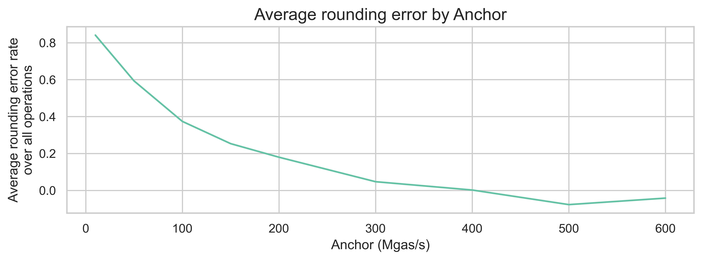
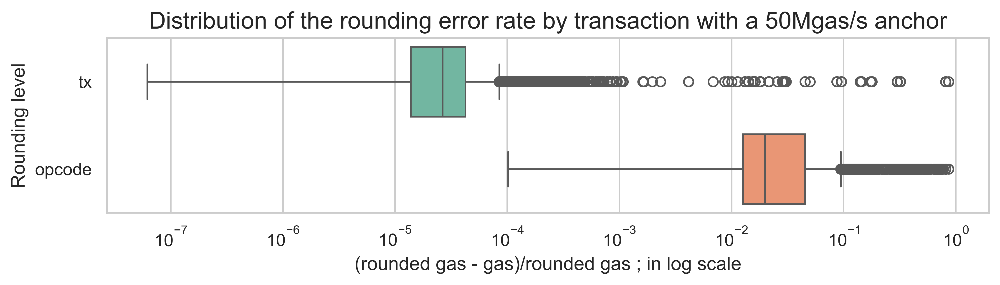

## Abstract

This proposal introduces the `milli-gas` counter as the EVM's internal gas accounting. Gas costs are defined in `milli_gas` and internal EVM gas accounting is entirely carried out in `milli_gas`. At the end of transaction execution, `milli_gas` is rounded up to `gas`. Gas limits and transaction fees are still computed and verified using the current `gas_used` counter. This new counter enables a more precise accounting of cheap compute without impacting UX.

## Motivation

Currently, most EVM compute operations (`ADD`, `SUB`, `MUL`, etc.) are significantly underpriced when compared with state operations (`SSTORE`, `SLOAD`, `CREATE`, etc.). There are two factors contributing to this mismatch. On one hand, client optimizations and hardware improvements have made pure compute operations more efficient. On the other hand, with the growing size of the Ethereum state, the performance of I/O operations touching this larger state has been deteriorating. Both of these trends are expected to continue, further worsening this mismatch.

There are a couple of proposals to reduce the cost of compute operations ([EIP-7904](./eip-7904.md)) and increase the cost of state operations ([EIP-8032](./eip-8032.md), [EIP-8037](./eip-8037.md), and [EIP-8038](./eip-8038.md)). However, given the current level of mismatch between these operations, there is an inherent trade-off in the anchor we use to reprice these operations.

If we make compute operations cheaper, we will introduce rounding errors, with most compute operations costing 1, when they should cost a fraction of that. These rounding errors impact scalability because we can now fit fewer of these cheaper operations in any given block. However, if we price all operations so that the fastest opcode is assigned 1 gas, we would need to make all other operations significantly more expensive, including both compute and state operations. Making everything more expensive would require a rebase on the concept of gas units to users, thus impacting UX.

To illustrate this point, let's focus on the pure compute operations. As compute operations impact only block execution time, the chosen anchor will induce a specific million gas per second rate on all compute opcodes. For instance, if we anchor on `EcRecover` at the current price (3000 gas units), this induces a rate of 175Mgas/s, based on the execution time estimated for this opcode on [EIP-7904's empirical analysis](../assets/eip-7904/gas-cost-estimator-report.pdf). The following plot shows the average rounding errors of compute operations for different anchors, using the same execution time estimates from EIP-7904.



As we can see, with an anchor of 50Mgas/s (which would result in a gas limit of 100Mgas, assuming a 2-second block execution limit), we would get an average rounding error of 59.3%. This means that we could be 59.3% cheaper on average per opcode if we didn't have to round to integer gas units. Only after a 400Mgas/s anchor do we get to reasonably low rounding errors. However, this level of Mgas/s would require a major rebase of the gas model, where all opcodes become significantly more expensive, and both the transaction-level and block-level gas limits increase by a factor of 100.

The way around this trade-off is to allow cheap opcodes to have fractional gas costs, thus avoiding both the scalability limits introduced by rounding errors and the significant UX change of increasing gas costs and limits 100x.

A similar argument was made in [EIP-2045](./eip-2045.md), which served as inspiration to this proposal.

## Specification

This proposal introduces a new `Uint` counter to the EVM, `milli_gas_left`. Gas costs are defined in `milli_gas` and internal EVM gas accounting is entirely carried out in `milli_gas`.

Transaction fees, transaction gas limits, and block gas limits are still computed and verified using the current `gas_used` counter. There are no changes to blob gas accounting, refunds, or call data gas accounting.

### EVM environment

The current `gas_left` variable from the internal state of the EVM is replaced by `milli_gas_left`:

```python
@dataclass
class Evm:
    """The internal state of the virtual machine."""
    pc: Uint
    stack: List[U256]
    memory: bytearray
    code: Bytes
    milli_gas_left: Uint
    valid_jump_destinations: Set[Uint]
    logs: Tuple[Log, ...]
    refund_counter: int
    running: bool
    message: Message
    output: Bytes
    accounts_to_delete: Set[Address]
    return_data: Bytes
    error: Optional[EthereumException]
    accessed_addresses: Set[Address]
    accessed_storage_keys: Set[Tuple[Address, Bytes32]]
```

All references to `evm.gas_left` are replaced by `evm.milli_gas_left`.

### Start-of-transaction conversion

The top-level frame starts with `milli_gas_left = (tx.gas - intrinsic_gas) * 1000`. Intrinsic gas, the calldata floor and all other transaction-level quantities stay in gas units.

### End-of-transaction conversion

At the end of each transaction execution, the gas left in the transaction output is rounded down, so that the gas used is rounded up:

```python
tx_output.gas_left = evm.milli_gas_left // 1000
```

The gas used before refunds is then `tx.gas - tx_output.gas_left`, as before this proposal. A transaction pays for less than one gas of rounding.

### Opcode costs

Opcode gas parameters as defined in the [Ethereum Execution Client Specifications](https://github.com/ethereum/execution-specs/blob/abd7612d2f4d6fcd9f628330f38884b300f0d89f/src/ethereum/forks/osaka/vm/gas.py) that are not updated at the same time or after the introduction of this proposal, are increased by 1000x when they are charged against `milli_gas_left`:

`GAS_PARAM = GAS_PARAM * 1000`

This includes memory expansion, precompile costs and `GAS_CALL_STIPEND`. The refund counter stays in gas units: refund parameters are not multiplied, and the refund cap applies to gas units, as before this proposal.

### Gas that contracts observe

Contracts observe gas in gas units, as before this proposal. Only the internal accounting uses `milli_gas`.

#### `GAS` opcode

The `GAS` opcode pushes the available gas in gas units, rounded down:

```python
push(evm.stack, U256(evm.milli_gas_left // 1000))
```

#### `*CALL` and `CREATE*` opcodes

The gas argument of `CALL`, `CALLCODE`, `DELEGATECALL` and `STATICCALL` is in gas units. It is converted to `milli_gas`. The part that the rule of [EIP-150](./eip-150.md) keeps in the calling frame is computed in whole gas:

```python
# STACK
requested = Uint(pop(evm.stack)) * 1000
available = evm.milli_gas_left - extra_milli_gas
retained = (available // 1000) // 64 * 1000
message_call_milli_gas = min(requested, available - retained)
```

`CREATE` and `CREATE2` forward `available - retained`, with `retained` computed in the same way. When `available` is a multiple of 1000, the child gets the same gas as before this proposal. The call stipend, `GAS_CALL_STIPEND * 1000`, is added to the child's `milli_gas` as before. When a child frame returns, its unused `milli_gas` is returned to the parent exactly, with no rounding.

#### `SSTORE` stipend check

The check of [EIP-2200](./eip-2200.md) compares `milli_gas_left` with `GAS_CALL_STIPEND * 1000`. Thus a frame that has the 2,300-gas stipend and nothing else still cannot execute `SSTORE`.

#### Quantities derived from the gas of a frame

A rule that computes a value from the gas of a frame uses `milli_gas / 1000` without rounding, and rounds down only the final value. For example, a per-frame limit of the form `child_gas * a // b` becomes `child_milli_gas * a // (b * 1000)`. When `child_milli_gas` is a multiple of 1000, the value is the same as before this proposal.

### Interaction with EIP-8037

When [EIP-8037](./eip-8037.md) is active, `milli_gas_left` replaces its `gas_left`. The other counters of [EIP-8037](./eip-8037.md) stay in gas units: `state_gas_reservoir`, `evm_state_gas_used` and the snapshots of both. The amount of each state-gas charge stays in gas.

The split at the start of the transaction is computed in gas, and `gas_left` is then converted:

```python
evm_gas = tx.gas - intrinsic_gas
execution_gas_budget = TX_MAX_GAS_LIMIT - intrinsic_gas
gas_left = min(execution_gas_budget, evm_gas)
milli_gas_left = gas_left * 1000
state_gas_reservoir = evm_gas - gas_left
```

The charges of the pre-execution phase of [EIP-2780](./eip-2780.md) are amounts in gas. The parts that `gas_left` pays are deducted from `milli_gas_left`, multiplied by 1000. If the transaction fails before the top-level frame starts, `milli_gas_left` is set to 0.

A state-gas charge is paid in the order of [EIP-8037](./eip-8037.md), with the parts that `gas_left` pays converted to `milli_gas`:

```python
def charge_state_gas(evm, amount, legacy_share):
    if evm.milli_gas_left < legacy_share * 1000:
        raise OutOfGasError
    evm.milli_gas_left -= legacy_share * 1000

    rest = amount - legacy_share
    from_reservoir = min(rest, evm.state_gas_reservoir)
    evm.state_gas_reservoir -= from_reservoir
    rest -= from_reservoir

    if evm.milli_gas_left < rest * 1000:
        raise OutOfGasError
    evm.milli_gas_left -= rest * 1000
    evm.evm_state_gas_used += amount
```

Refills, reverts and exceptional halts follow [EIP-8037](./eip-8037.md) without change. A refill and the credit of a revert go to `state_gas_reservoir`, in gas, and never to `milli_gas_left`. An exceptional halt consumes the frame's `milli_gas_left`. `GAS` and the `SSTORE` stipend check do not include the reservoir, as in [EIP-8037](./eip-8037.md).

At the end of the transaction, `tx_output.gas_left = evm.milli_gas_left // 1000`, and all other rules of [EIP-8037](./eip-8037.md) apply in gas units. `evm_state_gas_used` is an exact amount of gas, so the rounding goes only to the execution-gas dimension.

A system call starts with `milli_gas_left = 30_000_000 * 1000` and the `state_gas_reservoir` of [EIP-8037](./eip-8037.md), in gas.

## Rationale

### New counter vs. new variable type

A possible approach to allow for fractional gas would be to change the variable type of all gas-related variables from an integer to a float or a base fractional. Although simple in concept, the implementation of such a change in the EVM is not trivial. In addition, introducing fractional variables would make moving to a zkEVM significantly more complex.

Thus, introducing a new counter is the option that least disrupts the current EVM implementation, while allowing for expressive gas costs.

### Rounding at transaction-level

With the introduction of a new counter, there are two levels at which we could convert `milli_gas` to `gas`: at the transaction level or the block level. Conversion at the block level results in the fewest rounding errors in block utilization. However, it requires a bigger change to implement, as `milli_gas` will need to be used when computing transaction fees and limits, and `milli_gas` will need to be incorporated in the block environment.

The question is whether a conversion at the transaction level is sufficient to reduce rounding errors. To estimate this, we extracted the opcode counts per transaction for 1000 mainnet blocks and computed the new gas prices of all compute operations assuming an anchor of 50Mgas/s and the estimated execution times from [EIP-7904's empirical analysis](../assets/eip-7904/gas-cost-estimator-report.pdf). With this repricing, the fastest opcode (`JUMPDEST`) would be priced at 90 milli-gas units (i.e., 0.09 gas units). We also assumed that the non-compute operations and precompiles would have the same price, and we excluded any other transaction costs, such as intrinsic costs and calldata.

Then, we computed the rounding error of each transaction, assuming a conversion at both the transaction and opcode levels. The opcode-level conversion is equivalent to not using fractional gas and rounding all opcodes to an integer. The following plot shows the distribution for both errors. The x-axis is on a logarithmic scale.



In this sample of 1000 blocks, a transaction-level conversion has already successfully reduced the rounding errors from an average of 4% to 0.05% per transaction.

### Gas units at the contract boundary

Deployed contracts use gas in three ways: they read `GAS`, they pass a gas argument to calls, and they rely on the 2,300-gas stipend. If `GAS` returned `milli_gas` while call arguments stayed in gas units, these uses would disagree. For example, a contract that forwards `gasleft() - 5000` would keep a reserve of 5 gas instead of 5,000. A check such as `gasleft() < gasRequired / 63` would become 1000 times looser, and a failure handler could then record an out-of-gas failure as a logic error.

So all three stay in gas units, and only the internal counter changes. A contract can then see a difference only where a cost changes. If the costs that change only go down, as in [EIP-7904](./eip-7904.md), every gas budget that was sufficient before this proposal stays sufficient. This is the safe direction for repricing: a deployed contract cannot be made to run out of gas by a price decrease.

`GAS` rounds down, so a contract never sees more gas than it has. Two `GAS` reads around cheap operations can return the same value. The end-of-transaction conversion rounds the charge up, so no transaction gets fractional work for free.

### State-gas of EIP-8037 stays in gas units

Every state-gas charge of [EIP-8037](./eip-8037.md) is a whole multiple of its cost per state byte, so `milli_gas` gives it no precision. In gas units, the reservoir, the state-gas used and the snapshots stay exact, and a value that a contract reads from the reservoir has the same unit as `GAS`. The only rounding is at the end of the transaction.

## Backwards Compatibility

This is a backwards incompatible gas repricing that requires a scheduled network upgrade.

Contracts see gas in gas units, as before this proposal: `GAS`, the gas argument of calls and the call stipend keep their meaning. Without a change in costs, every charge is a whole number of gas and `milli_gas_left` is always a multiple of 1000, so a transaction has the same result and the same gas used as before this proposal. With costs in `milli_gas`, a contract sees only the cost changes themselves.

Tools that trace execution need to choose how to report fractional costs and gas. Tracers SHOULD report gas and costs in gas units, and MAY add the `milli_gas` values.

## Security Considerations

Lowering costs, which this proposal makes possible, has effects that contracts can observe:

- A failure handler whose cost is mostly compute becomes cheaper, so a handler that ran out of gas before a decrease can complete after it. Handlers that write storage or emit logs are dominated by operations whose cost does not go down.
- A loop that runs until `gasleft()` is low runs more iterations. The work per transaction and per block stays limited by the gas limits, which the repricing sets so that gas follows execution time.
- A callee with only the 2,300-gas stipend can run more compute. It still cannot write storage (the check of [EIP-2200](./eip-2200.md)), and the costs of calls and logs do not change.
- When compute costs go down, each transaction uses less gas, so more transactions fit in a block. Each of these transactions creates as much state as before, so the share of block gas spent on state creation increases. This proposal does not limit state growth. With [EIP-8037](./eip-8037.md), the state-gas dimension limits it, whatever the execution-gas costs.

The rounding of `GAS` cannot give a contract more gas than it has, and the end-of-transaction rounding cannot give a transaction free work.

## Copyright

Copyright and related rights waived via [CC0](../LICENSE.md).
