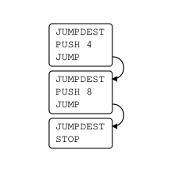
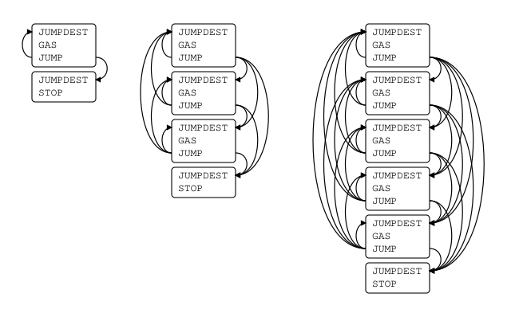

## Abstract

This Informational EIP provides background for understanding control flow in the Ethereum Virtual Machine (EVM): the history of control flow in computing, the foundations of control flow analysis, and the impact of static control flow on Ethereum's scaling roadmap.

This document serves as background material for proposals for static control flow — past and current proposals for subroutines and static jumps, container-format functions, call and return opcodes, and static relative jumps and calls — for discussions around RISC-V migration and zero-knowledge (ZK) verification infrastructure, and for discussions still to come.

## Motivation

### Historical Context

#### Babbage 1833: Jumps and Conditional Jumps

In 1833 Charles Babbage began the design of the Analytical Engine: a steam-powered, mechanical, Turing-complete computer.  Programs were to be encoded on punched cards that controlled a system of rods, gears, and other machinery to implement arithmetic, storage (for 1,000 40-digit decimal numbers), and conditional jumps.  Jumps were supported by cards that shuffled the card deck forwards or backwards a fixed number of cards.

#### Lovelace 1843: Computer Science and Machine Intelligence

The first published description of the Analytical Engine was in French, by L. F. Menabrea, 1842[^1]. The English translator, Ada Augusta, Countess of Lovelace, made extensive notes on the science of computer programming, and published her translation in 1843. The notes include her famous program for iteratively computing Bernoulli numbers — arguably the world's first complete computer program — which used conditional jumps to implement the required nested loops.

In Lady Lovelace's notes we also find her prescient recognition of the Analytical Engine's power — "In enabling mechanism to combine together general symbols in successions of unlimited variety and extent, a uniting link is established between the operations of matter and the abstract mental processes of the most abstract branch of mathematical science."[^1]  Here also we find what Alan Turing later called "Lady Lovelace's Objection"[^2] to the possibility of machine intelligence — "It can do whatever we know how to order it to perform. It can follow analysis; but it has no power of anticipating any analytical relations or truths. Its province is to assist us in making available what we are already acquainted with."[^1]

#### Turing 1946: Calls and Returns

In 1945 Alan Turing began designing his Automatic Computing Engine[^3] (ACE), completing the proposal in early 1946, in which he introduced the concept of calls and returns: _"To start on a subsidiary operation we need only make a note of where we left off the major operation and then apply the first instruction of the subsidiary. When the subsidiary is over we look up the note and continue with the major operation."_

The ACE used mercury delay-line memory, including a return stack holding return addresses.  The smaller Pilot ACE was for a time the world's fastest computer.

#### Industry Practice: 1945 to present

Call and return facilities have proven their worth across eighty years of important machines — under various names (subroutines, procedures, functions, methods) and at various levels of complexity (link registers, return stacks, stack frames).  The machines I have programmed or implemented cover much of that line: the Burroughs B5000, CDC 7600, IBM 360, PDP-11, VAX, Motorola 68000, and Intel x86 among physical machines, and virtual machines for Scheme, Forth, Pascal, Java, and WebAssembly.

The designs differ chiefly in where the return address lives.  Cray's CDC machines used the self-modifying code of the old Wheeler jump — plant a branch back to the caller in the callee's own code — at the cost of recursion and shared code; the Cray-1 abandoned it for a link register, like the IBM 360 before it and ARM and RISC-V since: keep the return address in a register, and return with a branch through it.  The PDP-11, VAX, 68000, and x86 push return addresses onto the same stack as data — the stack-frame design that C made universal, and that stack-smashing exploits have abused ever since, precisely because return addresses live where data can overwrite them.  The Burroughs B5000 gave its stack frames hardware protection — and did it in 1961, before almost every machine above; it was built for Algol 60, the language famously ahead not only of its predecessors but of nearly all its successors.  And Forth, like Turing's ACE, keeps a separate return stack, sealed off from data — the design adopted by the proposals discussed below.  The Java Virtual Machine (JVM) in effect does the same: bytecode can never touch a return address.  So does .NET's Common Language Runtime (CLR) — except in the _unverifiable_ code that supports C/C++.

Physical machines can afford these differences because they are built for performance all the way down to the silicon, and they will happily sacrifice static control flow to get it: every return design above — planted branch, link register, stack frame — is a jump through a runtime value, and hardware only executes — it never analyzes — so such a return costs nothing but the cycle it takes.  A virtual machine that trusts its code can interpret just as freely: Forth validates nothing.  Untrusted code is another matter.  It must be validated before it runs, and compiled if it is to run fast, and both are analysis, paid for in software.  The virtual machines built to run untrusted code — the JVM, the CLR, and WebAssembly (Wasm) — chose static control flow for exactly that reason.  They share three crucial properties:

* portable bytecode that can be directly interpreted
* static control flow that can be validated before runtime
* compilation to machine code at runtime, in _linear time_

The static control flow that supports linear-time compilers equally supports any other tool that must traverse the control flow of a program: each edge need be traversed only once.

A native call and return is likewise the norm — in the general-purpose VMs (the JVM's `invoke` family, the CLR's `call`, Wasm's `call`) and across the smart-contract world: the Wasm chains (NEAR, Polkadot, Cosmos, the Internet Computer), Move's `Call` and `Ret`, Cairo and the RISC-V zkVMs, TON's continuations, and the lambda-based Michelson and Plutus, where every application is a call.  The exceptions are telling.  Some script VMs forgo jumps altogether to stay trivially analyzable — Bitcoin Script has no jump, no call, no loop.  And the VMs that began with jumps alone and left calls to be synthesized have bolted subroutines on since, their verifiers and analyzers demanding it: Algorand's TEAL added `callsub` and `retsub` in 2021, eBPF added function calls in 2018, and the EVM's own container-format attempt is among the proposals this document serves.  The EVM deployed today remains the outlier: untrusted code, synthesized calls, dynamic jumps.  The rest of this document counts the cost.

### Control Flow

Tools that must know what code does have to follow where control can go: traverse the code, taking every jump.  How much such a traversal costs — and whether it is possible at all — depends on the code's control flow.  The EVM makes it cost more than it should.

#### Control Flow Graphs

The map of where control can go in a program is its _control flow graph (CFG)_:

* _Nodes_ are the _blocks_ of code: runs of instructions with one entry and one exit
* _Edges_ are the possible moves between blocks: each jump to its destinations, each fall-through to the next block

A jump whose destination is known before execution is _static_; a jump that takes its destination from the stack at runtime is _dynamic_.  Code has _static control flow_ when every jump is static.  A _path_ is one route through the graph from the start; every execution follows some path.

The difference is visible in the smallest pair — two blocks each, the left static, the right dynamic:

```
   jumpdest          jumpdest
   push 4            gas
   jump              jump
   jumpdest          jumpdest
   stop              stop
```

The static jump can land only at 4: one edge, one path.  The dynamic jump may land on either `jumpdest` — two edges from a single jump, and nothing in the code says which.

A _complete and sound CFG_ represents all and only the possible paths of program execution and is a fundamental starting point for many downstream tasks, including many static analyses:

* validating bytecode before execution
* translating bytecode to other representations (virtual register code, machine code)
* automated formal security analysis
* and many more

An example, a chain of three blocks:

```
   jumpdest
   push 4
   jump
   jumpdest
   push 8
   jump
   jumpdest
   stop
```

Three nodes and two edges: each jump's destination is pushed right beside it, so each jump contributes exactly one edge, and the graph has one path.



The sections below are about code where the destinations are not known.

#### Dynamic Control Flow

Dynamic jumps can make static analysis of control difficult to impossible.  Physical machines, as we saw, run on dynamic jumps — every x86 return pops an address off the stack and jumps to it — which is why recovering the control flow of machine code remains hard to this day.  Virtual machines validate their code when loading it, and often feed it to just-in-time compilers (JITs) and other downstream tools — and as we will show below, building and traversing a dynamic control flow graph can take quadratic space and time.  So the JVM and Wasm do not support dynamic jumps, and the CLR carefully restricts its own.

#### EVM: Calls and Returns

The Ethereum Virtual Machine does _not_ provide explicit facilities for calls and returns within a contract — `CALL` and its kin invoke _other_ contracts.  Instead, compilers _must_ synthesize internal calls with the dynamic `JUMP`: the return address is pushed as ordinary data, carried on the stack, and jumped to when the routine is done.  So dynamic jumps are not exotic — every internal function call in every deployed contract is one, and its destination is data.  A tool that must know where a return goes — to price it, to prove it safe, to decompile it — walks the code computing facts in place of values, _symbolic execution_, and must walk every return point the jump might reach.  Every routine shared by two callers doubles the walks: twenty calls is a million — what the literature calls a _path explosion_.  With explicit calls and returns there is nothing to guess: every return goes back to its call.  One walk, one answer.  A mechanical demonstration — a walker counting its walks over the same programs written both ways — accompanies this EIP in its [assets](../assets/eip-8173/walk-count/).

#### EVM: Any Jump, Anywhere

A return at least has candidates — a compiler's labels are good guesses.  When the destination is computed there are no candidates at all, and the walker must assume what the machine allows: _any_ jump may go to _any_ destination in the code.  Consider these EVM programs and the easily generated series of longer programs like them … the really long ones make for nice exploits.  `gas` pushes the gas remaining; it's not important that at runtime this isn't random or that the `jump` will most often fail; what matters is that because the jump destination is taken from the stack it is impossible to know _a priori_ where the jumps go, so every path must be explored.

```
   jumpdest           jumpdest          jumpdest          ...
   gas                gas               gas               ...
   jump               jump              jump              ...
   jumpdest           jumpdest          jumpdest          ...
   gas                gas               gas               ...
   jump               jump              jump              ...
   jumpdest           jumpdest          jumpdest          ...
   stop               gas               gas               ...
                      jump              jump              ...
                      jumpdest          jumpdest          ...
                      stop              gas               ...
                                        jump              ...
                                        jumpdest          ...
                                        stop              ...
                                                          ...
```

The control flow graphs for these programs make the problem clear.  Each node is a block from the programs above — one entry (a `jumpdest`), one exit (a `jump`, or the final `stop`) — and each edge is a move the machine might make.  Edges on the left are backwards branches; edges on the right are forwards branches.  See how the tangle of edges goes up fast, faster than the programs get longer.



Merely _traversing_ this graph is quadratic in the size of the code: every block's `jump` might reach every block's `jumpdest`, so the number of edges is the number of jumps times the number of destinations — quadratic, O(N²).  Any tool that must consider where jumps can go pays that price whether it actually draws the graph or not.  _Walking_ the paths costs far more.  A tool that must follow all of the paths forks its walk at every jump whose destination it cannot know, and the forks compound: the number of walks can grow exponentially or, worse, factorially in the size of the code — O(eᴺ) or O(N!).  Counting the walks for the programs above needs no more walker than this:

```python
def count_walks(code):
    dests = [pc for pc, op in enumerate(code) if op == 0x5B]   # JUMPDEST
    walks = 0
    work = [(0, frozenset())]                                  # a walk: position, visited
    while work:
        pc, seen = work.pop()
        if pc >= len(code) or code[pc] == 0x00 or pc in seen:  # end, STOP, or a loop: count it
            walks += 1
        elif code[pc] == 0x56:                                 # JUMP: the destination is data,
            work += [(d, seen | {pc}) for d in dests]          # so fork to every JUMPDEST
        else:
            work.append((pc + 1, seen | {pc}))
    return walks
```

Fed the smallest ladder — one jumping block and the stop block, bytes `5B 5A 56 5B 00` — it returns 2 walks:

```
0 → 0
0 → 3
```

Fed the first program above — bytes `5B 5A 56 5B 5A 56 5B 00` — it returns 5:

```
0 → 0
0 → 3 → 0
0 → 3 → 3
0 → 3 → 6
0 → 6
```

Every walk forks at its jump to all N `jumpdest`s.  One fork finds the stop; the forks into blocks already seen are abandoned; the fresh blocks — one fewer at every depth — walk on.  The shrinking choices multiply into the factorial, and the walks that end at every depth along the way sum into the e: ⌊e·(N−1)!⌋ walks for N blocks.  The next ladder counts 16 walks, the one after 65; thirty-two bytes already cost ten million.  A traversal is the same dozen lines with one change — the `seen` set shared by all walks, so each edge is followed at most once: that is the quadratic cost above.  The walker's per-walk `seen` is the factorial one.

In the JVM, Wasm, and the CLR it is simply impossible to have programs like these.

For Ethereum, these behaviors are a _denial-of-service vulnerability_ for any online static analysis, including bytecode validation and ahead-of-time (AOT) compilation at contract creation time, and JIT compilation at runtime.

Even offline, dynamic jumps (and the lack of calls and returns) can cause static analyses of many contracts to become quadratically impractical, exponentially intractable, or even mathematically impossible.  The problem lies where several fields meet — graph theory, compilers, languages, virtual machines, security — each naming the same things differently.  For further examples, consider these abstracts from a few recent papers on the problem.  The last paper brings neural networks to bear, and still disassembles only most Solidity programs.  There is an entire academic literature of complex, incomplete solutions to problems that static control flow renders trivial.

> "Ethereum smart contracts are distributed programs running on top of the Ethereum blockchain. Since program flaws can cause significant monetary losses and can hardly be fixed due to the immutable nature of the blockchain, there is a strong need of automated analysis tools which provide formal security guarantees. Designing such analyzers, however, proved to be challenging and error-prone."[^4]
>
> "The EVM language is a simple stack-based language ... with one significant difference between the EVM and other virtual machine languages (like Java bytecode or CLI for .Net programs): the use of the stack for saving the jump addresses instead of having it explicit in the code of the jumping instructions. Static analyzers need the complete control flow graph (CFG) of the EVM program in order to be able to represent all its execution paths."[^5]
>
> "Static analysis approaches mostly face the challenge of analyzing compiled Ethereum bytecode... However, due to the intrinsic complexity of Ethereum bytecode (especially in jump resolution), static analysis encounters significant obstacles."[^6]
>
> "Analyzing contract binaries is vital ... comprising function entry identification and detecting its boundaries... Unfortunately, it is challenging to identify functions ... due to the lack of internal function call statements."[^7]

In my experience, to avoid the problems of dynamic control flow, VMs use static jumps, calls, and returns.

### Static Control Flow and Ethereum Scaling

[As laid out above](#control-flow-graphs), _static control flow_ means that the destination of every jump or call is determinable _a priori_, before execution.  This has concrete implications for Ethereum's scaling roadmap, particularly around ZK verification, rollups, and future execution layer changes.

#### Static Control Flow and Rollups

##### ZK-Rollups

To understand why static control flow matters for ZK-Rollups[^8], we need to briefly understand how ZK systems verify computation:

* _Execution Traces:_ When a transaction executes, it produces an execution trace: a concrete, step-by-step record of every opcode executed, with the values of the stack, memory, and storage at each step.  The trace records what actually happened — including exactly where every jump went — so it is always linear in the number of steps executed.
* _Circuits:_ A circuit is a mathematical model of a computation.  For a ZK system, the circuit encodes the rules of the EVM: what states can follow from what prior states, how gas is consumed, which memory accesses are valid, etc.  The circuit is a set of polynomial constraints that must all be satisfied.  Crucially, the circuit encodes the _rules_ for each opcode type (including the rule for JUMP), not the specific paths taken by any particular execution.
* _Witnesses:_ The witness is the private data the prover supplies to demonstrate that a specific execution was correct.  It includes the execution trace itself plus auxiliary data.  The public inputs are the pre- and post-state roots — what the state was before and after the transaction.
* _Proofs:_ A ZK proof is a cryptographic proof that the witness satisfies the circuit's constraints, without revealing the witness itself — though for rollups the value is succinctness: the proof is small and quick to verify, and the privacy in the name is incidental.

A ZK-Rollup sequencer or prover batches many transactions, generates a ZK proof that all transactions executed correctly, and submits that proof to layer 1 (L1), where it is quickly verified.  The prover works from the _actual_ execution trace — it does not explore or enumerate possible paths.  The jump destinations are already known because they were recorded when the transaction ran.

The benefits of static control flow for ZK proving are therefore not about path exploration, but about the efficiency of the code being proven and the tractability of the analyses that surround it:

* _Compiled, not interpreted, execution:_ Today's zkVMs prove RISC-V programs, and run the EVM the only way they can — as an interpreter, itself compiled to RISC-V.  Code with static control flow can instead be compiled to RISC-V, once, in linear time, and the prover pays per instruction actually executed — a cost comparable to a contract written directly in RISC-V, with the interpreter's overhead gone from every step.
* _Leaner bytecode:_ Static jumps, explicit subroutine calls, and better stack discipline (eliminating SWAP/DUP workarounds) produce smaller and simpler bytecode.  The prover must process every opcode executed, so fewer opcodes mean less work — a modest gain next to compilation, but one every prover collects.
* _Deployment-time validation:_ With static control flow, bytecode can be fully validated once at deployment in linear time — including stack underflow, static stack depths, and reachability — rather than requiring expensive per-execution checks or quadratic offline analysis.  The O(N²) CFG problem [described above](#evm-any-jump-anywhere) is paid before legacy EVM code can be compiled or formally modeled: building its CFG is quadratic work that static control flow makes linear.
* _Faster proof generation and lower hardware requirements_ follow directly from the above: fewer instructions to prove and cheaper analysis reduce the compute and memory demands on rollup provers.

##### Optimistic Rollups

_Optimistic Rollups_ assume transactions are valid but allow fraud proofs to dispute invalid state roots.  A fraud proof re-executes the contested transaction and demonstrates that the submitted state root was wrong.  Key implications of static control flow include:

* _Bytecode validation:_ Static control flow allows contract bytecode to be fully validated at deployment in linear time, establishing safety properties that can be relied on during dispute resolution.
* _Dispute resolution:_ When a fraud dispute arises, the dispute system must re-execute the contested transaction.  The re-execution itself is deterministic regardless of control flow style, but static control flow makes the surrounding machinery — validators, formal checkers, and the interactive verification game — simpler to implement correctly and easier to reason about.
* _Interactive verification:_ Some optimistic rollup designs use multi-round interactive verification games that bisect execution to identify the disputed step.  Clear, structured control flow makes the bisection protocol more tractable and reduces the risk of edge cases in the dispute game implementation.

#### Static Control Flow and Code Generation

As already discussed, static control flow enables contracts to be compiled to machine code before execution, just-in-time or ahead-of-time.  This is an obvious win for non-ZK clients, whether on L1, layer 2 (L2), or EVM-compatible chains.

#### Static Control Flow and RISC-V Migration

There are ongoing discussions within the Ethereum research community about potentially replacing the EVM with a RISC-V execution environment.  RISC-V has a standard instruction set architecture that is seeing increasing use in the ZK community.  One current strategy for creating a ZK-EVM is to compile an EVM interpreter like revm to RISC-V for use in a zkVM.  Supporting RISC-V directly eliminates the overhead of the EVM interpreter.  An EVM with static control flow opens up another strategy — compile the EVM code to RISC-V code.  That gives good RISC-V code in one linear-time pass, and better code in multiple passes, altogether linear time.

A missing piece in this puzzle is that RISC-V is a 32-bit or 64-bit architecture, but the current EVM is a 256-bit architecture.  For that purpose there are current proposals for 64-bit EVM opcodes.  It's also the case that newer proof systems can charge for only the bits actually used[^9], which may in time blunt the width problem.  Today's zkVMs, though, pay the full 256-bit cost of every instruction executed, however few bits its values need.

## Specification

Several EIPs, past and current, specify new EVM opcodes and semantics for static control flow: subroutines and static jumps, container-format functions, call and return opcodes, and static relative jumps and calls.  They are all implemented with the standard Turing return stack architecture, and are for the most part compatible with each other.  In particular, the simplest of them — three call and return opcodes — can be used to implement all of the others.

## Rationale

Static control flow has been a cornerstone of efficient computation since Babbage and Turing.  The EVM's reliance on dynamic jumps is an anomaly among virtual machines and a significant barrier to analysis, compilation, and scaling.  Proposals to introduce explicit call/return opcodes and enforce static control flow bring the EVM in line with industry best practices and unlock a range of optimizations critical to Ethereum's scaling roadmap.

Static control flow is not a silver bullet.  But it is a _foundational piece_ that enables:

* Better tooling and security analysis for language developers and auditors
* Faster execution via compilation for non-ZK clients
* Future migrations to other execution environments (RISC-V, etc.)
* Efficient ZK proof generation for ZK-Rollups
* Cleaner fraud proofs for Optimistic Rollups

By making control flow explicit and enforceable, the EVM becomes compatible with the full ecosystem of optimization and analysis techniques that other VMs and processor designs have relied on for decades.

## Security Considerations

This Informational proposal itself specifies no changes to the protocol.  Therefore it has no direct security implications.  It does not affect the security considerations of the proposals it describes; rather, it helps to motivate and contextualize them.

<!--

[^1]: Menabrea, L.F. Sketch of the Analytical Engine Invented by Charles Babbage. Bibliothèque Universelle de Genève, No. 82, October 1842. Translation with Notes by the Translator [Ada Augusta, Countess of Lovelace]. Scientific Memoirs, Vol. 3, 1843, pp. 666–731.
[^2]: Turing, A.M. Computing Machinery and Intelligence. Mind, Volume LIX, Issue 236, October 1950
[^3]: Carpenter, B.E. and Doran, R.W. The other Turing machine. The Computer Journal, Volume 20, Issue 3, January 1977. DOI: 10.1093/comjnl/20.3.269
[^4]: Schneidewind, Clara, Scherer, Markus, and Maffei, Matteo. The Good, the Bad and the Ugly: Pitfalls and Best Practices in Automated Sound Static Analysis of Ethereum Smart Contracts. DOI: 10.48550/arXiv.2101.05735
[^5]: Albert, Elvira, Correas, Jesús, Gordillo, Pablo, Hernández-Cerezo, Alejandro, Román-Díez, Guillermo, and Rubio, Albert. Analyzing Smart Contracts: From EVM to a Sound Control Flow Graph. DOI: 10.48550/arXiv.2004.14437
[^6]: Contro, Filippo, Crosara, Marco, Ceccato, Mariano, and Dalla Preda, Mila. EtherSolve: Computing an Accurate Control Flow Graph from Ethereum Bytecode. DOI: 10.48550/arXiv.2103.09113
[^7]: He, Jiahao, Li, Shuangyin, Wang, Xinming, Cheung, Shing-Chi, Zhao, Gansen, and Yang, Jinji. Neural-FEBI: Accurate Function Identification in Ethereum Virtual Machine Bytecode. DOI: 10.48550/arXiv.2301.12695
[^8]: Thibault, Louis Tremblay, Sarry, Tom, and Hafid, Abdelhakim Senhaji. Blockchain Scaling Using Rollups: A Comprehensive Survey. IEEE Access, Volume 10, 2022, pp. 93039-93054. DOI: 10.1109/ACCESS.2022.3200051
[^9]: Diamond, Benjamin E. and Posen, Jim. Succinct Arguments over Towers of Binary Fields. Advances in Cryptology - EUROCRYPT 2025, LNCS 15604. DOI: 10.1007/978-3-031-91134-7_4

-->

<!-- markdownlint-capture -->
<!-- markdownlint-disable code-block-style -->

[^1]:
    ```csl-json
    {
      "type": "article-journal",
      "id": 1,
      "author": [
        {
          "family": "Menabrea",
          "given": "L.F."
        }
      ],
      "translator": [
        {
          "family": "Lovelace",
          "given": "Ada Augusta"
        }
      ],
      "title": "Sketch of the Analytical Engine Invented by Charles Babbage.",
      "container-title": "Scientific Memoirs",
      "volume": "3",
      "page": "666-731",
      "issued": {
        "date-parts": [
          [
            1843
          ]
        ]
      },
      "original-date": {
        "date-parts": [
          [
            1842,
            10,
            1
          ]
        ]
      },
      "DOI": "10.1145/2809523.2809528",
      "URL": "https://doi.org/10.1145/2809523.2809528"
    }
    ```

[^2]:
    ```csl-json
    {
      "type": "article-journal",
      "id": 2,
      "author": [
        {
          "family": "Turing",
          "given": "A.M."
        }
      ],
      "title": "Computing Machinery and Intelligence.",
      "container-title": "Mind",
      "volume": "LIX",
      "issue": "236",
      "page": "433-460",
      "issued": {
        "date-parts": [
          [
            1950,
            10
          ]
        ]
      },
      "DOI": "10.1093/mind/LIX.236.433",
      "URL": "https://doi.org/10.1093/mind/LIX.236.433"
    }
    ```

[^3]:
    ```csl-json
    {
      "type": "article-journal",
      "id": 3,
      "author": [
        {
          "family": "Carpenter",
          "given": "B.E."
        },
        {
          "family": "Doran",
          "given": "R.W."
        }
      ],
      "title": "The other Turing machine.",
      "container-title": "The Computer Journal",
      "volume": "20",
      "issue": "3",
      "page": "269-279",
      "issued": {
        "date-parts": [
          [
            1977
          ]
        ]
      },
      "DOI": "10.1093/comjnl/20.3.269",
      "URL": "https://doi.org/10.1093/comjnl/20.3.269"
    }
    ```

[^4]:
    ```csl-json
    {
      "type": "article",
      "id": 4,
      "author": [
        {
          "family": "Schneidewind",
          "given": "Clara"
        },
        {
          "family": "Scherer",
          "given": "Markus"
        },
        {
          "family": "Maffei",
          "given": "Matteo"
        }
      ],
      "title": "The Good, the Bad and the Ugly: Pitfalls and Best Practices in Automated Sound Static Analysis of Ethereum Smart Contracts.",
      "issued": {
        "date-parts": [
          [
            2021,
            1,
            14
          ]
        ]
      },
      "DOI": "10.48550/arXiv.2101.05735",
      "URL": "https://arxiv.org/abs/2101.05735"
    }
    ```

[^5]:
    ```csl-json
    {
      "type": "article",
      "id": 5,
      "author": [
        {
          "family": "Albert",
          "given": "Elvira"
        },
        {
          "family": "Correas",
          "given": "Jesús"
        },
        {
          "family": "Gordillo",
          "given": "Pablo"
        },
        {
          "family": "Hernández-Cerezo",
          "given": "Alejandro"
        },
        {
          "family": "Román-Díez",
          "given": "Guillermo"
        },
        {
          "family": "Rubio",
          "given": "Albert"
        }
      ],
      "title": "Analyzing Smart Contracts: From EVM to a Sound Control Flow Graph.",
      "issued": {
        "date-parts": [
          [
            2020,
            4,
            29
          ]
        ]
      },
      "DOI": "10.48550/arXiv.2004.14437",
      "URL": "https://arxiv.org/abs/2004.14437"
    }
    ```

[^6]:
    ```csl-json
    {
      "type": "article",
      "id": 6,
      "author": [
        {
          "family": "Contro",
          "given": "Filippo"
        },
        {
          "family": "Crosara",
          "given": "Marco"
        },
        {
          "family": "Ceccato",
          "given": "Mariano"
        },
        {
          "family": "Dalla Preda",
          "given": "Mila"
        }
      ],
      "title": "EtherSolve: Computing an Accurate Control Flow Graph from Ethereum Bytecode.",
      "issued": {
        "date-parts": [
          [
            2021,
            3,
            16
          ]
        ]
      },
      "DOI": "10.48550/arXiv.2103.09113",
      "URL": "https://arxiv.org/abs/2103.09113"
    }
    ```

[^7]:
    ```csl-json
    {
      "type": "article",
      "id": 7,
      "author": [
        {
          "family": "He",
          "given": "Jiahao"
        },
        {
          "family": "Li",
          "given": "Shuangyin"
        },
        {
          "family": "Wang",
          "given": "Xinming"
        },
        {
          "family": "Cheung",
          "given": "Shing-Chi"
        },
        {
          "family": "Zhao",
          "given": "Gansen"
        },
        {
          "family": "Yang",
          "given": "Jinji"
        }
      ],
      "title": "Neural-FEBI: Accurate Function Identification in Ethereum Virtual Machine Bytecode.",
      "issued": {
        "date-parts": [
          [
            2023,
            1,
            30
          ]
        ]
      },
      "DOI": "10.48550/arXiv.2301.12695",
      "URL": "https://arxiv.org/abs/2301.12695"
    }
    ```

[^8]:
    ```csl-json
    {
      "type": "article-journal",
      "id": 8,
      "author": [
        {
          "family": "Thibault",
          "given": "Louis Tremblay"
        },
        {
          "family": "Sarry",
          "given": "Tom"
        },
        {
          "family": "Hafid",
          "given": "Abdelhakim Senhaji"
        }
      ],
      "title": "Blockchain Scaling Using Rollups: A Comprehensive Survey.",
      "container-title": "IEEE Access",
      "volume": "10",
      "page": "93039-93054",
      "issued": {
        "date-parts": [
          [
            2022
          ]
        ]
      },
      "DOI": "10.1109/ACCESS.2022.3200051",
      "URL": "https://doi.org/10.1109/ACCESS.2022.3200051"
    }
    ```

[^9]:
    ```csl-json
    {
      "type": "paper-conference",
      "id": 9,
      "author": [
        {
          "family": "Diamond",
          "given": "Benjamin E."
        },
        {
          "family": "Posen",
          "given": "Jim"
        }
      ],
      "title": "Succinct Arguments over Towers of Binary Fields.",
      "container-title": "Advances in Cryptology – EUROCRYPT 2025",
      "collection-title": "Lecture Notes in Computer Science",
      "volume": "15604",
      "issued": {
        "date-parts": [
          [
            2025
          ]
        ]
      },
      "DOI": "10.1007/978-3-031-91134-7_4",
      "URL": "https://doi.org/10.1007/978-3-031-91134-7_4"
    }
    ```

<!-- markdownlint-restore -->

## Copyright

Copyright and related rights waived via [CC0](../LICENSE.md).
