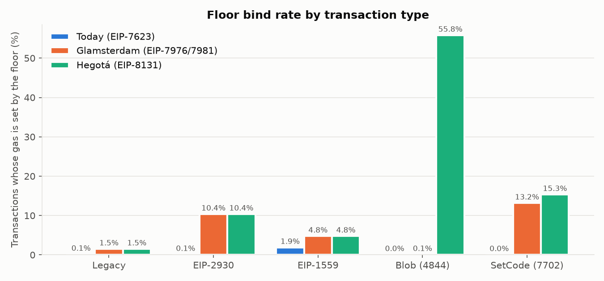
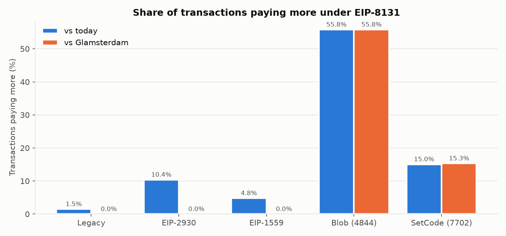
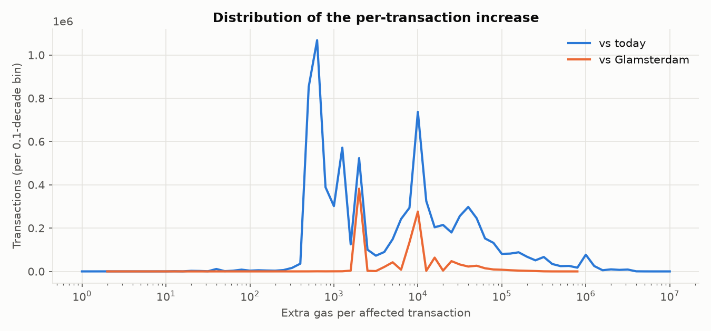
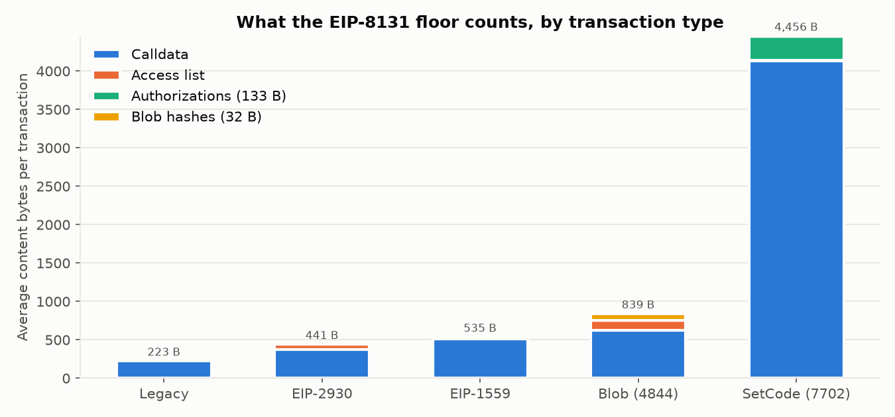

# EIP-8131 Empirical Report

Mainnet, 2026-08-22 to 2026-11-19 (90 days), blocks 25,806,959 to 26,452,577, 168,284,788 transactions (all, no sampling).

## Summary

| | vs Glamsterdam | vs today |
|---|---:|---:|
| Transactions paying more | 1,118,047 (0.66%) | 8,299,695 (4.93%) |
| Transactions paying less | 0 | 0 |
| Floor bind rate, before → after | 4.42% → 4.89% | 1.61% → 4.93% |
| Change in total gas | +0.086% | +2.30% |
| Extra gas per affected tx, median / p90 / p99 | 8,512 / 34,048 / 136,192 | 4,143 / 75,888 / 1,101,091 |
| Relative increase of affected txs, median | 13.7% | 9.8% |

Bind rate: share of transactions whose `gasUsed` is the floor.

Of the increase vs today, 96% comes from the EIP-7976 calldata rate (already in Glamsterdam). Access lists, authorizations and blob hashes add 865,071 affected transactions on top of it.

## Scenarios

| Scenario | Base | Calldata in floor | Access lists | Auths, blob hashes |
|---|---|---|---|---|
| Today (Osaka) | 21,000 | 10 / 40 gas per zero / non-zero byte (EIP-7623) | intrinsic only | not in floor |
| Glamsterdam | 12,000 / 15,000 / 21,000 (EIP-2780) | 64 gas per byte (EIP-7976) | +64 gas/B on intrinsic and floor (EIP-7981) | not in floor |
| EIP-8131 | as Glamsterdam | 64 gas per byte | 64 gas/B in floor, EIP-7981 surcharge kept | 133 B per auth, 32 B per blob hash |

"vs today" applies EIP-8131 to today's rules (21,000 base).

## By transaction type

| Type | Share | Avg content (B) | Avg floor today | Avg floor Glamsterdam | Avg floor EIP-8131 | Bind today | Bind Glamsterdam | Bind EIP-8131 | Pay more vs today | Pay more vs Glamsterdam |
|---|---:|---:|---:|---:|---:|---:|---:|---:|---:|---:|
| 0 Legacy | 12.89% | 223 | 25,649 | 32,201 | 32,201 | 0.14% | 1.49% | 1.49% | 1.49% | 0.00% |
| 1 EIP-2930 | 0.07% | 441 | 27,725 | 46,131 | 46,131 | 0.09% | 10.35% | 10.35% | 10.38% | 0.00% |
| 2 EIP-1559 | 84.81% | 535 | 31,728 | 51,461 | 51,461 | 1.88% | 4.75% | 4.75% | 4.80% | 0.00% |
| 3 EIP-4844 | 0.80% | 839 | 39,026 | 63,343 | 68,701 | 0.05% | 0.08% | 55.80% | 55.80% | 55.80% |
| 4 EIP-7702 | 1.43% | 4,456 | 86,491 | 279,710 | 300,054 | 0.04% | 13.16% | 15.32% | 15.05% | 15.32% |

Content: calldata + 20 B per access-list address + 32 B per key + 133 B per authorization + 32 B per blob hash.

Type 3: 6,112 extra gas per affected transaction on average. Type 4: 4,136 B average calldata.

### Type 4 by authorization count (vs Glamsterdam)

| Auths | Type-4 txs | Paying more | Extra gas |
|---:|---:|---:|---:|
| 1 | 1,952,114 | 115,739 (5.9%) | 895,290,220 |
| 2-3 | 176,279 | 111,672 (63.3%) | 2,246,862,607 |
| 4-10 | 191,285 | 110,452 (57.7%) | 5,085,097,107 |
| 11-50 | 77,098 | 29,962 (38.9%) | 3,991,361,039 |
| >50 | 4,011 | 27 (0.7%) | 10,833,754 |

Largest sender: [`0x59aab1bd…25e16b`](https://etherscan.io/address/0x59aab1bd0d26290274398c07b55955c15425e16b), 302,883 type-4 transactions, 300,817 paying more (up to 61 authorizations, 21,224 B average calldata), 69% of all extra gas. Excluding it, 3.2% of type-4 transactions pay more.

Earlier figures: 0.124% of type-4 transactions affected (auth-only version, Nov 2025 to May 2026; this sender had 296 affected transactions then) and a 20.63% type-4 bind rate against today's rules (1,500-block sample, May 2026). This window, against today's rules: 15.05%.

### Gas limit below the new floor

Transactions whose EIP-8131 floor exceeds their gas limit while their Glamsterdam floor did not:

| Type | Transactions | Share of type |
|---|---:|---:|
| 3 EIP-4844 | 351,582 | 26.15% |
| 4 EIP-7702 | 5,002 | 0.21% |
| 0 to 2 | 0 | 0% |

## Concentration (vs Glamsterdam)

| | Senders | Recipients |
|---|---:|---:|
| Affected addresses | 9,595 | 22,923 |
| Extra gas from top 10 | 93.7% | 93.8% |
| Extra gas from top 50 | 98.1% | 98.2% |
| Affected txs from top 10 | 77.2% | 77.2% |
| Addresses with one affected tx | 67.6% | 83.2% |

vs today: 809,809 affected senders; top 10 pay 50.1% of the extra gas, top 1% pay 93.2%.

### Top senders (vs Glamsterdam)

| # | Sender | Label | Txs | Extra gas | Avg extra/tx | Main type | Avg calldata (B) |
|---:|---|---|---:|---:|---:|---:|---:|
| 1 | [`0x59aab1bd…25e16b`](https://etherscan.io/address/0x59aab1bd0d26290274398c07b55955c15425e16b) |  | 300,817 | 11,637,895,950 | 38,688 | 4 | 21,224 |
| 2 | [`0x5050f69a…5b76c9`](https://etherscan.io/address/0x5050f69a9786f081509234f1a7f4684b5e5b76c9) |  | 232,805 | 2,073,354,240 | 8,906 | 3 | 0 |
| 3 | [`0x68872466…f32985`](https://etherscan.io/address/0x6887246668a3b87f54deb3b94ba47a6f63f32985) |  | 56,557 | 578,988,032 | 10,237 | 3 | 0 |
| 4 | [`0x7360f622…d13987`](https://etherscan.io/address/0x7360f62205709a1501e7a04513f61eda0bd13987) |  | 79,907 | 354,441,216 | 4,436 | 3 | 0 |
| 5 | [`0x98245d0a…6be459`](https://etherscan.io/address/0x98245d0adf4595c66f0a9db8e13c44cbff6be459) |  | 43,835 | 333,146,112 | 7,600 | 3 | 0 |
| 6 | [`0xdbbe3d8c…49eb29`](https://etherscan.io/address/0xdbbe3d8c2d2b22a2611c5a94a9a12c2fcd49eb29) |  | 24,204 | 247,848,960 | 10,240 | 3 | 0 |
| 7 | [`0x6db6161f…216b98`](https://etherscan.io/address/0x6db6161fc5662450e801398bad62dd9921216b98) |  | 23,465 | 201,197,568 | 8,574 | 3 | 0 |
| 8 | [`0x90502666…72db42`](https://etherscan.io/address/0x90502666e33d71483302f81c8349a6185572db42) |  | 6,618 | 132,468,694 | 20,016 | 4 | 5,805 |
| 9 | [`0x2f60a518…f3f7fd`](https://etherscan.io/address/0x2f60a5184c63ca94f82a27100643dbabe4f3f7fd) |  | 16,587 | 101,363,712 | 6,111 | 3 | 0 |
| 10 | [`0x1ffda89c…fd412a`](https://etherscan.io/address/0x1ffda89c755f6d4af069897d77ccabb580fd412a) |  | 18,442 | 92,280,832 | 5,004 | 3 | 0 |
| 11 | [`0x23920c97…83d2d8`](https://etherscan.io/address/0x23920c97f74b2e41edd58d3be9964ed75883d2d8) |  | 40,989 | 83,945,472 | 2,048 | 3 | 0 |
| 12 | [`0x6776be80…03b8d1`](https://etherscan.io/address/0x6776be80dbada6a02b5f2095cf13734ac303b8d1) |  | 6,556 | 66,795,520 | 10,188 | 3 | 0 |
| 13 | [`0xc94c243f…a51b8b`](https://etherscan.io/address/0xc94c243f8fb37223f3eb2f7961f7072602a51b8b) |  | 32,338 | 66,228,224 | 2,048 | 3 | 0 |
| 14 | [`0x65115c6d…a52e7a`](https://etherscan.io/address/0x65115c6d23274e0a29a63b69130efe901aa52e7a) |  | 27,623 | 56,571,904 | 2,048 | 3 | 0 |
| 15 | [`0xec7cd203…8c7463`](https://etherscan.io/address/0xec7cd2030e0510763b2c2c87fc7e7ccc2f8c7463) |  | 23,887 | 48,920,576 | 2,048 | 3 | 0 |

### Top recipients (vs Glamsterdam)

| # | Recipient | Label | Txs | Extra gas | Avg extra/tx | Main type | Avg calldata (B) |
|---:|---|---|---:|---:|---:|---:|---:|
| 1 | [`0x00fe7820…610e04`](https://etherscan.io/address/0x00fe78205f5f0e63b8ad2b2ae5337f538a610e04) |  | 300,817 | 11,637,895,950 | 38,688 | 4 | 21,224 |
| 2 | [`0xff000000…008453`](https://etherscan.io/address/0xff00000000000000000000000000000000008453) | Base batch inbox | 232,805 | 2,073,354,240 | 8,906 | 3 | 0 |
| 3 | [`0xff000000…000010`](https://etherscan.io/address/0xff00000000000000000000000000000000000010) | OP Mainnet batch inbox | 56,557 | 578,988,032 | 10,237 | 3 | 0 |
| 4 | [`0x00000000…ba7c4e`](https://etherscan.io/address/0x0000000000000000000000000000000000ba7c4e) |  | 79,907 | 354,441,216 | 4,436 | 3 | 0 |
| 5 | [`0x002bde9b…989449`](https://etherscan.io/address/0x002bde9b0c0857aee2cffdea6b8723eaf5989449) |  | 43,835 | 333,146,112 | 7,600 | 3 | 0 |
| 6 | [`0xff000000…000480`](https://etherscan.io/address/0xff00000000000000000000000000000000000480) | World Chain batch inbox | 24,204 | 247,848,960 | 10,240 | 3 | 0 |
| 7 | [`0x005969bf…51be97`](https://etherscan.io/address/0x005969bf0ecbf6edb6c47e5e94693b1c3651be97) |  | 23,465 | 201,197,568 | 8,574 | 3 | 0 |
| 8 | [`0x90502666…72db42`](https://etherscan.io/address/0x90502666e33d71483302f81c8349a6185572db42) |  | 6,618 | 132,468,694 | 20,016 | 4 | 5,805 |
| 9 | [`0xff000000…000130`](https://etherscan.io/address/0xff00000000000000000000000000000000000130) | Unichain batch inbox | 20,256 | 116,238,336 | 5,738 | 3 | 0 |
| 10 | [`0x000d4411…08939a`](https://etherscan.io/address/0x000d4411cdeb152378626b5c5e33fd5d6808939a) |  | 18,442 | 92,280,832 | 5,004 | 3 | 0 |
| 11 | [`0x004793cd…121df8`](https://etherscan.io/address/0x004793cde50c3cff1f4bbe5c6ec2821ae9121df8) |  | 40,989 | 83,945,472 | 2,048 | 3 | 0 |
| 12 | [`0x008dc74c…0bfa8e`](https://etherscan.io/address/0x008dc74cecc9deda8595b2fe210ce5979f0bfa8e) |  | 6,634 | 66,959,360 | 10,093 | 3 | 0 |
| 13 | [`0xca11bde0…76ca11`](https://etherscan.io/address/0xca11bde05977b3631167028862be2a173976ca11) | Multicall3 | 8,736 | 66,284,969 | 7,588 | 4 | 4,399 |
| 14 | [`0xc83f7d9f…373723`](https://etherscan.io/address/0xc83f7d9f2d4a76e81145849381aba02602373723) |  | 32,338 | 66,228,224 | 2,048 | 3 | 0 |
| 15 | [`0xff000000…043111`](https://etherscan.io/address/0xff00000000000000000000000000000000043111) |  | 27,623 | 56,571,904 | 2,048 | 3 | 0 |

### Top senders (vs today)

| # | Sender | Label | Txs | Extra gas | Avg extra/tx | Main type | Avg calldata (B) |
|---:|---|---|---:|---:|---:|---:|---:|
| 1 | [`0x59aab1bd…25e16b`](https://etherscan.io/address/0x59aab1bd0d26290274398c07b55955c15425e16b) |  | 330,229 | 105,160,374,025 | 318,447 | 4 | 20,734 |
| 2 | [`0x1584a8ee…a3c7dd`](https://etherscan.io/address/0x1584a8ee67789d1fe161065388657ad2f2a3c7dd) |  | 154,088 | 43,340,439,207 | 281,271 | 2 | 24,949 |
| 3 | [`0x80d04079…5552df`](https://etherscan.io/address/0x80d04079ffc53eb14edbeeb37279d126f45552df) |  | 328,626 | 40,341,046,242 | 122,757 | 2 | 5,810 |
| 4 | [`0x63259a52…df64e1`](https://etherscan.io/address/0x63259a528b9186992e55b265b2bd05eee8df64e1) |  | 21,798 | 8,157,092,662 | 374,213 | 2 | 11,003 |
| 5 | [`0xd55df81b…71886a`](https://etherscan.io/address/0xd55df81be2db8d2424ffe90a5e2b8ecb0c71886a) |  | 3,914 | 6,559,309,172 | 1,675,858 | 2 | 70,411 |
| 6 | [`0x159eb691…27b06c`](https://etherscan.io/address/0x159eb6910e36ab09df3798f174b9db00f327b06c) |  | 14,075 | 5,305,992,668 | 376,980 | 2 | 11,125 |
| 7 | [`0x2ea9bb3d…d2ac46`](https://etherscan.io/address/0x2ea9bb3d1022b8e63366ae3ea48ada4e2cd2ac46) |  | 3,864 | 5,049,656,025 | 1,306,847 | 2 | 52,489 |
| 8 | [`0x43b2f011…8304bd`](https://etherscan.io/address/0x43b2f01186fda9814c5f40770554ac68fd8304bd) |  | 13,982 | 4,249,054,726 | 303,895 | 0 | 11,496 |
| 9 | [`0x91355870…030366`](https://etherscan.io/address/0x91355870a334ffc33e84503327773259e3030366) |  | 37,582 | 3,975,952,277 | 105,794 | 2 | 8,439 |
| 10 | [`0x0b9b80f2…c1343b`](https://etherscan.io/address/0x0b9b80f2048d683f3e9a5ab9a32342ddc7c1343b) |  | 975 | 3,302,149,950 | 3,386,820 | 2 | 122,329 |
| 11 | [`0x5565f176…eb52d6`](https://etherscan.io/address/0x5565f17657cef60a02295eedaa52d0041ceb52d6) |  | 154,859 | 2,804,202,352 | 18,108 | 0 | 2,805 |
| 12 | [`0xf2099c47…a00efd`](https://etherscan.io/address/0xf2099c4783921f44ac988b67e743daefd4a00efd) |  | 903 | 2,615,795,227 | 2,896,783 | 2 | 109,047 |
| 13 | [`0x07ae8551…e70e67`](https://etherscan.io/address/0x07ae8551be970cb1cca11dd7a11f47ae82e70e67) |  | 84,798 | 2,246,320,731 | 26,490 | 2 | 1,108 |
| 14 | [`0x5050f69a…5b76c9`](https://etherscan.io/address/0x5050f69a9786f081509234f1a7f4684b5e5b76c9) |  | 232,805 | 2,073,354,240 | 8,906 | 3 | 0 |
| 15 | [`0xba9bc9a8…9ced49`](https://etherscan.io/address/0xba9bc9a8aa87872f7b990031bde984a00b9ced49) |  | 1,308 | 1,968,282,939 | 1,504,803 | 2 | 47,877 |

### Top selectors (vs today)

| # | Selector | Label | Txs | Extra gas | Avg extra/tx | Main type | Avg calldata (B) |
|---:|---|---|---:|---:|---:|---:|---:|
| 1 | `0xa9059cbb` | transfer(address,uint256) | 479,902 | 122,062,061,815 | 254,348 | 2 | 13,923 |
| 2 | `0x34fcd5be` |  | 349,517 | 105,595,683,950 | 302,119 | 4 | 19,732 |
| 3 | `0x8aaa8f3b` |  | 328,641 | 40,341,182,399 | 122,752 | 2 | 5,810 |
| 4 | `0x87201b41` | fulfillAvailableAdvancedOrders (Seaport) | 66,415 | 23,016,973,748 | 346,563 | 2 | 18,119 |
| 5 | `0xfd9f1e10` | cancel (Seaport) | 166,792 | 13,789,656,458 | 82,676 | 2 | 2,427 |
| 6 | `0x174dea71` |  | 53,360 | 9,437,521,871 | 176,865 | 2 | 6,623 |
| 7 | `0x297fdfe4` |  | 3,804 | 6,520,923,661 | 1,714,228 | 2 | 70,885 |
| 8 | `0x8f111f3c` |  | 3,872 | 5,067,544,061 | 1,308,767 | 2 | 52,568 |
| 9 | `0x82ad56cb` | aggregate3 (Multicall3) | 12,673 | 4,982,217,305 | 393,136 | 2 | 20,462 |
| 10 | `0x01010002` |  | 101,656 | 4,805,633,772 | 47,273 | 2 | 1,958 |
| 11 | (empty) | (empty calldata) | 749,182 | 4,580,350,072 | 6,114 | 3 | 0 |
| 12 | `0x7111a994` |  | 14,556 | 4,326,428,155 | 297,226 | 0 | 11,248 |
| 13 | `0x765e827f` | handleOps (ERC-4337 EntryPoint v0.7) | 101,352 | 4,138,946,651 | 40,837 | 2 | 4,067 |
| 14 | `0x3593564c` | execute (Uniswap Universal Router) | 120,674 | 3,672,752,694 | 30,435 | 2 | 1,199 |
| 15 | `0xf074ba62` |  | 1,608 | 3,454,179,877 | 2,148,122 | 2 | 82,150 |

## 133 vs 108 bytes per authorization

| | 108 B | 133 B |
|---|---:|---:|
| Transactions paying more vs Glamsterdam | 1,111,466 | 1,118,047 |
| Extra gas, share of all gas | 0.073% | 0.086% |
| Median extra gas per affected tx | 6,912 | 8,512 |
| Worst-case all-authorization block at 60M gas | 0.974 MiB | 0.894 MiB |

## Method

- Data: xatu `canonical_execution_transaction` joined with `canonical_beacon_block_execution_transaction` (blob hashes, encoded size). Access-list and authorization counts from Erigon RPC for every transaction whose encoded size has extra bytes (2,409,193 with an access list, all 2,400,787 type-4 transactions). The selection missed no access list in a 1,000-block RPC sample. xatu's authorization arrays are empty on mainnet.
- `execution = gas_used - intrinsic_today`, held constant across scenarios; gas = `max(intrinsic + execution, floor)`. For the 2,712,239 transactions floor-bound today, execution is taken at its upper end.
- Not modeled: EIP-8037 and EIP-8038 execution costs; per-authorization and creation costs are held at today's level. Glamsterdam's are higher, so bind rates vs Glamsterdam are upper bounds.
- Check: 0 transactions below today's floor.
- Selector and address labels only where certain. Quantiles and concentration are exact.
