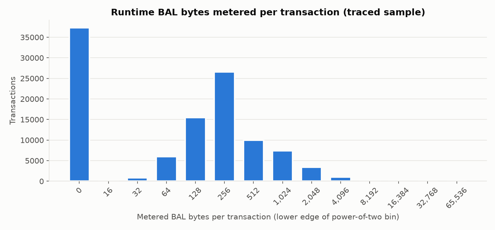
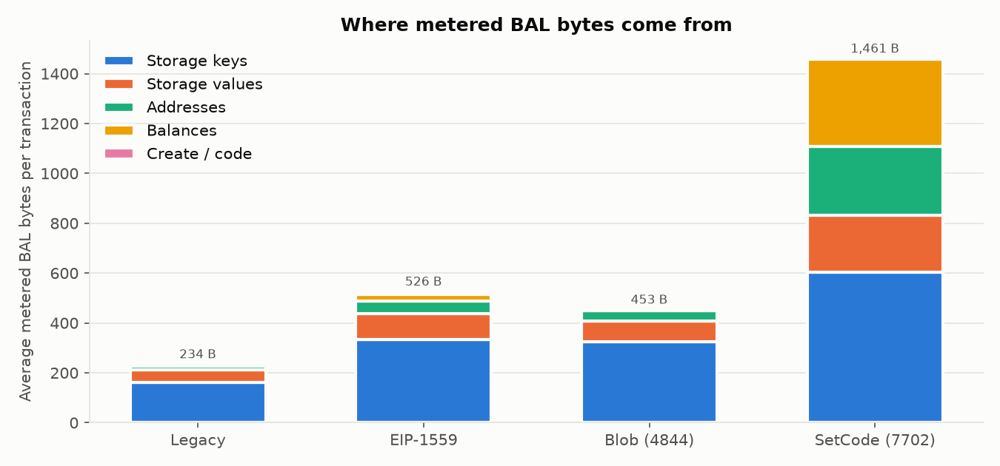
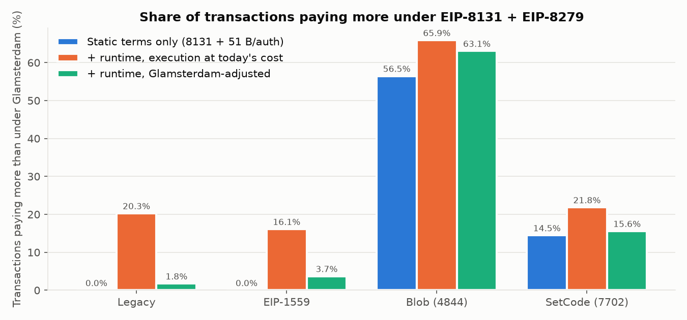
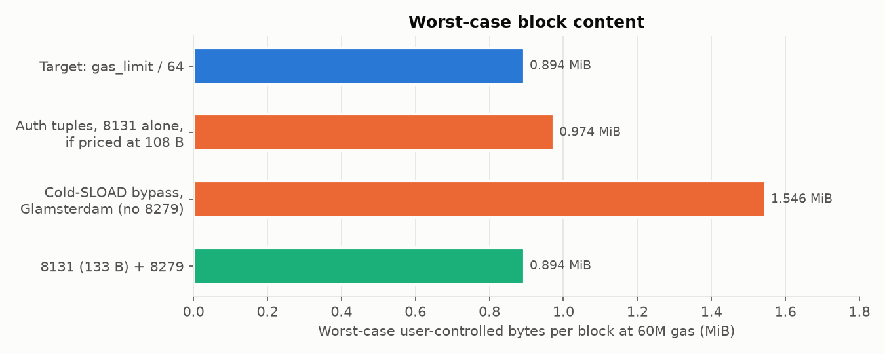

# EIP-8279 Empirical Report

Mainnet, 2026-08-22 to 2026-11-19. Runtime metering measured on all 108,809 transactions of 400 random blocks (seed 8279), traced. Static terms on all 168,284,788 transactions of the window.

## Summary

| | Execution at today's cost | Glamsterdam-adjusted |
|---|---:|---:|
| Pay more due to runtime metering | 18,162 (16.7%) | 4,013 (3.7%) |
| Bound by the runtime part alone | 14.5% | 1.9% |
| Extra gas over the static floor | +2.04% | +0.83% |
| Pay more vs EIP-8131 alone | 16.7% | 3.7% |
| Total gas vs EIP-8131 alone | +2.06% | +0.84% |
| Pay more vs Glamsterdam (EIP-8131 + EIP-8279) | 17.2% | 4.1% |
| Total gas vs Glamsterdam | +2.15% | +0.90% |
| Extra gas per affected tx, median / p90 / p99 | 1,382 / 25,751 / 137,091 | 6,263 / 52,274 / 566,764 |

Glamsterdam-adjusted: +7,100 gas per changed slot (EIP-8038 storage write 10,000 vs 2,900 today, every change counted as non-zero → non-zero) and +400 per touched account (cold access 3,000 vs 2,600). EIP-8037 state gas is not applied, so both columns are upper bounds.

Static per-authorization term (51 B), all transactions: 378,522 pay more (0.22%), all type 4, +0.026% of all gas.

Worst-case block at 60M gas: 1,621,488 B (1.546 MiB) under Glamsterdam, 937,500 B (0.894 MiB) of metered payload with EIP-8131 and EIP-8279.

## Metering

| Trigger | Bytes |
|---|---:|
| First touch of an account by an opcode (`BALANCE`, `EXT*`, `CALL*`, `CREATE*` target, `SELFDESTRUCT` beneficiary) | 20 |
| First touch of a storage slot | 32 |
| First write taking a slot off its original value | 32 |
| Value-bearing `CALL` to another account, `SELFDESTRUCT` with balance | 64 |
| `CREATE*`: two nonces; endowment | 16; +64 |
| Deployed code | 1 per byte |
| Per authorization (static) | 51 |

Sets start empty per transaction and are not rewound on revert. Sender, coinbase and top-level target are not metered unless an opcode touches them.

## BAL bytes per transaction

| Type | Txs | Mean | Median | p99 | Keys / values / addresses / balances / create (mean B) | Pay more vs Glamsterdam: static only | + runtime, today's cost | + runtime, adjusted |
|---|---:|---:|---:|---:|---|---:|---:|---:|
| 0 Legacy | 13,684 | 234 | 64 | 2,429 | 161 / 51 / 14 / 5 / 3 | 0.0% | 20.3% | 1.8% |
| 2 EIP-1559 | 92,510 | 526 | 244 | 5,148 | 332 / 106 / 50 / 26 / 13 | 0.0% | 16.1% | 3.7% |
| 3 EIP-4844 | 880 | 453 | 0 | 1,888 | 326 / 81 / 43 / 3 / 1 | 56.5% | 65.9% | 63.1% |
| 4 EIP-7702 | 1,680 | 1,461 | 480 | 17,288 | 605 / 228 / 276 / 350 / 1 | 14.5% | 21.8% | 15.6% |

Plain ERC-20 transfer: 128 B (8,192 floor gas). USDT transfer: about 256 B (16,384 floor gas).

## Selectors

| Selector | Function | Txs in sample | Pay more, today's cost | Pay more, adjusted |
|---|---|---:|---:|---:|
| `0xa9059cbb` | transfer(address,uint256) | 33,344 | 9,695 | 464 |
| `0x3593564c` | execute (Uniswap Universal Router) | 1,561 | 974 | 129 |
| `0x765e827f` | handleOps (ERC-4337 EntryPoint v0.7) | 1,579 | 601 | 201 |
| `0xb143044b` |  | 461 | 461 | 0 |
| `0x23b872dd` | transferFrom(address,address,uint256) | 1,329 | 407 | 15 |
| `0x095ea7b3` | approve(address,uint256) | 3,182 | 396 | 348 |
| `0x34fcd5be` |  | 368 | 261 | 230 |
| `0x8aaa8f3b` |  | 222 | 222 | 222 |
| `0x2213bc0b` |  | 300 | 214 | 89 |
| `0xa22cb465` | setApprovalForAll(address,bool) | 360 | 210 | 209 |
| `0xe4c705e9` |  | 193 | 193 | 32 |
| `0x3ce33bff` |  | 257 | 168 | 151 |

Approvals write to empty slots, whose extra Glamsterdam state gas is not in the adjustment.

## Gas limits

464 sampled transactions (0.43%) exceed their gas limit only because of runtime metering.

## Worst-case block size

60M gas, four 15M-gas transactions (EIP-7825 cap).

| Construction | Payload bytes |
|---|---:|
| `gas_limit / 64` | 937,500 (0.894 MiB) |
| Glamsterdam: calldata + cold `SLOAD`s (32 B per 2,100 gas) | 1,621,488 (1.546 MiB) |
| EIP-8131 alone with 108-byte authorizations (skipped 133-byte tuples at 7,816 gas) | 1,020,982 (0.974 MiB) |
| EIP-8131 (133 B) + EIP-8279 | 937,500 (0.894 MiB) |

With EIP-8279 the first cold `SLOAD` of such a transaction lifts its floor to 15,002,008, above its 15,000,000 budget.

Encoded (RLP) bytes, which the meter does not count exactly: worst pattern found is `BALANCE` touches plus calldata, about 1.01 MiB (1.08 MiB if the EIP-7981 surcharge were removed). Glamsterdam cold-`SLOAD` bypass: about 1.57 MiB encoded.

### Per-transaction overhead

Envelope plus the BAL entries no opcode creates, encoded exactly, against `base_gas / 64`:

| Case | Envelope | Implicit BAL | Total | Budget |
|---|---:|---:|---:|---:|
| Self-transfer, fresh sender, 100 gwei fee cap | 110 | 57 | 167 | 187 |
| Self-transfer, 1M ETH sender, inflated nonce and fee fields | 119 | 66 | 185 | 187 |
| Self-transfer, half the ETH supply, every field maxed | 140 | 71 | 211 | 187 |
| No-value call, fresh sender | 110 | 84 | 194 | 234 |
| No-value call, 1M ETH sender, inflated fields | 119 | 93 | 212 | 234 |
| Self-transfer by a delegated sender, fresh | 110 | 84 | 194 | 187 |
| Self-transfer by a delegated sender, 1M ETH, inflated fields | 119 | 93 | 212 | 187 |
| No-value call to a delegated account, 1M ETH, inflated fields | 119 | 120 | 239 | 234 |

The delegation target's entry (27 B) is paid by a 3,000-gas access charge, which a binding floor absorbs. A block of floor-bound delegated self-transfers with distinct targets: about 3% above `gas_limit / 64`.

## Method

- Traces: `debug_traceBlockByNumber` with `prestateTracer` (touched accounts, storage keys), `prestateTracer` diff mode (changed values) and `callTracer` (value transfers, `CREATE*`, `SELFDESTRUCT`, precompile calls), Erigon archive node.
- Static floor, execution proxy and Glamsterdam baseline as in the EIP-8131 report; EIP-7981 surcharge kept.
- Changed values are net per transaction (slots changed and restored are missed; the spec meters them).
- Authority addresses are not available; an authority touched in the prestate is metered once more (type 4 only).
- Type-1 and type-3 counts in the sample are small.
